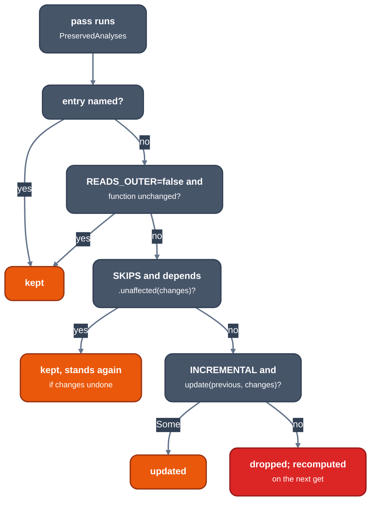

> Generated from the `//!` header of [`crates/opt/llrm-analysis/src/manager.rs`](https://github.com/ali-mosavian/llrm/blob/main/crates/opt/llrm-analysis/src/manager.rs); edit the header, not this file.
<!-- src: crates/opt/llrm-analysis/src/manager.rs sha256:3d55a65f12b45c1c428da4261854c3839e861f760a2bb9cd0748367a0809616d -->

# manager

The memory and range analyses as entries of llrm-mir's analysis manager:
asked for by name, cached, kept or brought up to date after a pass.

## How it works
A pass asks `analyses.get::<A>(context, layout, function)` and receives a
shared result. The manager computes it once, hands the same `Rc` to every
later asker, and decides after each pass what to do with it. The entries
here declare how, through the `Analysis` trait of `llrm_mir::passes`:

- A pass returns the `PreservedAnalyses` it left true. An entry not named is
  dropped, unless `READS_OUTER` is false (it reads only the function, as
  `DemandedBits` and `Shape`) and the function is unchanged.
- `SKIPS` with `depends`: the entry is kept past an invalidation if the
  change log cannot have altered it. `Depends` names the instructions the
  result models, those it keys entries by, and the users a change flows
  through. `ExposedFrames`, `PointerValues`, `Pointers` and `Writes` model
  pointers, aggregates and calls only, so a change to integer arithmetic
  leaves them standing.
- `INCREMENTAL` with `update`: the entry is brought up to date from the
  change log. `DominatedEdges` and `Counted` redo only the blocks or loops
  `Touched::reach` the changes (a change to a terminator or to the CFG
  redoes all); `Accesses` in [`crate::memoryssa`](memoryssa.md) survives pure moves.
- `LLRM_CHECK_REPLAY` asserts that every kept or updated result equals a
  fresh `run`.



*What happens to a cached analysis when a pass runs*

Function entries and what each asks for (every one also asks `Shape`, and
most `AssumptionCache` and `ExposedFrames`, which are omitted):

```text
 PointerValues    -
 Pointers         PointerValues
 Writes           PointerValues
 TableLoads       -
 Registers        TableLoads (updates)
 Followers        Registers
 Counted          Registers
 DominatedEdges   Registers
 Annotated        PointerValues, Registers, Counted, DominatedEdges
 Accesses         Annotated, CallFootprints, PointerValues (memoryssa)
 PlainAccesses    Writes, Annotated                       (the graph's structure, once)
 ThroughMemory    PlainAccesses, Writes, Annotated, Registers
 FloatFacts       ThroughMemory, PlainAccesses, Writes, Annotated, Registers
```

Module entries read the program through `ModuleAnalyses` and are dropped
unless every run of a pass preserved them. `GlobalsAA` (which globals no
outside code reaches but by name) and `Summaries` (each defined function's
memory effects, by name) can be held past passes that add no memory
operation when `covers` says the stale result states no more than a fresh
one. `Summaries` keeps per-body facts and recomputes only bodies whose
history moved. `ProgramSummaries` is a program entry: one fixed point over
all modules, each module's `Summaries` given the others'.

`Unit::within` builds the `Unit` that analyses read from `Outer` (the
module, target and program), carrying whichever cached results the caller
holds. `Held` and `Ranges` bundle the cached results a pass passes on to a
`Unit`, so the facts are the manager's and not a solve of the pass's own.

## Example
A pass replaces the uses of `%x` by `%a`, an integer edit:

```mir
declare void @use(ptr)
define i32 @f(ptr %p, i32 %a) {
entry:
  %x = add i32 %a, 1
  %y = mul i32 %x, 3
  %q = getelementptr i32, ptr %p, i32 1
  call void @use(ptr %q)
  ret i32 %y
}
```

| change                       | `Pointers`, `Writes`, `ExposedFrames`                |
|------------------------------|------------------------------------------------------|
| `%x` replaced by `%a`        | kept (`unaffected` is true)                          |
| `%q`, the address, rewritten | `Writes::unaffected` is false: recomputed             |

From unit test
`an_integer_edit_leaves_the_pointer_analyses_as_they_were_and_a_pointer_edit_does_not`
in
`manager_tests.rs`.

## Order check
A result a pass reads is a function of the body, not of when something first
asked for it (#1909: a `ThroughMemory` asked early and kept past sound edits
made `fold` weaker, 18 KB of asm against 34 KB). `LLRM_CHECK_ORDER=SEED`
asks some analyses early at each body pass's entry, which ones by the seed,
and the object must be the lazy compile's. `tests/analysis_order.rs` runs it
on matmul. The wide sweep is a command, not a gate; run it before a release
and when an analysis starts to be kept:

```text
for s in 1 2 3 4 5 6 7 8; do
  LLRM_CHECK_ORDER=$s tools/identical.py target/release/llrm-cc target/release/llrm-cc
done
```

`tools/identical.py` keeps a `LLRM_CHECK_*` value already set; the bench
BASIC and Nib programs under the harness flags are compiled the same way
with and without the seed.

## Provides
The entries: `ExposedFrames`, `PointerValues`, `Pointers`, `Annotated`,
`Writes`, `Registers`, `DemandedBits`, `AssumptionCache`,
`Followers`, `Counted`, `ThroughMemory`, `FloatFacts`, `DominatedEdges`;
module entries `GlobalsAA`, `Summaries`; program
entry `ProgramSummaries`; `Held`, `Ranges`, `Touched::reach`,
`writes`. [`crate::cfg`](cfg.md)'s `Shape`, [`crate::memoryssa`](memoryssa.md)'s
`Accesses` is an entry defined beside its analysis.

## Needs
[`crate::alias`](alias.md), [`crate::consts`](consts.md), [`crate::globalsaa`](globalsaa.md),
[`crate::induction`](induction.md), [`crate::ranges`](ranges.md), [`crate::floatfacts`](floatfacts.md),
[`crate::frameescape`](frameescape.md).

## See also
LLVM's new pass manager `AnalysisManager` and `PreservedAnalyses`; the trait
is in `crates/ir/llrm-mir/src/passes.rs`.
