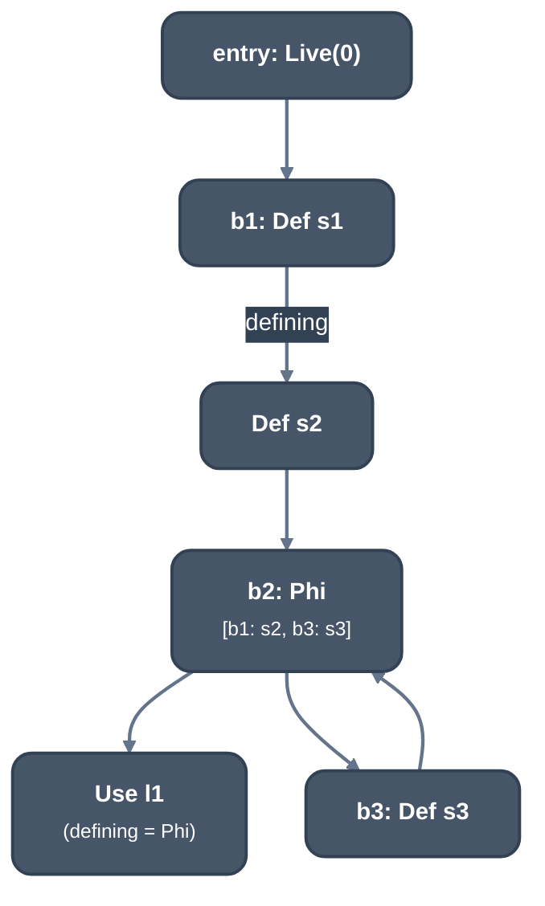

> Generated from the `//!` header of [`crates/opt/llrm-analysis/src/memoryssa.rs`](https://github.com/ali-mosavian/llrm/blob/main/crates/opt/llrm-analysis/src/memoryssa.rs); edit the header, not this file.
<!-- src: crates/opt/llrm-analysis/src/memoryssa.rs sha256:8e0b1181f6b2703e2a6f70510acae1b2e186802fa23de92579aaf0b544535268 -->

# memoryssa

Memory SSA: a single memory state versioned by stores and writing calls,
with a walker that finds the writes a load may see.

## How it works
`Accesses` records what each instruction touches: a load's or store's own
`MemRef`, a call's footprint (`alias::calls_by_attributes`: its attributes
and `GlobalsModRef`, no points-to solve), and the bytes a call fills before
reading any. A query of a call is the meet of the footprint and `AAResults`
(BasicAA, GlobalsAA). It is the manager's `accesses` analysis, built from
[`crate::manager`](manager.md)'s `Annotated`, and kept across changes that only move
instructions or give a store another value (`update`).

`built` numbers the accesses. Every instruction that writes (`None` writes
means anything) is a `Def`; one that only reads memory is a `Use`; one that
touches none is skipped. Each access names the access before it in its block
as `defining`. Each block starts in a memory `Phi` over its predecessors'
exit states, with the entry block also fed by `Live`, the state on entry to
the function. Phis are wired before they are resolved, so back edges need no
iteration over memory versions; then phis whose inputs reduce to one state
are replaced by it. What that makes (`Structure`) depends on the body and
its `Accesses` alone, so it is kept in the accesses, per body state, and
every graph built from them shares it: the walks' memory of what was
asked (and the registers they know) is each graph's own. The manager's
`PlainAccesses` is the one set `ThroughMemory` and `FloatFacts` share.

Edits that make, erase or move no memory op or terminator, rewrite no
terminator and make or erase no block leave the structure as it was
(`structure_kept`): the manager's accesses carry it past them, and
`LLRM_CHECK_CLOBBERS` builds it afresh to compare.



*Memory SSA of a loop: b2's Phi merges b1's last Def and b3's Def*

The walker (`clobbers`, `clobbers_at_end`, `nearest_writes`) answers, for a
`MemRef` read at a site, the set of nearest defs whose write may change it,
or `Live`. It steps up `defining` links and through every phi input,
skipping defs that `may_clobber` rules out: a constant or `invariant` read
is changed by nothing; two references at fixed displacements of one frame
whose bytes miss are settled by `regions::displaced_span`; otherwise
[`crate::pointerfacts`](pointerfacts.md) disjointness is tried before `regions::overlapping`.
Per (cell, def) answers are remembered, and a walk jumps along chains of
accesses that leave the cell alone. After enough steps per access, a
persistent map from (object, byte) to the nearest def writing it replaces
stepping. A visited set closes cycles without taking a back edge as evidence
that memory is unchanged. An empty answer means no reachable source, not a
reusable value; the caller must establish value availability itself.
`nearest_writes` stops after `MAX_NEAREST_WRITES` (100) and the caller
serves nothing past that. `unchanged` and `available_on_edge` answer whether
an earlier access still supplies the bytes, the caller having proved
dominance and equal addresses.

Predicates shared with the passes: `changes`, `spares`, `covers`/`covered`
(outer references certainly hold every byte of the inner), `placed`,
`same_bytes`, `byte_keys`, and `Writers`, which indexes writes by object.

## Example
A diamond whose arms store to the same cell of `@g` and whose join loads it:

```mir
define i16 @f(i1 %c) {
b0:
  br i1 %c, label %b1, label %b2

b1:
  store i16 1, ptr getelementptr (i8, ptr @g, i16 32)
  br label %b3

b2:
  store i16 2, ptr getelementptr (i8, ptr @g, i16 32)
  br label %b3

b3:
  %x = load i16, ptr getelementptr (i8, ptr @g, i16 32)
  ret i16 %x
}
```

| access      | kind  | incoming or defining                           |
|-------------|-------|------------------------------------------------|
| `b3` entry  | `Phi` | (`b1`, the `b1` store), (`b2`, the `b2` store) |
| `%x = load` | `Use` | the `b3` `Phi`                                 |

From unit test `test_a_join_gets_one_memory_phi` in `memoryssa_tests.rs`.

## Provides
`Accesses` (analysis `accesses`), `MemorySSA` via `built`, `Kind`, `Access`,
`Reach`, the predicates above. Consumers: [`crate::avail`](avail.md),
[`crate::consts`](consts.md), [`crate::floatfacts`](floatfacts.md), and in llrm-transforms `gvn`,
`dse`, `hoist`, `loadjoins`, `loopmotion`, `promote`, `spares`, `homes`,
`transform`.

## Needs
[`crate::manager`](manager.md) (`Annotated`, `PointerValues`, `ExposedFrames`),
[`crate::cfg`](cfg.md), [`crate::regions`](regions.md), [`crate::pointerfacts`](pointerfacts.md),
[`crate::memory`](memory.md).

## Keeps
Conservative: rebuilt after a function changes. `Accesses` survives moves.
`LLRM_CHECK_CLOBBERS` and `LLRM_CHECK_JUMPS` assert the fast paths against
the slow ones.

## See also
LLVM `MemorySSA` and its `ClobberWalker`
(`llvm/lib/Analysis/MemorySSA.cpp`).
