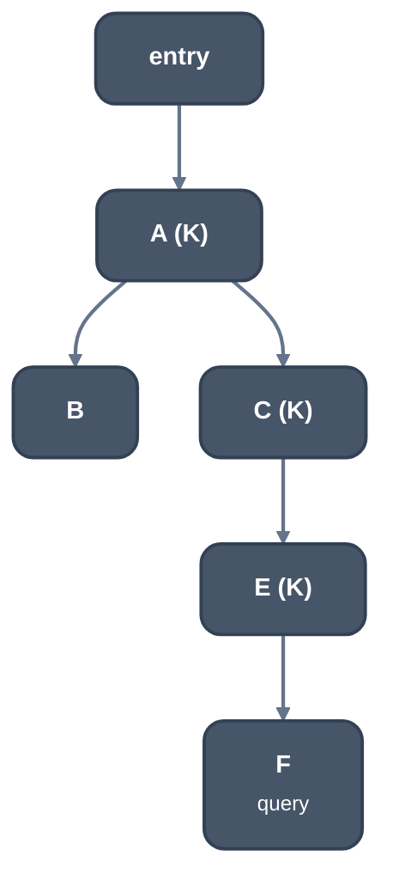

> Generated from the `//!` header of [`crates/opt/llrm-analysis/src/nearest.rs`](https://github.com/ali-mosavian/llrm/blob/main/crates/opt/llrm-analysis/src/nearest.rs); edit the header, not this file.
<!-- src: crates/opt/llrm-analysis/src/nearest.rs sha256:36770fb8ed5e1f12968a3c3a9a73c4f31abbb77049e6f6f3a0e20328b8011762 -->

# nearest

The items placed in blocks that dominate a given block, nearest first.

## How it works
Loads look for a provider among the stores and loads that dominate them.
Scanning every item of the function per load is quadratic. `Nearest::of`
builds, per key, the blocks that hold an item of that key, sorted by their
preorder number in the dominator tree, and links each to the nearest block
above it in the tree that also holds one. `Nearest::dominating` binary
searches for the last block at or before the query block, walks the links up
until a block's subtree span contains the query, and yields the items from
there up. The work is the length of that chain, not of the function.

*Key K holds items in A, C, E; sorted by preorder A C E with up links - A C.
A query at F finds E, the last block <= F, and walks the chain E -> C -> A*

Items of several keys are merged by a cursor per key: the walk takes the
largest preorder number first, and within a block the last item first. An
item reached through two keys is returned once. A block the dominator tree
does not reach is left out of the chains and, as the query, yields nothing:
everything dominates it, so the caller decides.

## Example
None: the module has no MIR input of its own. Its test,
`test_the_items_that_dominate_a_block_are_found_nearest_first` in
`nearest.rs`, places items in a generated chain of diamonds and compares
`dominating` with a scan of every item. The figure above is the worked case.

## Provides
The `Nearest` index and its `Walk` iterator. Consumers: [`crate::avail`](avail.md) and
`loadjoins` in llrm-transforms.

## Needs
`llrm_mir::domtree::DomTree` (`span`, the preorder interval of a
block).
