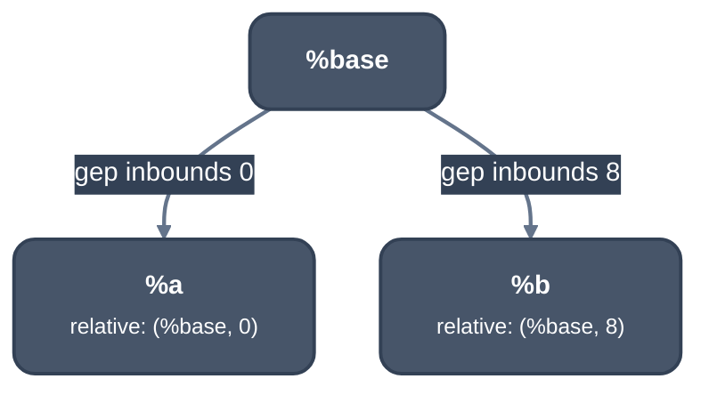

> Generated from the `//!` header of [`crates/opt/llrm-analysis/src/pointerfacts.rs`](https://github.com/ali-mosavian/llrm/blob/main/crates/opt/llrm-analysis/src/pointerfacts.rs); edit the header, not this file.
<!-- src: crates/opt/llrm-analysis/src/pointerfacts.rs sha256:86db913c232f6d43a431ede1e91156e6d8a9780524953dde19793ce88f1f8c31 -->

# pointerfacts

Finds constant byte offsets between pointer values, and so whether two
accesses off one base overlap, without any alias reasoning.

## How it works
`Offsets::relative(pointer)` walks `getelementptr inbounds` chains whose
indices are all integer constants, summing the byte offset with the data
layout (`collect_offset`), and returns the value it stopped at and the
offset from it. It stops at a value that is not such a `getelementptr` (a
parameter, an alloca, a global, a variable index, a step not `inbounds`).
`fixed` is the same through steps that need not be `inbounds`, for when the
address matters and not the object it stays in. A cycle is refused, and so
is an offset that does not fit the pointer's index width.

`inbounds` is the MIR's own proof that the result stays in its base's
allocation, so two pointers that reach one base lie in one allocation. Only
then does `comparable` return their two offsets, and `disjoint` and
`same_bytes` compare the byte ranges `[offset, offset + bytes)` of two
`Location`s. Two unrelated pointer values never prove disjointness.



*Location{%a, 8} and Location{%b, 4} are disjoint, since 0 + 8 <= 8*

Facts are read from the current SSA on each call, not stored on operands a
later transformation could retarget.

## Example
```mir
target datalayout = "e-p:16:16-p1:32:16:16:16"

define void @f(ptr %p, i16 %i) {
b:
  %a = getelementptr inbounds i8, ptr %p, i16 2
  %b = getelementptr inbounds i16, ptr %a, i16 1
  %c = getelementptr i8, ptr %p, i16 4
  %d = getelementptr inbounds i8, ptr %p, i16 %i
  %e = getelementptr inbounds [2 x i16], ptr %p, i16 0, i16 2
  ret void
}
```

| query                                       | answer    |
|---------------------------------------------|-----------|
| `relative(%b)`                              | (`%p`, 4) |
| `relative(%c)`, not `inbounds`              | (`%c`, 0) |
| `relative(%d)`, variable index              | (`%d`, 0) |
| `disjoint` of `%a` and `%b`, 2 bytes each   | true      |
| `disjoint` of `%a`, 4 bytes, and `%b`, 2    | false     |
| `same_bytes` of `%b` and `%e`, 2 bytes each | true      |

From unit test `offsets_follow_constant_inbounds_steps_only` in
`pointerfacts.rs`.

## Provides
`Offsets` (made by `offsets`), `Location`. Consumers: [`crate::memoryssa`](memoryssa.md),
`argpromotion` in llrm-transforms.

## Needs
`llrm_mir::datalayout::DataLayout` for offsets and index widths.
