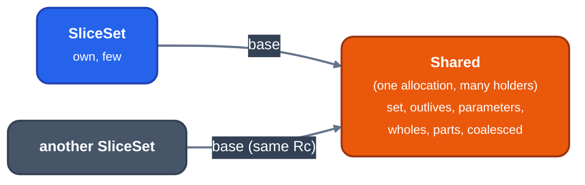

> Generated from the `//!` header of [`crates/opt/llrm-analysis/src/sliceset.rs`](https://github.com/ali-mosavian/llrm/blob/main/crates/opt/llrm-analysis/src/sliceset.rs); edit the header, not this file.
<!-- src: crates/opt/llrm-analysis/src/sliceset.rs sha256:c4c3475c229284f7298b2ec23b103d769d08e4120ccdad6bef57523e21e208be -->

# sliceset

An ordered set of memory slices that holds most of itself as a run shared
with other sets, so the callback effects every call summary repeats are
built, compared and listed once.

## How it works
A function that may call back into the module (an address-taken function or
an entry) has, in its summary, the effects of all those callbacks. That run
of slices is the same for every such summary, every instantiation of it at a
call and every call's effect. Building, comparing, filtering and listing a
tree set holding it each time is wasted work.

`Shared` is one immutable run of slices behind an `Rc`, with facts computed
once: whether none is in a `Frame` or `Stack` object (`outlives`), whether
any is a `Parameter`'s, and which objects it holds whole or in part. A
`SliceSet` is `own` (a `BTreeSet<Slice>`) plus an optional `base:
Rc<Shared>`, the two disjoint. Seen as a set, it is exactly the union.

*A SliceSet is own plus a base; another SliceSet's base is the same Rc, so
ptr_eq is a shortcut*

`absorb` takes the other set's run by reference when this set has none or
the same one, and copies slices otherwise. `retain` and `retain_outliving`
ask the run as a whole where `shared_kept` can answer, and `materialize` it
into `own` where only per-slice tests can. `coalesced` drops the subranges
of an object the set has every byte of; the run is materialized only if its
own wholes and parts disagree or the set's own wholes cover a part of it.
`mapped` rewrites `own` and keeps the run, so the map must not change what
the run holds. Equality compares by `Rc::ptr_eq` and `own` when the runs are
the same.

## Example
None: this is a container, with no MIR input and no printed output. Its
test, `a_set_with_a_shared_run_is_the_union_of_it_and_its_own` in
`sliceset.rs`, checks a `SliceSet` holding a shared run against a `BTreeSet`
of the same slices.

## Provides
`SliceSet`, `Shared` and `whole`. Consumers: [`crate::alias`](alias.md) (call
summaries and `callbacks_over`) and
the `interprocedural` pass in llrm-transforms.
