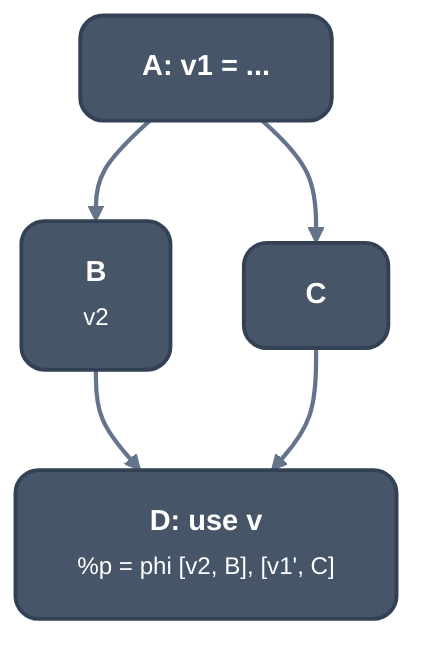

> Generated from the `//!` header of [`crates/opt/llrm-analysis/src/ssa.rs`](https://github.com/ali-mosavian/llrm/blob/main/crates/opt/llrm-analysis/src/ssa.rs); edit the header, not this file.
<!-- src: crates/opt/llrm-analysis/src/ssa.rs sha256:649d1756042017e210b664d943c27b4b1df5dd7ef99ebc761c1526f11affe636 -->

# ssa

SSA helpers the transformations share: use lists, dead-phi pruning, value
substitution and an updater that places the phis a new definition needs.

## How it works
`use_index` maps each value to the non-phi instructions that read it, in
layout order, each at most once; `values` lists the values a function
mentions.

`pruned_phis(function, roots)` removes phis nothing needs, including cycles
that only other dead phis read. A value is needed when a root or a non-phi
instruction reads it, or a needed phi reads it; the rest of the phis are
erased (their operands first, since only dead phis read dead phis). It
reports whether any went.

`provider(value, swap)` follows a substitution map from a value to an
operand (a value may be replaced by a constant) until it reaches one the map
does not move; a cycle is `SubstitutionError::CyclicValueSubstitution`.
`substituted` reads each operand of an instruction through it and leaves the
definition alone.

`SsaUpdater` is LLVM's SSAUpdater for one value defined in several blocks.
`add_available_value(block, v)` says `v` is the definition at the end of
`block`. The value at the end of any other block is what reaches it from its
predecessors. One predecessor passes the question up; no predecessor reads
`poison`; several place a phi at the head of the block, one input per edge
(a `switch` may reach a block by several), asked of the predecessors. A phi
whose inputs are all one value, ignoring itself, is replaced by that value.
`rewrite_use` makes a use read the value where it reads: a phi's input at
the end of the block it comes from, any other at the middle of its block.
`inserted_phis` lists the phis placed that stand.



*Available A -> v1, B -> v2. Asking for D finds preds B and C and places D:
%p = phi [v2, B], [v1', C]; C has one pred A and passes v1 up*

## Example
`pruned_phis` on two phis that only read each other:

```mir
define void @f(ptr %seed, i1 %c) {
b0:
  br label %b1

b1:
  %first = phi ptr [ %seed, %b0 ], [ %second, %b1 ]
  %second = phi ptr [ %seed, %b0 ], [ %first, %b1 ]
  br i1 %c, label %b1, label %b2

b2:
  ret void
}
```

No root and no non-phi instruction reads either phi, so both are erased and
the call returns true. If the body also held `call void @use(ptr %first)` or
`%loaded = load i16, ptr %first`, or `%first` were a root, both phis stay.

From unit test
`test_unused_phi_cycles_are_pruned_but_real_dependencies_survive` in
`ssa.rs`.

## Provides
The helpers above. Consumers in llrm-transforms: `dead`, `promote`
(`pruned_phis`); `gvn`, `lcssamerges`, `transform`, `loadjoins`
(`substituted`, `provider`); `rotate`, `floatloop`
(`SsaUpdater`).

## Needs
[`crate::occurrence`](occurrence.md) for the operation and phi walks.

## See also
LLVM `SSAUpdater` (`llvm/lib/Transforms/Utils/SSAUpdater.cpp`).
