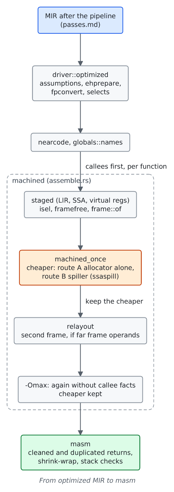
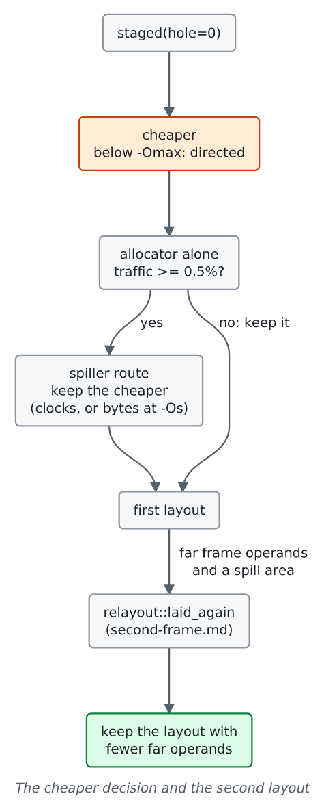

# Backend phases

For contributors to `crates/backend/llrm-core/src/backend`. Lists every phase from MIR lowering for selection to the object, in the order they run, with what each consumes and produces. The MIR passes before it are in [passes](passes.md), the facts they read in [analyses](https://github.com/ali-mosavian/llrm/tree/main/crates/opt/llrm-analysis/src), the target description in [machine](../machine/readme.md).

Files are under `crates/backend/llrm-core/src/backend/` unless named otherwise.

## Overview

Both routes run the same machine phases (next section); the spiller route adds `ssaspill`. [`flow.rs`](https://github.com/ali-mosavian/llrm/blob/c341bd6e3de058142c6652d399b8dfeb444eff9b/crates/backend/llrm-core/src/flow.rs#L56) `machine_with` holds the list.

## Gating

| Setting | Source | Effect |
|---|---|---|
| allocation search | `-fallocation-search`, off at -O0 | the allocator tries other shapes of a body and keeps the cheapest |
| routes | `-fallocation-routes`, off at -O0 | both routes are made and the cheaper kept; off: the allocator alone |
| exhaustive | `-fallocation-search-all`, -Omax | every shape; both routes always; a second whole run without callee facts |
| size | -Os, -Oz | candidates are priced in bytes, every block counted once |

Below -Omax, `directed` ([`assemble.rs`](https://github.com/ali-mosavian/llrm/blob/c341bd6e3de058142c6652d399b8dfeb444eff9b/crates/backend/llrm-core/src/backend/assemble.rs#L517)) runs the allocator alone first and runs the spiller route only where at least 0.5% of the weighted instructions are spill or frame-cell traffic. Levels per phase: [levels](../reference/levels.md).

## Lowering for selection (MIR)

| Step | File | Purpose |
|---|---|---|
| `mir assumptions` | `crates/opt/llrm-transforms/src/dead.rs` | `llvm.assume` calls and what only they read are removed |
| `mir ehprepare` | `ehprepare.rs` | a landing pad becomes one the runtime can enter (reached from a never-taken root block) |
| `mir fp to unsigned` | `fpconvert.rs` | float to unsigned 64-bit as signed conversions and a select, where the target expands `fptoui.i64` |
| `mir selects` | `selects.rs` | `select` as a branch and phi where the target has no conditional move |
| `mir near code` | `nearcode.rs` | a function only its module calls, directly, is entered by a near call |
| global names, data | `globals.rs`, `constpool.rs` | symbols and initialisers; readonly constants the phases put in memory, one datum per distinct bytes |

## Instruction selection

`isel.rs` turns each function into LIR over virtual registers, in SSA. It chooses instructions and addressing; two-address form, registers and frame size are later.

| File | Role |
|---|---|
| `isel/matcher.rs` | runtime of the generated selector: automaton built from the target's `patterns.isel`, cost-based choice among matching patterns |
| `isel/combined.rs` | cross-instruction selection: far pointer as `les`, single-use load as a compare operand, load-update-store as one read-modify-write, push operands |
| `isel/expand.rs` | integers wider than the target's widest native one as halves with carry |
| `isel/wide.rs` | `i64` as two dwords; sign-bit facts let a 32-bit product take one instruction |
| `isel/unwind.rs` | landing pads entered by the runtime |
| `division.rs`, `arithmetic.rs` | constant division by multiply, and the ranking of constant multiply chains against `imul` by CPU ([arithmetic-targets](../machine/arithmetic-targets.md)) |
| `addressforms.rs`, `addressvalues.rs`, `pointers.rs` | address arithmetic folded into memory operands; address-valued operands; the target's pointer representation ([pointer-lowering](../machine/pointer-lowering.md)) |
| `comparefold.rs`, `farload.rs`, `rmw.rs` | one-use memory compares, complete far-pointer loads, exact read-modify-write chains |
| `lower_int64.rs`, `inline_asm.rs` | contracts of inline helper routines and inline assembly operands |
| `calleefacts.rs`, `callregs.rs` | what a function nothing outside reaches leaves different (registers written, known per callee); registers a runtime call destroys or keeps |

After selection: `framefree.rs` decides whether the frame register can be a value register; `frame.rs` (`frame::of`) lays out the slots (isel allocas, temporaries, homed arguments) and `slots.rs`/`lifetimes.rs` let block locals whose lifetimes never overlap share a slot.

## Machine phases

In `machine_with` order. Each phase's result is verified (`verify.rs`) under `LLRM_DEBUG=verify`; `ISEL_DUMP=1` prints the LIR after each (`lirtext.rs`).

| # | Phase | File | Purpose |
|---|---|---|---|
| 1 | `far-indirect-calls` | `farcall.rs` | a far indirect call gets the memory operand the 16-bit ISA requires |
| 2 | `ssaspill` | `ssaspill.rs`, `ssarepair.rs`, `storedhomes.rs` | spiller route only: Braun and Hack spilling on SSA (Belady's rule per block); `ssarepair` rebuilds SSA where a reload gives a value a second definition; `storedhomes` knows cells the optimizer proved hold a phi's value, so a spilled value needs no store of its own |
| 3 | `phielim` | `phielim.rs` | phis become copies at the end of predecessors; critical edges get a block |
| 4 | `pressuresink` | `pressuresink.rs`, `regclass.rs` | a load made where its one reader is, when no register class gets more pressure |
| 5 | `floatfold` | `floatfold.rs` | a float load with one arithmetic reader is that instruction's memory operand |
| 6 | `floatassign` | `floatassign.rs`, `floatregions.rs` | which float values hold which of the eight x87 stack registers; spills and memory operands explicit |
| 7 | `floatalloc` | `floatalloc.rs` | converts to stack form: [floating-pop-reuse](floating-pop-reuse.md) |
| 8 | `twoaddr` | `twoaddr.rs` | `c := a + b` becomes `c := a; c += b` |
| 9 | `coalesce` | `coalesce.rs` | a copy whose values can share a register is removed (Briggs and George tests) |
| 10 | `regalloc` | `allocate.rs`, `live.rs`, `liveunion.rs`, `liveness.rs`, `neighbours.rs`, `constrain.rs`, `classes.rs`, `registerinfo.rs`, `datagroup.rs`, `regalloc_input.rs` | greedy allocation with eviction and last-chance recolouring (depth 5, interference 8); `constrain` gives a required register a value of its own; `datagroup` makes DS a fourth selector register where the stack lives in the data group |
| 10a | split and spill | `splitkit.rs`, `spillplacement.rs`, `spiller.rs`, `postings.rs`, `spillforward.rs` | live-range splitting by edge bundles, inline spilling of what is not kept, definition and use index kept as the body changes |
| 11 | `parcopy` | `parcopy.rs` | parallel copies sequenced, cycles broken with a swap or temporary |
| 12 | `prologue` | `prologue.rs` | reserve the frame the spiller asked for (after the allocator, before the peephole) |
| 13 | `peephole` | `peephole.rs`, `peep/` | local rewrites that depend on the final registers (below) |
| 14 | `loopslots` | `loopslots.rs` | a loop's spill slots in registers the loop leaves free |
| 15 | `schedule` | `schedule.rs` | latency-aware order of allocated instructions, in-order pipeline model |
| 16 | `jumps` | `jumps.rs` | block order, redundant jumps removed, tail duplication up to 8 instructions' worth of bytes |

`regalloc_input.rs` is test support. `needs.rs` records what a body contains so the peephole skips a sub-pass with no subject.

### Peephole

`peephole.rs` repeats these over a body until none changes. Rules are generated from `peephole.peep` (`peep/mod.rs`, `walk.rs`, `guards.rs`, `make.rs`, `groups.list`).

| Sub-pass | File |
|---|---|
| rename a definition's register so a following copy is redundant | `regthrash.rs` |
| copy propagation over physical registers | `copyprop.rs` |
| sink a copy out of a loop | `copysink.rs` |
| remove reloads of a slot a register already holds | `spillforward.rs` |
| move a copy or spill store into the one successor that reads it | `postrasink.rs` |
| pack neighbouring literal stores | `storecombine.rs` |
| one literal in a dead register for a run of stores (-Os) | `sharedstores.rs` |
| exact address chains folded to 32-bit form | `exactaddress.rs`, `affine.rs` |
| compare of a value with a constant a step already subtracts | `stepflags.rs` |
| repeated pure computations after allocation | `machinecse.rs` |
| pure instructions whose result is dead | `machinedce.rs` |
| which 32-bit roots hold zero above bit 15 | `upperzero.rs` |
| overlap of two memory operands from their addresses | `overlap.rs` |
| registers and flags read and written by an instruction | `effects.rs`, `lanes.rs` |

## Choosing a route and a frame

`cost`, `route_cost` and `executed.rs` price a candidate: expected executions per block (branch heuristics, proven trips) weigh each instruction by the CPU's timings (`timing.rs`, `cpu.rs`, the target's `timings.times`). [second-frame](second-frame.md) describes `relayout.rs`.

## After the machine phases

| Step | File | Purpose |
|---|---|---|
| landing pad last | `assemble.rs` | the pad's block moves to the end |
| `masm cleaned returns` | `masm.rs` | return forms for the convention's pops |
| `lir duplicated returns` | `jumps.rs` | a return block copied into the jumps that reach it where it is cheaper |
| shrink-wrap | `shrinkwrap.rs` | saved registers and frame set up where first needed; a tail block of at most 8 instructions copied when at least three pieces wait |
| `stack checks` | `stackusage.rs` | per-procedure and call-chain stack use (`-fstack-usage`, `-Wstack-usage`); a check the program proves unneeded is elided |
| `nativeframe.rs`, `arrival.rs` | | frames of native-code input; where a parameter is before it is stored |
| `asm.rs`, `layout.rs`, `masm.rs` | | the procedure as assembly, instruction lengths, branch shrinking, placement |
| `objbuild.rs` | | code and data laid in sections, names resolved, relocations |
| `cfi.rs`, `debuginfo.rs`, `valuetrack.rs` | | call frame information read back from emitted code; `-g` places, variables, lines; where each variable's value is over the emitted code |
| `timing.rs`, `target.rs`, `cpu.rs` | | instruction clock bounds, what each instruction requires of the machine, one immutable tuning profile |

`-S` prints the assembly; `LLRM_DEBUG=cost,pressure,size` print per-function estimates; `--dump DIR` writes the MIR before selection ([passes](passes.md)).
