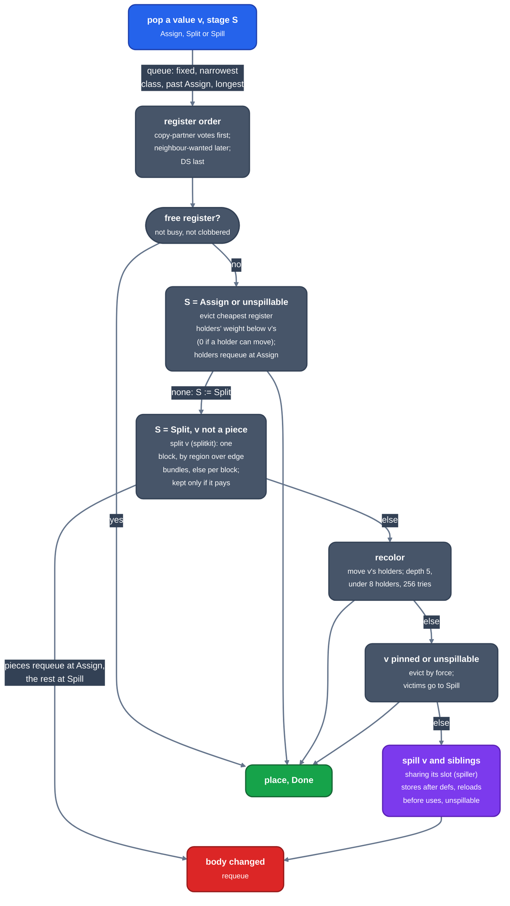

> Generated from the `//!` header of [`crates/codegen/llrm-codegen/src/backend/allocate.rs`](https://github.com/ali-mosavian/llrm/blob/main/crates/codegen/llrm-codegen/src/backend/allocate.rs); edit the header, not this file.
<!-- src: crates/codegen/llrm-codegen/src/backend/allocate.rs sha256:9350dbde0ba96258fc3cab9f753db333a8c0c3e9f0d9736673bea2540f06a463 -->

# allocate

Assigns a register to every value of a lowered body, splitting and
spilling the values that do not fit.

## How it works
The allocator is greedy with eviction, after LLVM's `RegAllocGreedy`.
Values are taken from a priority queue one at a time and each is given a
register, or is moved, split or spilled. There is no interference graph:
two values clash when their live intervals overlap while in the same
register.

### Inputs
The body is machine-level LIR after `phielim`, `twoaddr` and `coalesce`,
over virtual values with widths. Besides it the allocator reads:

- pins: values already bound to a register (arguments, results, what an
  instruction requires, see `constrain`);
- the register classes (`classes`, `regclass`): which registers a value may
  take, from how its operands use it;
- the CPU profile, block frequencies and the frame (spill slots).

### What stands for interference
Three facts are kept for the body and recomputed incrementally whenever a
rewrite changes it (`Facts`):

```text
 live intervals     value -> segments of instruction slots, + spill weight
 Masks              points that destroy a register without naming it:
                    calls (clobbers), 16-bit callees (clobbers_high:
                    the upper half only), points that need DS (the
                    data group)
```

After a rewrite the values that compete again are those it changed, those it
brought to life that no one has queued, and those the queue gave up on and
has not got back (`popped`): the others are placed, spilled or waiting, so
the live values are not all looked at (`LLRM_CHECK_IDLE` compares with the
scan of all of them).

A value may use a register when no value placed there overlaps its
interval (`LiveIntervalUnion`) and no mask point lies inside it
(`_clobbered`). Registers are compared by root, so `AX` and `EAX` are one
register; a mask on the upper half matters only to values wider than a
word. The weight is the references to the value, weighted by block
frequency (10 per loop level) and divided by its size plus a grace, less
what its copies and folds would save; a value that must not be spilled
(`unspillable`, `protected`) weighs infinity.

### Preparing the body
`RegAlloc::transform` first changes the body so that the greedy loop can
treat every value alike, in this order:

1. `constrain::distinct_classes` copies a value that needs two incompatible
   register sets at once (both a byte and an index) into one value per role;
   isel already gives a word that is both base and index of one address two
   values.
2. `explicit_selectors` reaches a far cell through ES where its selector is
   also read as a number.
3. A pin outside the value's class is dropped where an instruction delivers
   the value in that register, else it is an error; a value both pinned and
   required in two registers is an error.
4. `constrain::constrained` gives each register an instruction requires a
   value of its own, live across that one instruction and copied in and out,
   and returns those pins; `required` adds the rest.
5. A value read once from a cell that holds, by an instruction that takes
   the cell, is not held at all: the read stays a memory operand.

`unallocatable` then refuses a body no assignment can fit: a value no
register may hold, two pinned values live together in one register, or
more unspillable values live at a point than there are registers.

### The loop



*One value through the allocator loop*

An eviction records a cascade number so a value evicted by one that was
itself evicted cannot ping-pong. A value that cannot be spilled may break
the cascade of a spillable one.

When a split or a spill changes the body, the facts are recomputed from
what changed, pins are found again for the changed blocks, the union is
refreshed, any placed value that now overlaps another or has a clobber in
its range is unplaced, and every new, moved or unplaced value re-enters
the queue. The loop stops when the queue is empty.

The last chance before a value is spilled is recoloring
(`greedy::greedy`'s `try_last_chance_recoloring`).

Last, `_recolored_hints` moves a value into a copy partner's register when
that register is free over its whole interval and joins more copies than
the one it has, so each joined copy becomes a deleted move.

### Applying
`applied` replaces every operand's value by its register at its width
(selector and address registers included), deletes identity moves and
dead allocator copies, and refuses a body with a spill left. `datagroup`
then restores DS where a value held it.

## Example
A dword multiply by 5 (`Times5& = x * 5`), before and after. `; inserted`
notes are dropped. `v4` and `v5` are pinned to EAX and EDX (`requires`) and
everything else is free.

Before (`Coalescer`):

```lir
0x0000  v1 := mov [[bp+0x6]]
0x0000  v2 := mov [None v1@unplaced]
0x0001  v4 := mov v2
0x0001  v4 := shl v4, 0x2
0x0001  v4 := add v4, v2
0x0002  v5 := mov v4
0x0002  v5 := shr v5, 0x10
0x0002     ; requires v4@EAX,v5@EDX
```

After (`RegAlloc`):

```lir
0x0000  BX := mov [[bp+0x6]]
0x0000  EBX := mov [None v1@BX]
0x0001  EAX := mov EBX
0x0001  EAX := shl EAX, 0x2
0x0001  EAX := add EAX, EBX
0x0002  EDX := mov EAX
0x0002  EDX := shr EDX, 0x10
0x0002     ; ...
0x0002     ; requires v6@EAX,v7@EDX
```

Every value is a register; the pinned values are fresh ones (`v6`, `v7`),
see `constrain`.

When registers run out, values get frame cells. Eight LONG parameters
multiplied in pairs (`Mix&`), the first lines, before (`Coalescer`):

```lir
0x0000  v1 := mov [[bp+0x14]]
0x0000  v9 := mov [None v1@unplaced]
0x0001  v2 := mov [[bp+0x12]]
0x0001  v10 := mov [None v2@unplaced]
0x0002  v11 := mov v9
0x0002  v11 := imul v11, v10
; ...
```

After (`RegAlloc`): `v9` and `v11` are stored to frame cells, and `v11` is
read back before its update (`spill reload`):

```lir
0x0000  BX := mov [[bp+0x14]]
0x0000  ECX := mov [None v1@BX]
0x0001  BX := mov [[bp+0x12]]
0x0001  EAX := mov [None v2@BX]
0x0002  EBX := mov ECX
0x0002  [[bp-0x18]] := mov EBX
0x0002     ; ...
0x0002  [[bp-0x4]] := mov ECX
0x0002  EBX := mov [[bp-0x18]]  ; spill reload
0x0002  EBX := imul EBX, EAX
0x0002  [[bp-0x18]] := mov EBX
; ...
```

From `ISEL_DUMP=1 llrm-qb -O2 -march=i386` of `Times5&` and of `Mix&`, first
route.

## Runs
Once per function and route in the machine phases (`regalloc`), after
`coalesce` and before `parcopy`, at every -O level; `search` only widens
the candidates tried. `assemble.rs` runs the whole machine list twice per
function (allocator alone, and with `ssaspill`) and keeps the cheaper.
The file also holds the per-block liveness rows (`live`, `live_rows*`)
that other phases read.

## Needs
[`crate::backend::live`](live.md),
[`crate::backend::regclass`](regclass.md), [`crate::backend::constrain`](constrain.md),
`crate::backend::splitkit`, [`crate::backend::spillplacement`](spillplacement.md),
`crate::backend::spiller`, [`crate::backend::datagroup`](datagroup.md) and
[`crate::backend::frame`](frame.md).

## See also
- LLVM's `RegAllocGreedy`:
  <https://github.com/llvm/llvm-project/blob/llvmorg-18.1.8/llvm/lib/CodeGen/RegAllocGreedy.cpp>
- The phase list: `crate::backend`.
