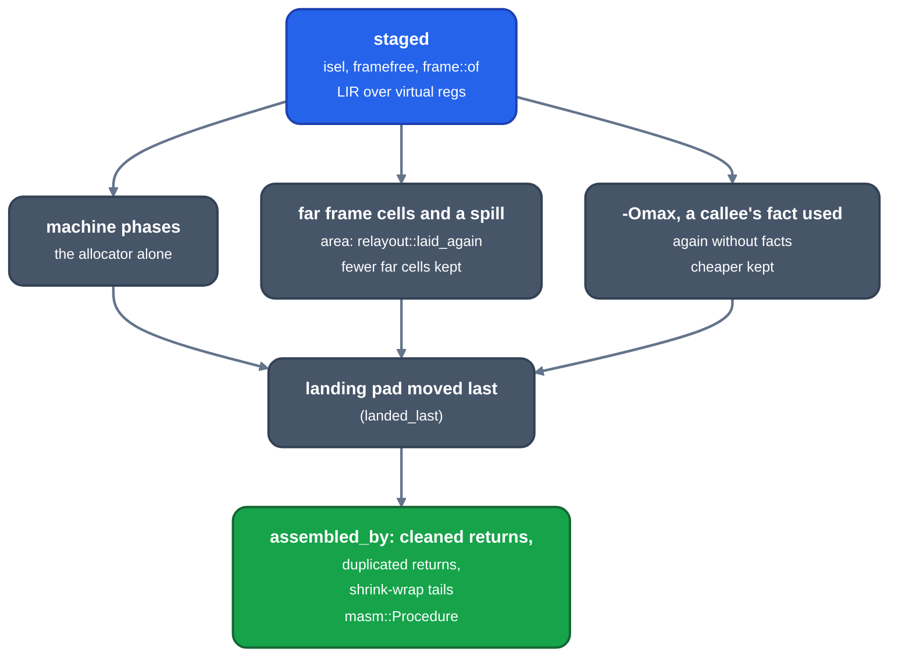

> Generated from the `//!` header of [`crates/codegen/llrm-codegen/src/backend/assemble.rs`](https://github.com/ali-mosavian/llrm/blob/main/crates/codegen/llrm-codegen/src/backend/assemble.rs); edit the header, not this file.
<!-- src: crates/codegen/llrm-codegen/src/backend/assemble.rs sha256:b86558cd3f1666a001cae8afa450bbc2a6017d21928a9c84a7c0d1fb1a55d2ef -->

# assemble

Takes a MIR module to masm, as `llc` takes a module to an object: each
defined function selected and put through the machine phases, each defined
variable's data, and the symbols both name.

## How it works
`assembled_by` first places near-callable functions (`nearcode`) and names
the globals. It then machines the functions callees first, so what a
function that takes part in interprocedural register use writes is known
(`calleefacts`) when its callers are selected, and records it after each.

`machined` makes one function:



*How a staged procedure becomes a masm Procedure*

`phased` runs the list of `flow::machine_with` over the staged body
(`prologue` is skipped; masm writes the prologue from the frame's reserve).
Each phase's output is checked, and `ISEL_DUMP=1` prints the LIR after
each.

When all functions are done the module's constants are added to the data,
stack checks the program proves unneeded are elided, undefined names
become externs, and debug info is described.

## Example
A MIR function and the masm it becomes (`bump`, called twice from `main`):

```mir
define internal regparm3cc i16 @bump(i16 %0) addrspace(1) nearcode ... {
b1:
  %1 = add i16 %0, 1
  ret i16 %1
}
```

```text
_bump proc near
L0_0:
    inc ax
    ret
_bump endp
```

From `--dump` (`mir/21-homes.ll`) and `-S` of a nib program at -O2 with
`-fno-inline-functions -fno-inline-functions-called-once -fno-ipa-cp-clone
-march=i386`.

## Runs
Once per module. Per-function candidates are described above; the gating
flags are in `crate::backend`.
