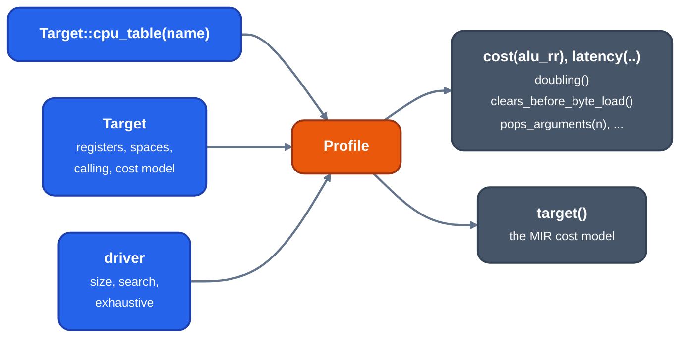

> Generated from the `//!` header of [`crates/codegen/llrm-codegen/src/backend/cpu.rs`](https://github.com/ali-mosavian/llrm/blob/main/crates/codegen/llrm-codegen/src/backend/cpu.rs); edit the header, not this file.
<!-- src: crates/codegen/llrm-codegen/src/backend/cpu.rs sha256:0e506eefb0c9853bb8802b9e7f9b952c6e840411a6d994255717fa00cb3622c6 -->

# cpu

One immutable description of a code-generation tuning target: a CPU's
prices and a target's registers, address forms and cost model.

## How it works
`Profile` joins two sources. The target (`llrm_target::Target`) gives
the register capacity, the general registers, address spaces, calling
conventions and cost model. A row of the target's timing table
(`timings.times`) gives the CPU's clocks per instruction form, latencies,
issue width, in-order flag, prefix cost, partial-register stall, pairing
and address-size-prefix stall. Instruction forms are named by strings
such as `alu_rr` or `movzx`.



*Where a CPU profile comes from and what reads it*

The four driver flags select the allocator's effort: `size` (-Os, ties
broken by the shorter encoding), `search` (the allocator tries other
shapes of a body), `exhaustive` (every shape) and `routes` (both the
allocator alone and the spiller route are made and the cheaper kept).
They are part of the profile so that every phase reads one value.
`tuned_optimizing` builds a profile once per (target, CPU, size, search,
exhaustive, routes) and leaks it, so a profile is a `&'static` reference
that passes hold freely. An unknown CPU is an error that lists the
target's CPUs.

Costs are rankings, not guarantees. `Profile::cost` and
`Profile::latency` err when a form has no entry; `Profile::prices`
asks first. The smaller audited subset of multiply and divide clocks
that may change legality is read through `timing.rs`. Helper decisions
that depend on the prices live here: `Profile::doubling` (`add r,r`
or `shl r,1`), `Profile::clears_before_byte_load` (`xor r,r; mov rl,m`
or `movzx`) and `Profile::pops_arguments` (pops against `add sp`).
`MultiplyChains` caches the constant-multiply chains found under this
profile's prices (GCC's `alg_hash`); a clone starts with an empty cache.

## Example
Facts the profiles state (from the target's timing tables):

```text
address_prefix_stall            P6 6, Core 3, 386 486 P5 K5 K6 K7 0
67h form beats a spill (before_spill)   386 K5 K6 K7 Core
call / size call on a 486       18 / 5
```

From unit tests
`test_medium_model_profiles_distinguish_native_and_67h_addressing`,
`test_secondary_address_form_is_ranked_against_reload_and_spill_work` and
`test_the_lowered_target_forwards_its_size_costs` in `cpu.rs`.

## Used by
The driver (`driver/mod.rs`, `Options::cpu`) builds it from the machine's
CPU name. Consumers by grep: `allocate`, `schedule`, `peephole`,
`isel`, `jumps`, `executed`, `division`, `arithmetic`, `timing`,
`exactaddress`, `affine`, `phielim` and `parcopy`.

## See also
Arithmetic by CPU: `docs/machine/arithmetic-targets.md`.
