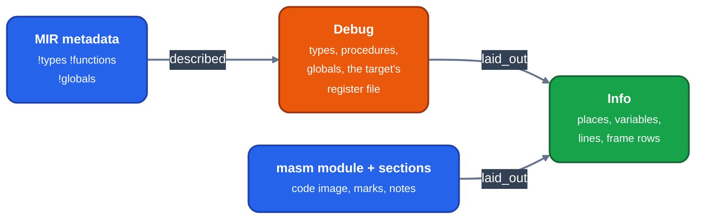

> Generated from the `//!` header of [`crates/codegen/llrm-codegen/src/backend/debuginfo.rs`](https://github.com/ali-mosavian/llrm/blob/main/crates/codegen/llrm-codegen/src/backend/debuginfo.rs); edit the header, not this file.
<!-- src: crates/codegen/llrm-codegen/src/backend/debuginfo.rs sha256:151c92e56d30beb8c5c31cb8cdd2fbace29f1c5e72763b0a0fafec71b99b824b -->

# debuginfo

`-g`: build a module's debug information as `llrm_debug::Info`,
the format-neutral model each object format's writer encodes.

## How it works
Two steps, either side of code layout.



*From MIR metadata and a masm module to Info*

`described` runs before layout. It reads MIR's metadata
(`llrm_mir::debuginfo`) into model types (scalars, pointers by reach,
structs and unions, arrays, procedure types), one list in which a member
may name a type made after it, then each function and global by the symbol
the backend gave it. It also takes from the target's register file the
frame register, the return-address register and each register's DWARF
and CodeView numbers, so a writer needs no target. It returns none when
the module has no functions and no globals described.

`laid_out` runs once the code has addresses. For each procedure it adds
the range, the body's start and end (the code after the prologue), and
frame rows from [`super::cfi`](cfi.md) read back from the emitted bytes. Each
variable gets a `Location` from where the compiler said it lives:

- a frame cell, or a static; a parameter that arrives in a register is said
  to be in it until the function stores it to its home (found by
  `arrival::stored`);
- a value tracked over the code (`valuetrack::tracked`): the places it holds
  over ranges, joined into one location list, or pieces. A format that names
  one place per scope (CodeView 4, Turbo Debugger) takes the place every
  range shares from the first value to the last statement (`stable`), else
  leaves the variable out. A variable whose note a pass lost is said to be
  nowhere;
- gone: an empty list, "optimized out".

Where a format finds a cell by the frame register and the function keeps
none, a cell through the stack pointer is said over the ranges the
pointer is the same distance from the frame address, or the variable is
left out. `-g` never changes the code, so nothing is added to make a
variable sayable.

The segments' line tables become `Info::lines`, and the code each
segment holds becomes `Info::code`.

## Example
One place for a scope (`stable`): `k` was computed in `ax` and copied to
`bx` for a call that clobbers `ax`. The last statement is 11.

```text
range     places held
[2, 6)    ax, bx
[6, 12)   bx
stable -> Some((2, bx))     the place every range holds, from the first range
```

From unit test `the_place_a_scope_is_given_is_one_every_range_holds` in
`debuginfo.rs`.

## Runs
`described` when a module is assembled (`assemble.rs`; `driver/basic.rs`
for the BASIC path), `laid_out` when the object is built (`objbuild.rs`).
Without debug metadata in the module (no `-g`), `described` returns none
and no `Info` is made.

## Needs
`valuetrack`, `cfi` and `arrival` for the emitted code; the writers
consume the result.

## See also
The model, the writers and what each can say: `docs/formats/debug-info.md`.
