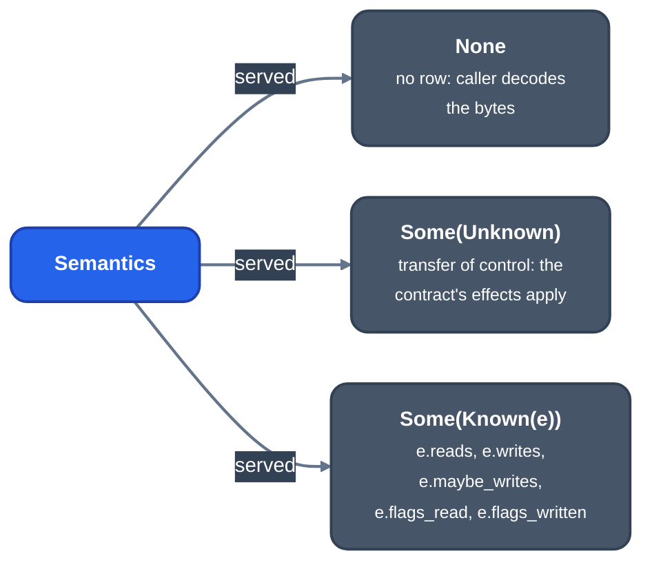

> Generated from the `//!` header of [`crates/codegen/llrm-codegen/src/backend/effects.rs`](https://github.com/ali-mosavian/llrm/blob/main/crates/codegen/llrm-codegen/src/backend/effects.rs); edit the header, not this file.
<!-- src: crates/codegen/llrm-codegen/src/backend/effects.rs sha256:46d12e4d3d1ccb2fc6574f0a6b96fb1df2a80ce88a0c5b99d4edd259d57cecde -->

# effects

The registers and flags an instruction reads and writes, from its
`x86.instr` row.

## How it works
The target's register file carries one row per instruction form
(`Info::effects`): operand roles, implicit reads and writes, and the
flags read and written. `served` looks `what` up for code of
`bits` bits and returns one of three answers.

*What a served Semantics row says*

`maybe_writes` holds what is written only if the instruction runs, such
as a repeated string operation's pointers. The table itself lives in
`llrm_x86::effects`; this module picks the rows of the register file
asked, since two targets compiled in one process have different rows
(real mode has `les`, a flat target has none).

## Example
No honest example: the module answers one lookup and rewrites nothing, so
there is no LIR before and after. Its test
`the_rows_are_those_of_the_register_file_asked` shows the answer for a
real-mode `les` and a flat target.

## Provides
The effects of one instruction as register roots and flag masks.

## Used by
`peephole.rs` (`_effects_by_table`), which adds the instruction's
`requires` and `delivers` and turns the registers into byte lanes. The
lanes feed `machinecp`, `copysink`, `regthrash`, `exactaddress`, `liveness`,
`parcopy`, `upperzero` and other post-allocation passes.
