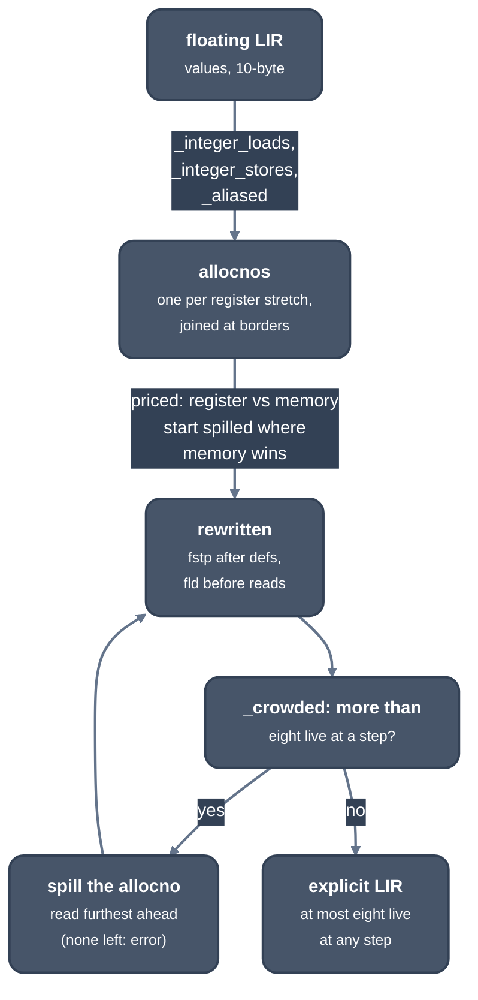

> Generated from the `//!` header of [`crates/codegen/llrm-codegen/src/backend/floatassign.rs`](https://github.com/ali-mosavian/llrm/blob/main/crates/codegen/llrm-codegen/src/backend/floatassign.rs); edit the header, not this file.
<!-- src: crates/codegen/llrm-codegen/src/backend/floatassign.rs sha256:c8f6e1e2dd42693ac76cac2250a05ed3a47ecfa048129e7a0bfa9ac98659930e -->

# floatassign

Decides which floating values hold one of the eight flat x87 registers and
which live in memory, and makes every spill, restore and memory operand
explicit.

## How it works
This is pass one of x87 allocation, as IRA and LRA are for any register
class in gcc; [`crate::backend::floatalloc`](floatalloc.md) is pass two (stack form) and
decides nothing.

First the body is made ready. An integer a `fild` reads from a register or
an immediate goes through a frame cell (a constant through the constant
pool). A float-to-integer store lands in an owned cell, with `wait` around
it in a BASIC module, and the integer is read back only if something reads
it. Later loads of a cell nothing wrote since are given the first load's
value (`_aliased`).

Then each value is split into allocnos, per register stretch: from a
definition, a restore or a block entry to the value's death, a boundary
(`floatregions::boundary`) or a block exit. The border of a block is decided
per value from the edge bundles, as LLVM's SpillPlacement does (`_stacked`):
a value is on the stack at a border where it is read before the stack is
next emptied. Stretches that meet at a border join into one allocno. Values
joined by copies share one spill cell where their lives do not overlap
(`_shared_cells`), so a copy between two spilled values is no instruction.

Each allocno is priced in the register form against the memory form,
weighted by block frequency and the CPU's x87 timings. A read in memory is a
memory operand where x87 has the form and it costs no more than a reload
(`Plan::fused`), else a `fld` first. A value that is a load of a cell
nothing writes before its last reader (`_homes`) is read again from that
cell rather than kept or stored, as gcc's REG_EQUIV memory. Those costing
more in a register start in memory.

The result is then rewritten (`Plan::rewritten`) and checked against the
stack's depth (`_crowded`): at the first step with more live values than
`float_stack`, the allocno read furthest ahead among those at that point is
moved to memory (Belady, as LRA), and the body is rewritten again. Only the
steps the new victim reaches are rewritten (a step is kept by which of the
roots it touches are spilled), and a block's steps and the floats live after
each, which no spill changes, are worked out once. The allocnos holding a
register at a point are found by the point.



*Assigning x87 stack slots*

A spilled value takes a ten-byte frame cell in extended format, so no
precision is lost.

## Example
`keep(a, b)` multiplies two doubles, calls `show` with the product and adds
`a` to it. `a` is live in an x87 register across the call, which leaves the
stack empty, so it is stored before the call and loaded back after it.

Before (after `FloatFold`):

```lir
keep: 12 instructions
  block 0x0000
    0x0000  v1 := fld [[bp+0x8]]  ; inserted
    0x0002  v3 := fmul v1, [[bp+0x10]]  ; inserted
    0x0003  [[bp-0x10]] := fstp v3  ; inserted
    ; ...
    0x0007  [None] := fstp v5  ; inserted
    0x0007  call   ; inserted; delivers v6@EAX; clobbers EAX,ST0
    0x0009  v8 := fadd v1, [[bp-0x10]]  ; inserted
```

After (`FloatAssign`):

```lir
keep: 14 instructions
  block 0x0000
    0x0000  v1 := fld [[bp+0x8]]  ; inserted
    0x0002  v3 := fmul v1, [[bp+0x10]]  ; inserted
    0x0003  [[bp-0x10]] := fstp v3  ; inserted
    ; ...
    0x0007  [None] := fstp v5  ; inserted
    0x0007  [[bp-0x18]] := fstp v1  ; inserted
    0x0007  call   ; inserted; delivers v6@EAX; clobbers EAX,ST0
    0x0009  v1 := fld [[bp-0x18]]  ; inserted
    0x0009  v8 := fadd v1, [[bp-0x10]]  ; inserted
```

From `ISEL_DUMP=1` of the nib function `keep(a: f64, b: f64)` with `-m32
-O0`.

## Runs
Machine phase after `floatfold` and `phielim`, before `floatalloc`, once per
function; a no-op when the body has no floating value. Not gated by an -O
level.

## Needs
`live`, `spillplacement::bundles`, [`crate::backend::frame`](frame.md) for cells,
`constpool` for float constants, and the CPU profile's x87 costs.

## See also
`docs/optimizations/floating-pop-reuse.md`.
