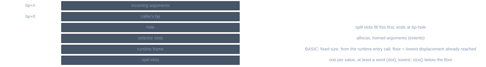

> Generated from the `//!` header of [`crates/backend/llrm-core/src/backend/frame.rs`](https://github.com/ali-mosavian/llrm/blob/main/crates/backend/llrm-core/src/backend/frame.rs); edit the header, not this file.
<!-- src: crates/backend/llrm-core/src/backend/frame.rs sha256:4a9fce5253a9173d46dfcd411c6df7640fbd603c8bf706bc6c27058c090d2444 -->

# frame

The stack frame of one function body: where each spill slot, temporary and
selector-made stack object lives, and how many bytes the prologue reserves.

## How it works
Displacements are bytes from the frame register, negative below it. A
`Frame` has a `floor`, the deepest displacement already reached, and hands
out slots below it:

*Frame layout, incoming arguments at the top*

`of` builds the frame after selection. It scans the body for the lowest
frame cell referenced (outgoing native stack arguments excepted) and, for a
BASIC procedure that enters through the runtime's frame call, for the
runtime frame size: the constant in `cx` at that call plus the runtime's own
10 bytes (20 for VB/DOS). A size that is not a known constant, or a native
frame referenced below its reservation, is `Refused`.

`slot` gives a value a slot on first request, keyed by value or by a name;
it fills the hole just below the frame register first, then the space under
the lowest slot. A slot belongs to its value: sharing is done by the callers
that colour slots (`spiller`, isel's alloca groups), not here. `cell`
returns the slot as a frame memory operand. `saved` and `restore` roll back
the slots of a trial that is discarded.

`tagged` marks every frame cell in the body with the slot it is in (nearest
`extents` entry), so later phases and the verifier can tell which stack
object an address belongs to; a cell in no slot is refused. A pointer one
past a slot's end or one before its start belongs to that slot.

## Runs
`lir frame` in `assemble::staged`, once per function after selection and
`framefree`; the frame is then shared by every machine phase that spills.

## Needs
[`crate::backend::isel`](isel.md) for `extents`, `calls` and `hole`;
[`crate::backend::nativeframe`](nativeframe.md) for a native procedure's reservation.

## See also
`docs/optimizations/second-frame.md`.
