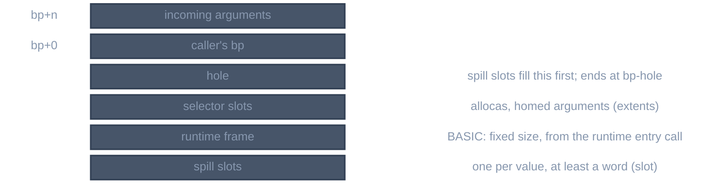

> Generated from the `//!` header of [`crates/backend/llrm-core/src/backend/frame.rs`](https://github.com/ali-mosavian/llrm/blob/main/crates/backend/llrm-core/src/backend/frame.rs); edit the header, not this file.
<!-- src: crates/backend/llrm-core/src/backend/frame.rs sha256:7ea29fb93c733f3e726f56c1c11ef847d85de7d7d2903c04e2c09fc0bf04ab38 -->

# frame

The stack frame of one function body: where each spill slot, temporary and
selector-made stack object lives, and how many bytes the prologue reserves.

## How it works
Displacements are bytes from the frame register, negative below it. A
`Frame` has a `floor`, the deepest displacement already reached, and hands
out slots below it:



*Frame layout, incoming arguments at the top*

A spill slot is aligned as its width is, up to `align`: the target's stack
slot (4 in flat code, a word in real mode), or its stack alignment (8) for a
function that needs the stack aligned (`calleefacts`: one holding a double
or calling one that does), as gcc's `assign_stack_local` and LLVM's
`calculateFrameObjectOffsets` do. A dword or a quad off its alignment costs
a 486 3 clocks (Intel486 data sheet 240440-002, section 10.1, Clock Count
Assumptions 2; Table 2.1 gives the alignments). The frame register is
8-aligned where the stack is at the call (`masm::parts` rounds the frame,
`isel` pads a call's arguments), so a displacement that is a multiple of 8
is an aligned address.

`of` builds the frame after selection. It scans the body for the lowest
frame cell referenced (outgoing native stack arguments excepted) and, for a
BASIC procedure that enters through the runtime's frame call, for the
runtime frame size: the constant in `cx` at that call plus the runtime's own
10 bytes (20 for VB/DOS). A size that is not a known constant, or a native
frame referenced below its reservation, is `Refused`.

`slot` gives a value a slot on first request, keyed by value or by a name;
it fills the hole just below the frame register first, then the space under
the lowest slot. A slot belongs to its value: sharing is done by the callers
that colour slots (`spiller`, isel's alloca groups), not here. `cell`
returns the slot as a frame memory operand. `saved` and `restore` roll back
the slots of a trial that is discarded.

`tagged` marks every frame cell in the body with the slot it is in (nearest
`extents` entry), so later phases and the verifier can tell which stack
object an address belongs to; a cell in no slot is refused. A pointer one
past a slot's end or one before its start belongs to that slot.

## Example
`double keep(double a, double b)` on `-m32 -O2` calls `ext(b)` and adds `a`
to the result. It has no frame cell before `FloatAssign`. To keep `a` across
the call, `FloatAssign` asks the frame for a slot and gets `slot0`, the
eight bytes just below the frame register:

```lir
═══ keep_ · FloatFold · m32 ════════════════════════════════════════════════════
fn keep_()   ; calls clobber eax
frame  arg0 [bp+0] 24 B

═══ keep_ · FloatAssign · m32 ══════════════════════════════════════════════════
fn keep_()   ; calls clobber eax
frame  slot0 [bp-8] 8 B  arg0 [bp+0] 24 B
; ...
    #10               fstp.f64    [slot0], t1:i80                       ; spill
     #5               call        ext_()
     #6  t3         = fload.f80
     #7  t4         = fadd.f64    t3:i80, [slot0]
```

From `ISEL_DUMP=1 llrm-c -m32 -O2` of that function, stages `FloatFold` and
`FloatAssign`.

## Runs
`lir frame` in `assemble::staged`, once per function after selection and
`framefree`; the frame is then shared by every machine phase that spills.

## Needs
[`crate::backend::isel`](isel.md) for `extents`, `calls` and `hole`;
[`crate::backend::nativeframe`](nativeframe.md) for a native procedure's reservation.

## See also
`docs/optimizations/second-frame.md`.
