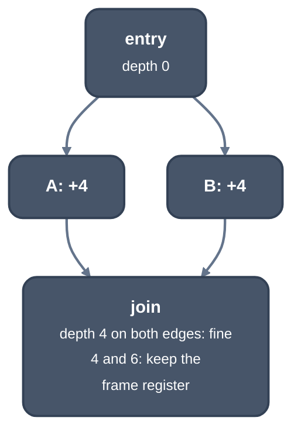

> Generated from the `//!` header of [`crates/codegen/llrm-codegen/src/backend/framefree.rs`](https://github.com/ali-mosavian/llrm/blob/main/crates/codegen/llrm-codegen/src/backend/framefree.rs); edit the header, not this file.
<!-- src: crates/codegen/llrm-codegen/src/backend/framefree.rs sha256:cc533c44fbe9ecef3eadae16b564b1c51773f47a63cb6359b4f2dec247866aa2 -->

# framefree

Decides, before allocation, whether a function can do without its frame
register, which is then one more value register.

## How it works
`has_fp` is LLVM's `X86FrameLowering::hasFPImpl`: a function keeps its
frame register when `MachineFrameInfo` says so, and `pinned_by` names which
fact does (`Pinned`): the frame address is taken, there are variable
sized objects, or the stack adjustment is opaque. The rest of the
function's facts (`far`, inline code, a landing pad) are read by `has_fp`.
The register is free when `masm` can address
every frame cell through the stack pointer, which needs the stack depth at
every instruction. The depth is computed here from the LIR before
allocation, reading the same things `masm::stack_addressed` reads; spill
code adds cells and moves but no push or pop, so the depth does not change.

Per block the walk sums pushes and pops (word or dword), `add sp, n` and
`sub sp, n`, and the bytes each call pops. Depths are then propagated along
the CFG from the entry:



*Frame depth at each block; every way into a block must agree, every return
at depth 0*

The frame register is kept where any of these holds: the target does not
allow freeing it (`registers.optional`), the body is not 32-bit, or it has
inline code (bytes of x87 register operations, `fsin` for one, touch no
stack cell and do not count), a landing pad, `returns_twice`, or debug
variables not located by the CFA. It is kept where the frame register is
read or written as a value, or is a base or index of anything but a frame
cell; the stack pointer is written other than by `add`/`sub` with an
immediate; there is an indirect call, jump or branch, a `leave`, an escape
or a barrier other than `fnstcw`, `fldcw`, `fnstsw`, `in` and `out`, a push
or pop of a width other than 2 or 4, or two edges disagree on the depth.

When freed, the frame register joins the allocatable set and the saved
registers (the prologue pushes it where it is used).

## Example
`mix(a, b, c, d, n)` on `-m32 -O2` updates four accumulators in a loop. The
body has no push, pop or indirect call, so the stack depth is known at every
instruction and the frame register is free: the prologue saves `ebp` with
the other callee-saved registers, the loop uses it as a value register, and
the argument is read through `esp`. The decision itself is not printed; this
is the listing it leads to.

```asm
_mix proc near
    push esi
    push edi
    push ebp
L0_0:
    mov esi, dword ptr [esp+16]
    ; ...
L0_8:
    mov ebp, edx
    imul ebp, edi
    add eax, ebp
    ; ...
    lea ebp, [ecx+edx]
    xor eax, ebp
    inc edi
```

From `-S` of a nib function with four accumulators updated in a `for` loop,
with `-m32 -O2 -fno-inline-functions -fno-inline-functions-called-once`.

## Runs
In `assemble::staged`, after isel and before `frame::of`, once per function.
Never for a BASIC module, whose frames are chained through BP.

## Needs
[`crate::backend::isel`](isel.md) (`pops`, `inline`, `landing`).

## See also
LLVM `X86FrameLowering::hasFP`; `masm::stack_addressed`.
