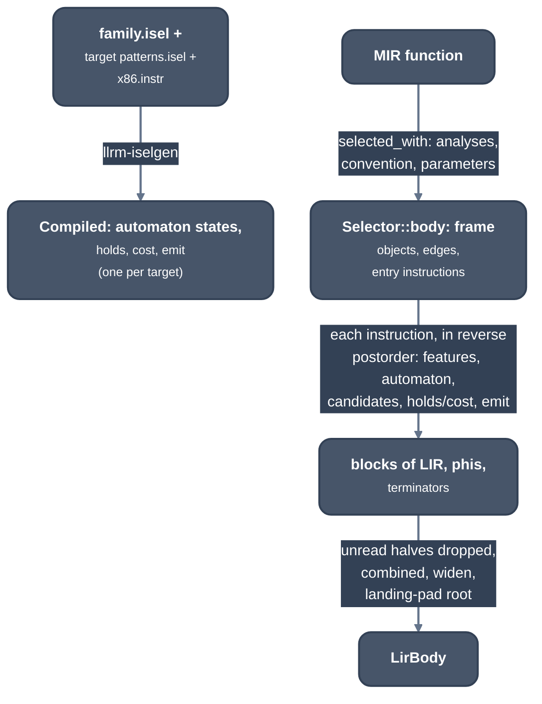
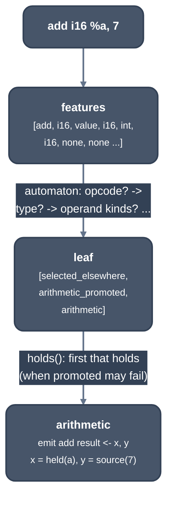

> Generated from the `//!` header of [`crates/backend/llrm-core/src/backend/isel.rs`](https://github.com/ali-mosavian/llrm/blob/main/crates/backend/llrm-core/src/backend/isel.rs); edit the header, not this file.
<!-- src: crates/backend/llrm-core/src/backend/isel.rs sha256:547a3588b20ac3d000ada4b05212ef655df08caed2a8bd7e4be06c6a17cd17b7 -->

# isel

Instruction selection: one MIR function becomes LIR over virtual registers,
as LLVM's SelectionDAG makes MachineInstrs.

## How it works
Selection chooses instructions and addressing. Two-address form, registers
and the frame's size are left to the machine phases. The rules that choose
are data, not code in this file: they are generated at build time and run by
`isel/matcher.rs`.



*Instruction selection: build time (build.rs, top), run time per function
(bottom)*

### Rules from generated definitions
A target's `patterns.isel` is spliced into the x86 family's file, and
`llrm-iselgen` checks every `emit` against the forms in `x86.instr`. Each
pattern has one `match` line (opcode, result type, operand kinds and types,
nested defining instructions), optional `when` predicates, `let` operand
constructors, and a body: `emit` a form, `call` a hook written by hand
(`hook_` in `matcher.rs`), `chain` an operation on a wide integer as its
halves, `refuse` or `nothing`. `group` members with a `cost` compete; a
pattern with `cover` takes over a nested instruction. The generator turns
the `match` lines into a decision automaton, as TableGen merges common
prefixes, and the rest into `holds`, `cost` and `emit` functions.

### Matching
For an instruction the matcher computes its features (opcode, result type,
and each operand's kind and type, up to three operands; a constant first
operand of a commutative opcode is swapped second) and walks the automaton
to a leaf: the patterns still standing, in file order. The first whose
`when` predicates hold is chosen; if it is in a group, the cheapest holding
member of the group is. Its `emit` appends LIR. A shape no pattern takes is
refused, by the opcode's name.



*Selecting add i16 %a, 7*

Decisions that need more than the instruction are made first, per
instruction, before any is emitted: a comparison read only by its block's
branch stays flags (`fuse`); a dword load read only through `trunc` is two
word loads (`narrowed`); a quotient and a remainder of the same operands are
one division (`pair`); the first covering pattern that holds marks what it
covers (`covered_by_pattern`), and that instruction is then selected by the
cover alone.

### What the hooks cover
What is not pattern-shaped is in this file: calls (the convention decides
what is pushed, passed in registers and popped, `called`), `memcpy` and
`memset` (by pieces or `rep`), float conversions and compares, far pointers
as an offset and a selector (`fars`), address arithmetic folded into memory
operands (`indexed`), `switch`, and branch conditions merged into one chain.
Allocas get frame cells (`alloca_groups`, `Selected::extents`); a parameter
arrives in a cell or in registers, delivered by an entry instruction.

### Wide integers
An integer wider than the target's native one is two halves, low first
(`wide.rs`, `expand.rs`): `chain` patterns for add, sub and the bit
operations, hooks for the rest. A value's sign bits can show that a product
or quotient of 32-bit values needs one instruction.

```text
 add i64 %a, %b  (32-bit target)
   add  lo <- a.lo, b.lo
   adc  hi <- a.hi, b.hi        takes the carry of the half below
```

### After the instructions
Wide halves nothing reads are dropped. `combined` then makes the selections
that need neighbours; `widen` marks exact address sums and makes a word
value used as a dword address component a dword one
(`addressforms::promote`); if the function has a landing pad, `rooted` adds
a root block that reaches it. Block frequencies and branch odds are set from
the MIR's.

## Runs
First of the staged phases in `assemble::staged`, once per function and
again at -Omax where a callee's known register effects were used (the second
run selects without them and the cheaper is kept). Its output is the input
of `framefree` and `frame::of`.

## Needs
`llrm_analysis` (CFG shape, memory, constants, ranges) for what the
patterns' predicates ask; [`crate::backend::calleefacts`](calleefacts.md) for the registers
a callee writes; the target's [`crate::backend::isel::Compiled`](isel.md).

## See also
`docs/machine/targets.md`; LLVM `SelectionDAGISel`.
