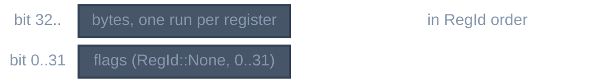

> Generated from the `//!` header of [`crates/codegen/llrm-codegen/src/backend/lanes.rs`](https://github.com/ali-mosavian/llrm/blob/main/crates/codegen/llrm-codegen/src/backend/lanes.rs); edit the header, not this file.
<!-- src: crates/codegen/llrm-codegen/src/backend/lanes.rs sha256:53dd34fcc7683e557d786e384bbf4fee3fb6d760487b9629456498ba9ea797ff -->

# lanes

A set of register and flag lanes, as a 128-bit mask.

## How it works
A lane is a byte of a general register root (4 each, 7 roots of a 32-bit
target), a byte of a segment register (2 each, 6 segments), or a flag bit
against `RegId::None` (32). Long mode adds 8 roots and a root's upper four
bytes, which no view splits, are one lane: 5 lanes for each of 15 roots, 119
lanes in all, which fit the mask a 32-bit target has always had. The table
sorts the lanes in `(RegId, u32)` order, so flag bit `i` is mask bit `i`,
and iteration visits lanes in the order a `BTreeSet<Lane>` would. Each
register records the mask bit of its byte 0 and its byte count, so a lane's
bit is a table lookup.

*Lane mask bits*

Union, difference, intersection, subset and disjointness are single word
operations. Inserting a lane that is none of the 72 panics.

## Example
No example: a bit set type. `liveness.rs` shows what it holds.

## Used by
`liveness`, `peephole` and its sub-passes (`copysink`, `postrasink`,
`regthrash`, `exactaddress`, `sharedstores`), `loopslots`,
`schedule`, `parcopy`, and `peep/guards`, `peep/walk`, `peep/make`.
