> Generated from the `//!` header of [`crates/codegen/llrm-codegen/src/backend/lifetimes.rs`](https://github.com/ali-mosavian/llrm/blob/main/crates/codegen/llrm-codegen/src/backend/lifetimes.rs); edit the header, not this file.
<!-- src: crates/codegen/llrm-codegen/src/backend/lifetimes.rs sha256:47a2f432a3daa8dbb427a43f6afef9a38c11afd935bff5dc257048d85800d0d7 -->

# lifetimes

Where a block local's bytes are live, from its lifetime markers, so that
locals never live together can share a frame slot.

## How it works
A local is tracked only if it is an `alloca` with a marker; every use of it
but its markers (pointer arithmetic followed) must fall inside its
lifetime. Any other local is live throughout and shares with none.

A forward fixed point finds, for each block, the tracked locals live on
entry: a local is live at a block start if it is live at the end of any
predecessor. Inside a block, `llvm.lifetime.start` adds the object and
`llvm.lifetime.end` removes it. A second walk numbers the positions where
each object is live (both markers count) and merges them into segments.

```mermaid
%%{init: {'theme':'base','themeVariables':{'fontFamily':'Segoe UI, Helvetica Neue, Arial, DejaVu Sans, sans-serif','fontSize':'15px','textColor':'#64748b','titleColor':'#64748b','gridColor':'#94a3b8','sectionBkgColor':'transparent','sectionBkgColor2':'transparent','altSectionBkgColor':'transparent','taskTextColor':'#ffffff','taskTextOutsideColor':'#64748b','taskTextLightColor':'#ffffff','taskTextDarkColor':'#ffffff','doneTaskBkgColor':'#16a34a','doneTaskBorderColor':'#166534','activeTaskBkgColor':'#2563eb','activeTaskBorderColor':'#1e40af','critBkgColor':'#dc2626','critBorderColor':'#991b1b','taskBkgColor':'#475569','taskBorderColor':'#334155','todayLineColor':'transparent'},'gantt':{'barHeight':34,'barGap':12,'topPadding':48,'leftPadding':150,'fontSize':14,'sectionFontSize':14,'numberSectionStyles':2}}}%%
gantt
  dateFormat X
  axisFormat %s
  tickInterval 1second
  section %a
  S∶ lifetime.start :milestone, t10, 2, 2
  segment of %a, positions 1 to 4 :done, t14, 2, 5
  s∶ store :milestone, t11, 3, 3
  l∶ load :milestone, t12, 4, 4
  E∶ lifetime.end :milestone, t13, 5, 5
```

*Positions of one alloca's lifetime markers and accesses* Axis: 1 position
0; 2 1: lifetime.start; 3 2: store; 4 3: load; 5 4: lifetime.end; 6 position
5.

An access at a position where the object is not live (a use before its
start, or after its end) disqualifies it: it is dropped from the result and
so shares nothing.

## Example
No example: no dump prints the intervals, and no test compares them as text.
Read `slots.rs`, where they decide which locals share a cell.

## Used by
`isel` takes the intervals in its own instruction numbering; `slots` then
lets the locals whose intervals do not overlap share a slot.
