> Generated from the `//!` header of [`crates/backend/llrm-core/src/backend/loopslots.rs`](https://github.com/ali-mosavian/llrm/blob/main/crates/backend/llrm-core/src/backend/loopslots.rs); edit the header, not this file.
<!-- src: crates/backend/llrm-core/src/backend/loopslots.rs sha256:989f239b24dc455c1e16ad4e0fd97a7740608acab978b49f2fe2198b7e4d3065 -->

# loopslots

Moves a loop's spill slots, and its loop-invariant reloads, into the
registers the loop leaves free.

## How it works
Allocation spills a value across its whole range. Inside one loop,
registers may still be free: untouched there, or used only to reload a
slot for the next instruction. The phase runs two steps, `hoisted` and then
`promoted`, over the natural loops innermost first (a loop that overlaps one
already taken is skipped).

`hoisted`: a register whose every write inside the loop loads one source
the loop never writes (a spill slot, or a constant) and which nothing reads
before that load keeps one load, placed at the loop's entry edges; the
other loads of it are dropped and their values renamed to the first's.
Segment registers qualify too.

`promoted`: for a loop whose frame accesses are all word-wide spill slots,
each slot the loop reaches is given a register (`free`), best saving first:

```mermaid
%%{init: {'theme':'base','themeVariables':{'fontFamily':'Segoe UI, Helvetica Neue, Arial, DejaVu Sans, sans-serif','fontSize':'15px','primaryColor':'#475569','primaryTextColor':'#ffffff','primaryBorderColor':'#334155','lineColor':'#64748b','secondaryColor':'#475569','tertiaryColor':'transparent','clusterBkg':'transparent','clusterBorder':'#64748b','edgeLabelBackground':'#334155','textColor':'#64748b','titleColor':'#64748b'},'flowchart':{'curve':'basis','nodeSpacing':38,'rankSpacing':52,'padding':16,'wrappingWidth':360,'htmlLabels':true,'useMaxWidth':true}}}%%
flowchart TB
  classDef mid fill:#475569,stroke:#334155,stroke-width:2px,color:#ffffff,rx:12px,ry:12px
  linkStyle default stroke:#64748b,stroke-width:2.2px
  subgraph g_bf["BEFORE"]
    en["<b>entry</b>"]:::mid
    hd["<b>header</b><br/><small>body<br/>latch</small>"]:::mid
    ex["<b>exit</b>"]:::mid
  end
  subgraph g_af["AFTER"]
    en2["<b>entry</b><br/><small>mov r,[slot]<br/>(and push r if parked)</small>"]:::mid
    hd2["<b>header, body, latch</b><br/><small>uses of [slot] now use r</small>"]:::mid
    ex2["<b>exit</b><br/><small>mov [slot],r (only if<br/>written and read after)<br/>(pop r if parked)</small>"]:::mid
  end
  en --> hd
  hd --> ex
  en2 ==> hd2
  hd2 ==> ex2
  style g_bf fill:#47556912,stroke:#475569,stroke-width:1.6px,stroke-dasharray:7 5,color:#475569
  style g_af fill:#47556912,stroke:#475569,stroke-width:1.6px,stroke-dasharray:7 5,color:#475569
```

*A loop slot held in register r, before and after*

The registers `free` offers are of three kinds: untouched by the loop
(cost nothing), used only to reload a slot for the next reader (their
reloads are folded away), and live through the loop but untouched, which
are parked with a `push` on entry and a `pop` on exit.

BP is one more when the loop reaches no other frame cell, calls nothing and
touches no x87 state or trapping instruction (the runtime walks the BP
chain when it raises an error): it enters with `push bp; mov bp,[slot]` and
leaves with `pop bp`. A spill slot's address is never taken, so no pointer
reaches a slot this moves.

A slot is promoted when what it saves per trip (a load per read, a store
per write, less the move a kept reload becomes, from the CPU's operation
costs) times the trips (header frequency per entry) exceeds the cost of the
load on entry, the store on exit, and any push and pop. A slot an
instruction reaches in a way a register cannot stand in for (an x87 store,
a far-pointer load, a dword access) is never promoted. A loop needs entry
blocks that go only to the header, exits reached only from the loop, and no
block without a successor.

## Runs
After `peephole` (spill traffic is final), before `schedule`. Always on;
loops that qualify are rewritten and others are left as they are.
`LLRM_DEBUG=traffic` prints the spill traffic by cause first.

## Needs
[`crate::backend::liveness`](liveness.md) for what each instruction writes and what is
live into the header and the exits, and the loop forest and block
frequencies from `analysis`.
