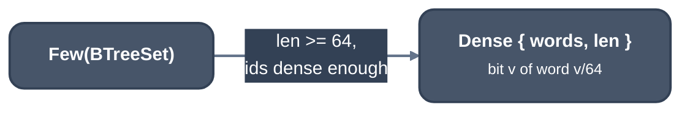

> Generated from the `//!` header of [`crates/backend/llrm-core/src/backend/neighbours.rs`](https://github.com/ali-mosavian/llrm/blob/main/crates/backend/llrm-core/src/backend/neighbours.rs); edit the header, not this file.
<!-- src: crates/backend/llrm-core/src/backend/neighbours.rs sha256:a22b9a92e1f2f4fd4267445a2d84155fd66571b894c6bbc516ce30a3c4ac5be3 -->

# neighbours

The values one value interferes with: a sorted set that turns into a bit
vector once it is dense.

## How it works
A function with N values live together has up to N^2 interference pairs.
As tree sets each costs a node and a descent; as bits, one shift. A set
starts as a `BTreeSet`. When it reaches `DENSE_AT` members, and again at
each multiple, it becomes `Dense` if its largest id is below
`BITS_PER_MEMBER` times its size, so a set of widely spread ids stays a
tree. This is GCC IRA's choice for an allocno's conflicts: a vector of ids
or a bit vector over its id range, whichever is smaller
(`ira_allocate_object_conflicts`, `ira-build.cc`).

*Neighbour set representations*

`join` adds a whole group at once: every value in a mask except one becomes
a neighbour, a word at a time when the set is dense. Iteration is ascending
in both forms.

## Used by
`coalesce`, for its interference graph.
