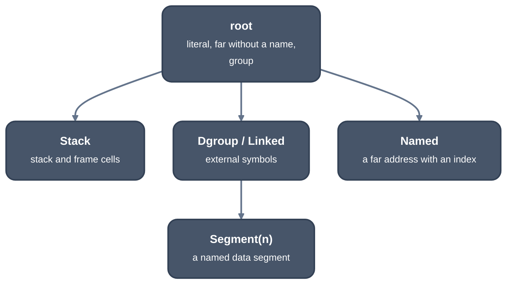

> Generated from the `//!` header of [`crates/codegen/llrm-codegen/src/backend/overlap.rs`](https://github.com/ali-mosavian/llrm/blob/main/crates/codegen/llrm-codegen/src/backend/overlap.rs); edit the header, not this file.
<!-- src: crates/codegen/llrm-codegen/src/backend/overlap.rs sha256:67eb96214a76e196aba4c737f46a8916bf4a0e6de62d07f5dd9e68ef97fba45e -->

# overlap

Whether two machine memory operands may overlap, read from their
addresses alone.

## How it works
The answer is syntactic. A pass that needs a semantic answer for memory
outside the frame (two globals, a pointer) gets it from the MIR, carried on
the instruction as `CallMemory` carries a call's effects, never re-derived
here.

`may_overlap` tries three things in order.

1. Two fixed frame cells (no base register) meet when their byte ranges do.
   This is the fast path for a body that copies a large struct.
2. Two frame addresses in different slots (`slot_home`) never meet, even
   where one has a base register: an indexed access stays in its slot.
3. Otherwise each address becomes a set of spans (region, origin, low, high)
   and they meet if any pair does.

A region is a path of nested parts, and a coarser prefix meets every child
below it:

*Regions of a memory address*

Spans in one region compare by offset and width when they count from the
same origin (SP, BP, here, or an external symbol); in different origins
they may meet. An address with a base register, or in the root or `Named`
region, covers its whole region. A root-region address is known not to be
the stack, so stack spans are removed from the comparison. An unknown
address or an end past 2^63 may overlap anything.

## Example
No honest example: a yes-or-no answer about two operands, with no LIR of its
own. Read `tests` in this file for the operand pairs and the answers.

## Used by
`spiller`, `floatassign`, `storedhomes`.
