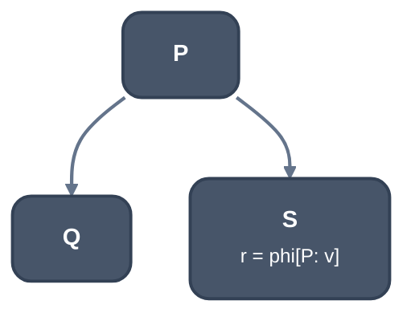
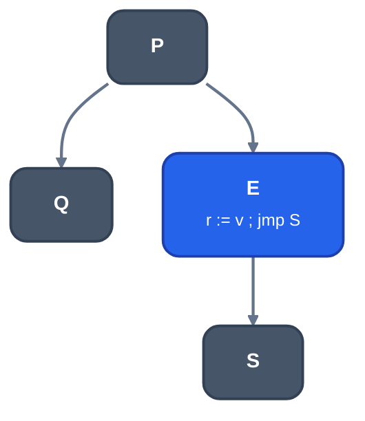

> Generated from the `//!` header of [`crates/backend/llrm-core/src/backend/phielim.rs`](https://github.com/ali-mosavian/llrm/blob/main/crates/backend/llrm-core/src/backend/phielim.rs); edit the header, not this file.
<!-- src: crates/backend/llrm-core/src/backend/phielim.rs sha256:0cd61e3ff7bf48f43c3c36ff8375299ed095d76aa355a0fba3e663ab33d2c148 -->

# phielim

Takes LIR out of SSA: each phi becomes parallel copies on its incoming
edges.

## How it works
For each phi `r = phi [p1: v1, p2: v2]` the pass puts `r = v1` at the end
of `p1` and `r = v2` at the end of `p2`, before the terminator. The copies
of one edge carry one group number, so [`crate::backend::parcopy`](parcopy.md) later
orders them as a single simultaneous assignment. A phi with an incoming edge
from outside the body is left alone.

A copy on a branch's edge instead of in its predecessor is made only when
it costs the target at least a tenth less (`EdgePrices::cheaper_on_edge`:
the edge's chance times its copies and the `jmp`, against the copies every
time), and never in a build for size: the odds are a guess, and an edge
that wins by less costs a block and a jump the clocks do not show.

Before copying, three shortcuts avoid a copy altogether. A one-input phi
renames its result to its input. A loop-exit one-input phi is the exception:
it becomes a copy opening the exit, so a call after the loop does not pin
the loop's register to a call-preserved one. On a critical edge, where every
incoming value is defined once in its own predecessor, is read by nothing
but this phi (or only past the loop the edge closes), and the phi's result
is not live after that definition, the definitions are renamed to define the
result outright. That is what gcc's out-of-SSA does with a phi argument that
does not interfere with the result.

Otherwise a predecessor with several successors makes the edge critical. A
copy there may run in the predecessor only if no other path reads either end
of it (`_observed`: whether a block that reads it is reachable from the
predecessor's other successors without entering the successor, searched
from both ends so that the smaller region is walked) and, where block odds
are known, the edge is not cheaper
(`EdgePrices::cheaper_on_edge`: the edge's chance times copies plus a `jmp`
against the copies run every time). Otherwise the copy goes in a new block
on the edge, which holds its copies and a jump to the successor:



*Before: edge P to S is critical (r = phi[P: v])*



*After: the copy goes in a new block E on the edge*

The new block's label is above every physical offset (`(entry + 1) << 32`),
in a namespace of its own per body entry.

`unsplit` undoes a split whose copies coalescing removed: a block of only a
jump is bypassed, so the jump is not taken on every pass. The peephole calls
it first.

## Example
A loop carrying three values has three phis at its head (`ISEL_DUMP=1` of
a C Fibonacci loop, `t = a + b; a = b; b = t;`, `llrm-c -O2 -m16`).

Before:

```lir
═══ _f@3 · SharedConstants · m16 ═══════════════════════════════════════════════
B0  entry  → B1                                                   ×1.0
     #2  t2         = mov.i16     0
     #3  t3         = mov.i16     1
     #4               jmp         B1

    B1  ← B0 B3  → B3 B2  loop                                        ×32.0
         #5  y4.1       = phi         B0: t2, B3: y4.2
         #6  y3.1       = phi         B0: t3, B3: y4.1
         #7  y2.2       = phi         B0: y2.1, B3: y2.3
; ...

    B3  ← B1  → B1                                                    ×31.0
        #13  y4.2       = add.i16     y3.1, y4.1
        #14               jmp         B1
```

After:

```lir
═══ _f@3 · PhiElimination · m16 ════════════════════════════════════════════════
B0  entry  → B1                                                   ×1.0
     #2  t2         = mov.i16     0
     #3  t3         = mov.i16     1
    #15  y4.1       = mov.i16     t2                                    ; copy
    #16  y3.1       = mov.i16     t3                                    ; copy
    #17  y2.2       = mov.i16     y2.1                                  ; copy
     #4               jmp         B1

    B1  ← B0 B3  → B3 B2  loop                                        ×32.0
; ...

    B3  ← B1  → B1                                                    ×31.0
        #13  y4.2       = add.i16     y3.1, y4.1
        #19  y4.1       = mov.i16     y4.2                                  ; copy
        #20  y3.1       = mov.i16     y4.1                                  ; copy
        #21  y2.2       = mov.i16     y2.3                                  ; copy
        #14               jmp         B1
```

Each phi became one copy at the end of each predecessor (`#15`-`#17` on the
entry edge, `#19`-`#21` on the back edge), one group per edge. The back-edge
copy `#20` reads `y4.1`, which `#19` writes, so [`crate::backend::parcopy`](parcopy.md)
orders them after allocation. The loop-exit phi `#11` became the copy `#18`.

## Runs
A machine phase after `ssaspill` (spiller route only) and before
`pressuresink`, in every machine (`flow::machine_with`); `EdgePrices` come
from the CPU profile, and with none a copy stays in its predecessor. Also
`placed_on_edges`, which [`crate::backend::floatalloc`](floatalloc.md) uses to put its
selected transfers on exact edges.

## Keeps
Result is out of SSA except for phis it refused. Value identities are
unified where a phi was trivial, so the body's widths and operands are
renamed throughout.

## See also
- LLVM `PHIElimination`:
  <https://github.com/llvm/llvm-project/blob/llvmorg-18.1.8/llvm/lib/CodeGen/PHIElimination.cpp>
