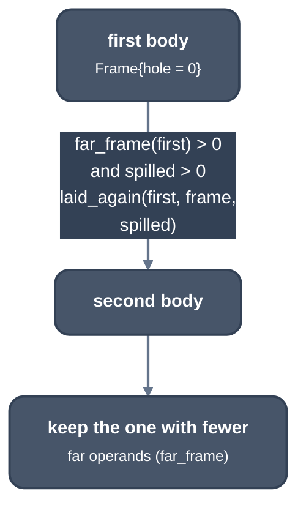

> Generated from the `//!` header of [`crates/codegen/llrm-codegen/src/backend/relayout.rs`](https://github.com/ali-mosavian/llrm/blob/main/crates/codegen/llrm-codegen/src/backend/relayout.rs); edit the header, not this file.
<!-- src: crates/codegen/llrm-codegen/src/backend/relayout.rs sha256:a48fa5d98595dceb12bff37e753293e5150966db3ba503b4c991e9d423d9d6f5 -->

# relayout

Lays a function's frame out a second time, with a hole for the spill slots,
by moving each frame cell of the first layout.

## How it works
A frame operand past `[bp-128]` needs a four-byte displacement. When a
function has a spill area and such operands, a layout with a hole of
`spilled` bytes above the allocas, for the spill slots to fill, may put them
nearer. That layout is made from the first one, without running the backend
again, because every frame cell names the slot it lies in
(`Addr::slot_home`).

`replayed` makes the new `Frame`: its floor lowered by the hole, the extents
of the slots instruction selection laid out moved, and the spill slots
handed out again by `Frame::slot` in the order they were first made, which
gives each old slot a new first byte. `Moves` then rewrites each cell by its
slot:

```text
 slot of the cell                    new displacement
 incoming argument (home 0)          unchanged
 laid out by isel (an extent)        disp - hole
 spill slot (home h -> h')           disp - h + h'
```

The same move is applied to the operands of every instruction, the
call-private ranges of calls (the complement of what some pointer reaches;
an incoming argument's range from BP up stays), the debug homes and
variables, and the displacement bytes of inline code (`inline_places`).
`Machined::reserve` is recomputed from the new frame. Pricing and
encodability decisions treat a frame cell as near whatever its slot, so the
two layouts decide alike (a frame cell priced by its displacement once made
them differ).

`ordered` is the other relayout: the pin's
`X86FrameLowering::orderFrameObjects` (the use-density order
`PrologEpilogInserter` asks for at every optimisation level), applied to the
first layout when it has far operands and the order reaches fewer of them.
Objects sort by uses per byte, highest first, ties by alignment and then by
later creation, and are laid from BP downward; a BASIC frame reorders the
selector's slots only, since the runtime zero-fills them and the spill slots
lie outside what it fills.

It gives up and returns `None`, and the first layout stands, on a frame cell
in no known slot, on inline-code bytes it cannot move, on call-private
ranges that are not what `outside` makes, on a native frame, or on a frame
that already has a hole.



*Laying the frame out a second time*

## Example
None: the unit tests of this file check the pricing of a frame cell and the
move of a call-private range, not a relaid function, and no test prints one.
Read `Moves` for the displacement rule in the table above.

## Runs
In `machined_once` (`assemble.rs`), after the first layout is chosen, unless
the target is basic, the frame is native, nothing is spilled, or no frame
operand is far. `LLRM_CHECK_FRAME=1` also runs the backend again with the
hole and panics if the result differs (`difference`) from the relaid
function, or if it could not be relaid.

## See also
- Design:
  <https://github.com/ali-mosavian/llrm/blob/18265caabe0332942d4052f0ea2f5fe67320d0ec/docs/optimizations/second-frame.md>
