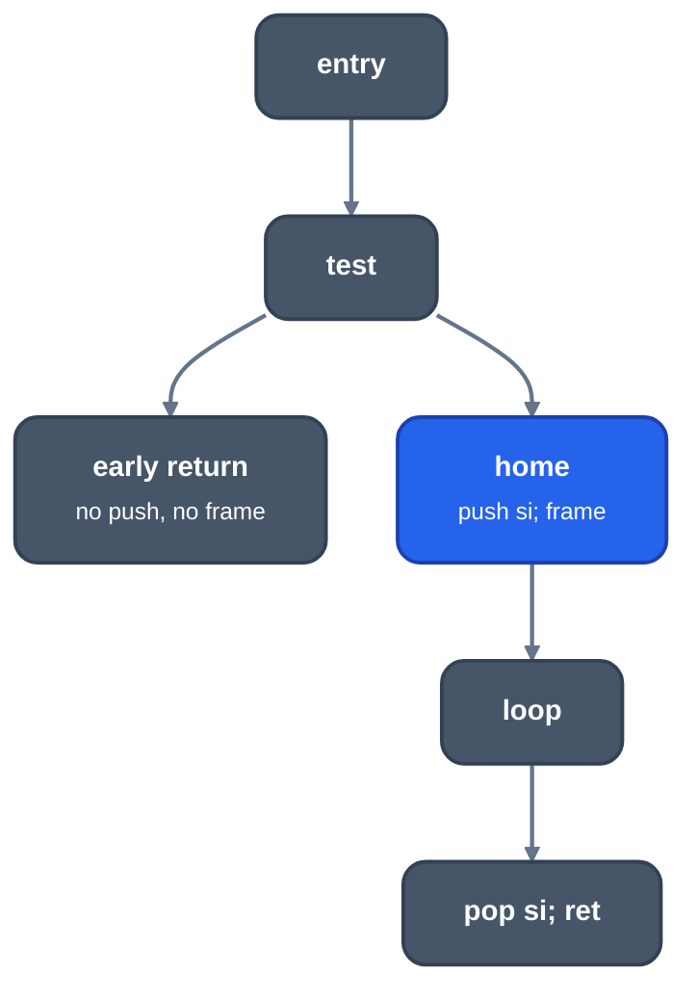

> Generated from the `//!` header of [`crates/backend/llrm-core/src/backend/shrinkwrap.rs`](https://github.com/ali-mosavian/llrm/blob/main/crates/backend/llrm-core/src/backend/shrinkwrap.rs); edit the header, not this file.
<!-- src: crates/backend/llrm-core/src/backend/shrinkwrap.rs sha256:eedff27eb451bbaf92901fe2f162ba44ff83f2c3da5221cac910edda58e1ed5d -->

# shrinkwrap

Sets up a procedure's frame and kept registers where they are first needed,
not at the entry, and takes them back only on the returns that path reaches.

## How it works
A procedure has pieces to set up: the frame (the stack reserve and the frame
register) and each register it keeps for its caller. A piece is set up in
its home, the nearest block that dominates every use of it and is outside
any loop (a set-up in a loop would run each trip). It is taken back before
each return that home dominates. This is gcc's separate shrink-wrapping
(`try_shrink_wrapping_separate`), which places each component, where LLVM's
ShrinkWrap moves the whole prologue.



*Frame and pushes only on the path that needs them*

A piece is wrapped only if it is safe and pays:

- Some return is not dominated by the home. Otherwise every path pays for
  the set-up and nothing is gained.
- A return the home reaches is also dominated by it. A return reachable both
  through the home and around it would pop what was never pushed.
- For the frame, and for every piece when the stack pointer addresses the
  frame cells, each block reachable from the home is dominated by it, so
  every block is entered at one stack depth.

No register is set up above the frame, since the frame's cells sit just
below the arguments and a push before the reserve would cover them. The
frame therefore comes up to the dominator of its own uses and the homes of
the registers, or stays at the entry if a register is set up there. Pieces
open in the order of the dominator chain, the frame first, and close in
reverse.

`tails_split` makes more pieces wait. A small block that ends in a return
and is reached by two or more paths (at most `MAX_GROW` = 8 instructions) is
copied for each way into it, when that raises `worth`, how much of the
procedure is set up late, to at least `WORTH` (three pieces). The early path
then returns through a copy that nothing was saved for.

## Example
The pass places pieces while masm builds the procedure, after LIR is
final, so its result is in the assembly, not in a LIR dump. A function that
returns `k` at once when `n` is 0 and otherwise loops over calls to `g`:

```asm
f_ proc near
L0_0:
    or eax, eax
    je L0_13          ; early return: no push, no pop
L0_2:
    push ecx          ; set-up in the home block
    push ebx
    push esi
    ; ... loop with `call g_`
L0_14:
    mov eax, edx
    pop esi           ; taken back only on this return
    pop ebx
    pop ecx
    ret
L0_13:
    mov eax, edx
    ret
f_ endp
```

The three pushes sit in `L0_2`, which the early return does not reach, and
the early return leaves with a bare `ret`.

From `-S` of a C function (`if (n == 0) return k;` then a loop calling `g`)
at -O2 -m32; the comments are added.

## Runs
`wrapped` runs when masm builds a procedure's items, for a procedure that
saves a register or has a frame, whose blocks are all reachable from the
entry, and that returns. The frame is not moved in an interrupt handler, a
runtime entry frame, a procedure with a stack check or one with inline code.
Registers are not wrapped in an interrupt handler or a runtime entry frame.
`tails_split` runs before that in assembly, after `lir duplicated returns`,
not at -Os, and only for a procedure with at least three pieces. Neither has
a level switch beyond that.

## See also
LLVM's
[`ShrinkWrap`](https://github.com/llvm/llvm-project/blob/llvmorg-18.1.8/llvm/lib/CodeGen/ShrinkWrap.cpp)
and gcc's
[`shrink-wrap.cc`](https://github.com/gcc-mirror/gcc/blob/releases/gcc-13.4.0/gcc/shrink-wrap.cc).
The tail copy size is in `docs/reference/levels.md`.
