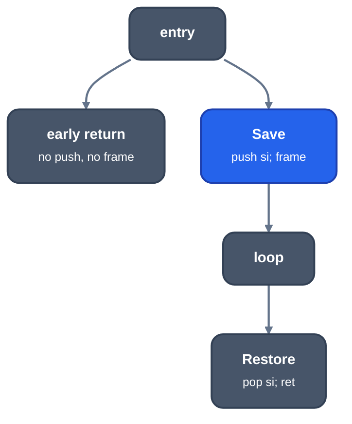

> Generated from the `//!` header of [`crates/backend/llrm-core/src/backend/shrinkwrap.rs`](https://github.com/ali-mosavian/llrm/blob/main/crates/backend/llrm-core/src/backend/shrinkwrap.rs); edit the header, not this file.
<!-- src: crates/backend/llrm-core/src/backend/shrinkwrap.rs sha256:dbb07dba7fb3c8f752c922bd12136f3b51c338f84fdc7b0941b092b37ae1e904 -->

# shrinkwrap

Sets up a procedure's frame and kept registers where they are first needed,
not at the entry, and takes them back only on the returns that path reaches.

## How it works
The frame and the registers a procedure keeps are one piece of work: set up
at the top of one Save block, taken back before the return of one Restore
block. [`crate::backend::saverestore`](saverestore.md) finds the two blocks as LLVM's
`ShrinkWrapImpl` does (the nearest blocks that dominate and post-dominate
every use, outside any loop, no hotter than the entry); this module says
which blocks use the frame or a kept register and lays the result out for
`masm`.

A path that never reaches Save pays nothing: no push, no frame, a bare
`ret`. There is one epilogue, so no return is copied to give a path its own.



*One Save, one Restore*

A wrap is refused where the placement cannot be used as it is:

- The Restore does not end in a return (the epilogue would sit before a
  jump).
- Some block the Save reaches is also reached around it, for the frame and
  wherever the stack pointer addresses the frame cells, so a block would be
  entered at two stack depths.

Where the entry uses the frame, the registers alone are saved late (the
frame stays at the entry, before them). No register is set up above the
frame, since the frame's cells sit just below the arguments and a push
before the reserve would cover them: the frame comes first at Save and last
back at Restore.

## Example
The pass places pieces while masm builds the procedure, after LIR is
final, so its result is in the assembly, not in a LIR dump. A function that
returns `k` at once when `n` is 0 and otherwise loops over calls to `g`:

```asm
f_ proc near
L0_0:
    or eax, eax
    je L0_13          ; early return: no push, no pop
L0_2:
    push ecx          ; set-up in the home block
    push ebx
    push esi
    ; ... loop with `call g_`
L0_14:
    mov eax, edx
    pop esi           ; taken back only on this return
    pop ebx
    pop ecx
    ret
L0_13:
    mov eax, edx
    ret
f_ endp
```

The three pushes sit in `L0_2`, which the early return does not reach, and
the early return leaves with a bare `ret`.

From `-S` of a C function (`if (n == 0) return k;` then a loop calling `g`)
at -O2 -m32; the comments are added.

## Runs
`wrapped` runs when masm builds a procedure's items, for a procedure that
saves a register or has a frame, whose blocks are all reachable from the
entry, and that returns. The frame is not moved in an interrupt handler, a
runtime entry frame, a procedure with a stack check or one with inline code.
Registers are not wrapped in an interrupt handler or a runtime entry frame.
There is no level switch beyond that.

DEVIATE 1: LLVM's `postShrinkWrapping` splits the restore block so that the
paths that need nothing skip it; masm makes no new block, so a placement
that asks for the split is refused (`saverestore`'s DEVIATE 2).

## See also
LLVM's
[`ShrinkWrap`](https://github.com/llvm/llvm-project/blob/d1106deb71cc81016406a1917d0508d2df296266/llvm/lib/CodeGen/ShrinkWrap.cpp).
