> Generated from the `//!` header of [`crates/codegen/llrm-codegen/src/backend/slots.rs`](https://github.com/ali-mosavian/llrm/blob/main/crates/codegen/llrm-codegen/src/backend/slots.rs); edit the header, not this file.
<!-- src: crates/codegen/llrm-codegen/src/backend/slots.rs sha256:f6f8eec7262ddadad15879804d68aee935b5ba2be6bb45b0b9d923eece3c2a24 -->

# slots

Lets two values share one frame slot when they are never live together, so
a frame holds the most that is live at once, not the sum of all spills.

## How it works
A slot (`Color`) is its home, the capacity in bytes of the largest holder,
and the interval each holder occupies. `fits` accepts a new holder when the
slot is big enough and its interval overlaps no holder's. `choose` returns
the first slot listed in `partners` (homes the caller prefers) that fits,
else the first slot that fits, else none, and the caller opens a new slot.
`moved` rewrites a body's frame cells when slots are laid out again, each
cell keeping its place in its slot and taking the new slot's tag.

```mermaid
%%{init: {'theme':'base','themeVariables':{'fontFamily':'Segoe UI, Helvetica Neue, Arial, DejaVu Sans, sans-serif','fontSize':'15px','textColor':'#64748b','titleColor':'#64748b','gridColor':'#94a3b8','sectionBkgColor':'transparent','sectionBkgColor2':'transparent','altSectionBkgColor':'transparent','taskTextColor':'#ffffff','taskTextOutsideColor':'#64748b','taskTextLightColor':'#ffffff','taskTextDarkColor':'#ffffff','doneTaskBkgColor':'#16a34a','doneTaskBorderColor':'#166534','activeTaskBkgColor':'#2563eb','activeTaskBorderColor':'#1e40af','critBkgColor':'#dc2626','critBorderColor':'#991b1b','taskBkgColor':'#475569','taskBorderColor':'#334155','todayLineColor':'transparent'},'gantt':{'barHeight':34,'barGap':12,'topPadding':48,'leftPadding':150,'fontSize':14,'sectionFontSize':14,'numberSectionStyles':2}}}%%
gantt
  dateFormat X
  axisFormat %s
  tickInterval 1second
  section slot A (4 bytes)
  x :done, t10, 1, 2
  y∶ shares A with x :done, t11, 4, 5
  section slot B (4 bytes)
  z overlaps both∶ own slot :crit, t12, 2, 4
```

*Slots shared by intervals that do not overlap*

## Example
None: this is a helper that answers one question per call and has no output
of its own. Its effect shows in the spill slots of the `spiller` and
`ssaspill` examples.

## Used by
- `crate::backend::spiller`, which shares spill slots by the live range of
  each spilled value and prefers the slot of a related value, and
  `slots_colored`, which does so once over the allocation kept.
- [`crate::backend::isel`](isel.md), which shares the slots of block locals by their
  lifetimes.
