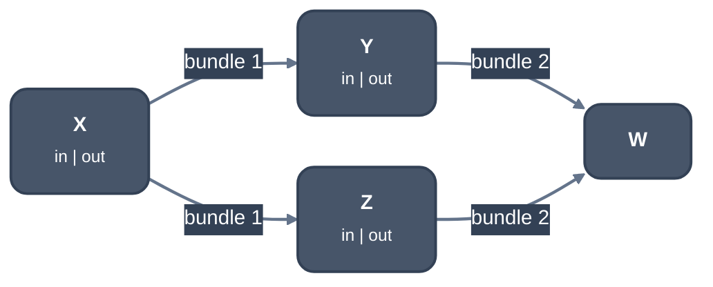

> Generated from the `//!` header of [`crates/codegen/llrm-codegen/src/backend/spillplacement.rs`](https://github.com/ali-mosavian/llrm/blob/main/crates/codegen/llrm-codegen/src/backend/spillplacement.rs); edit the header, not this file.
<!-- src: crates/codegen/llrm-codegen/src/backend/spillplacement.rs sha256:30bd8cf9dbe007d8b1926f5816e32f9930e7dbc43a2628243bf8b192f70cb190 -->

# spillplacement

Decides, for each value being split, which edge bundles hold it in a
register and which on the stack.

## How it works
An edge bundle is the unit that is either all register or all stack. Each
block has an entry and an exit node; the exit of a block and the entries of
its successors are joined into one bundle.

*Edge bundles join a block's exit to its successors' entries*

Blocks bias the bundles at their borders (`Constraint`): `PrefReg` toward a
register, `PrefSpill` toward the stack, `MustSpill` where the register is
occupied. The bias is weighted by the block's frequency, taken from its loop
depth. A block the value only passes through links its entry and exit
bundles with its frequency as the weight, so the two settle together.

A bundle is a node with a value of -1 (stack), 0 or 1 (register), set by
comparing the weight against and toward a register, plus the weight of
linked bundles already settled, with a dead zone (`threshold`) around a tie.
Changing a node queues the bundles linked to it that disagree. `iterate`
runs this to a fixed point, bounded at ten times the number of bundles in
updates. A bundle joining more than a hundred blocks needs a stronger pull
before it chooses a register. `finish` returns the bundles that settled in a
register.

The result drives `crate::backend::splitkit`: blocks whose borders are in
registers form the region a piece holds.

## Example
None: this module answers a placement query for `splitkit` and prints
nothing, and the tests build bodies in code and assert on the bundles. Read
`splitkit` for the effect.

## Runs
Not a pass: `crate::backend::splitkit` queries it for each value it
splits, and `floatalloc` asks for the bundles of a body, at every -O level.

## Provides
`edge_bundles`: the bundles of a body, a fact depending only on block labels
and successors, so every body a split makes of the original shares them.
`Placement`: one placement query over those bundles.

## See also
LLVM's
[`EdgeBundles`](https://github.com/llvm/llvm-project/blob/llvmorg-18.1.8/llvm/lib/CodeGen/EdgeBundles.cpp)
and
[`SpillPlacement`](https://github.com/llvm/llvm-project/blob/llvmorg-18.1.8/llvm/lib/CodeGen/SpillPlacement.cpp).
