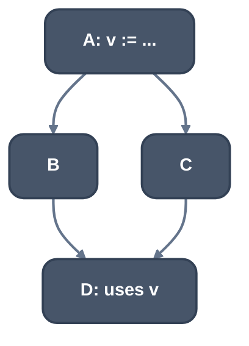
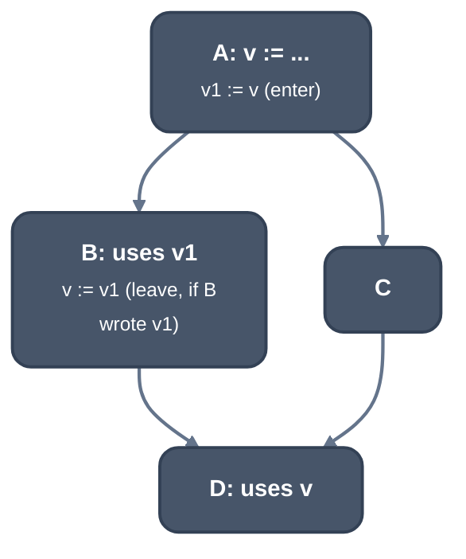

> Generated from the `//!` header of [`crates/backend/llrm-core/src/backend/splitkit.rs`](https://github.com/ali-mosavian/llrm/blob/main/crates/backend/llrm-core/src/backend/splitkit.rs); edit the header, not this file.
<!-- src: crates/backend/llrm-core/src/backend/splitkit.rs sha256:8decf20dc07891a21b5dcda469cafb1631b2023fb384dff54a3b40966aa3dd18 -->

# splitkit

Splits a live range into pieces held in registers where that pays, instead
of spilling all of it.

## How it works
When the allocator cannot place a value it first tries to split it. Three
strategies choose where a piece holds the value, in order:

- `local`: for a value live in one block, the longest run of references that
  some candidate register is free across, when that is at least two and not
  all of them (`tryLocalSplit`).
- `placed`: by region (`tryRegionSplit`). For each candidate register,
  [`crate::backend::spillplacement`](spillplacement.md) settles which edge bundles hold the
  value in a register, weighting blocks by frequency against the
  interference of that register. The best candidate's region comes first,
  and the compact region the use clusters form takes the uses left over.
  Each candidate meets a live block once: a dense table of the value's
  blocks (`cost::Frame`, LLVM's `SplitAnalysis` block table) holds their
  frequencies, references and neighbours, a candidate's interference is
  asked per block when first needed, and a `Region` is built only for the
  best candidate and the compact one. `LLRM_CHECK_SPLIT` holds the result to
  the region-per-candidate scan (`placed_scan`).
- `per_block`: if no region is found, each block naming the value at least
  twice holds it from its first reference to its last (`tryBlockSplit`).

A `Split` finds the value's live blocks and references once for all of
these strategies and `pays`.

`pays` keeps a region only if the references it holds save more than the
copies it adds. A reference saves what a reload would cost, less what its
instruction folds as a memory operand, and each crossing costs a copy, both
weighted by loop depth. A region that holds the value's whole range is not a
split.

`carved` (`SplitEditor`) makes a region: a fresh value for the piece, read
inside the region, joined by copies at each crossing.

*Before: v is used in B and D*

*After splitting region {B}*

An edge copy goes at the end of a source with one successor, else at the
start of a target whose predecessors all need the same copy, else in a new
block on the edge. A copy to leave is omitted if the piece never writes the
value.

`loop_bases` is a separate use of the same editor: a spilled address operand
(base, index or selector) used inside a natural loop and outside it is
carved into the loop as a piece, so the loop reads it from a register once.

## Example
None: the tests build bodies in code and assert on structure, and a stage
dump does not say which copy a split made. Read the figures above for the
shape.

## Runs
Inside the register allocator ([`crate::backend::allocate`](allocate.md)), at the split
stage of a value that no register took and no eviction made room for; the
pieces and the rest compete again. A piece splits again only while its live
blocks strictly shrink, so splitting ends. `loop_bases` runs only as a
candidate body when the allocation search is on (`-fallocation-search`).

## See also
LLVM's
[`SplitKit`](https://github.com/llvm/llvm-project/blob/llvmorg-18.1.8/llvm/lib/CodeGen/SplitKit.cpp)
and the [greedy
allocator](https://github.com/llvm/llvm-project/blob/llvmorg-18.1.8/llvm/lib/CodeGen/RegAllocGreedy.cpp).
