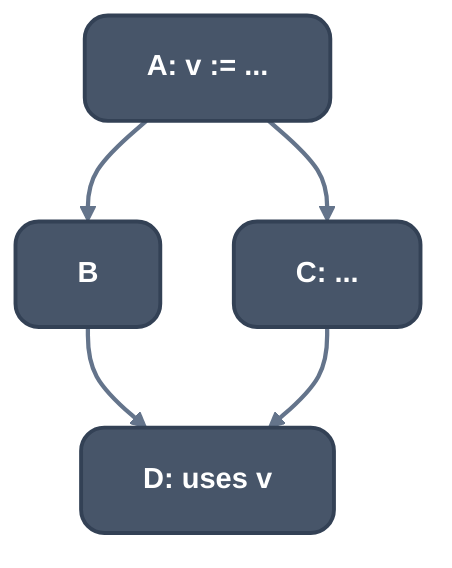
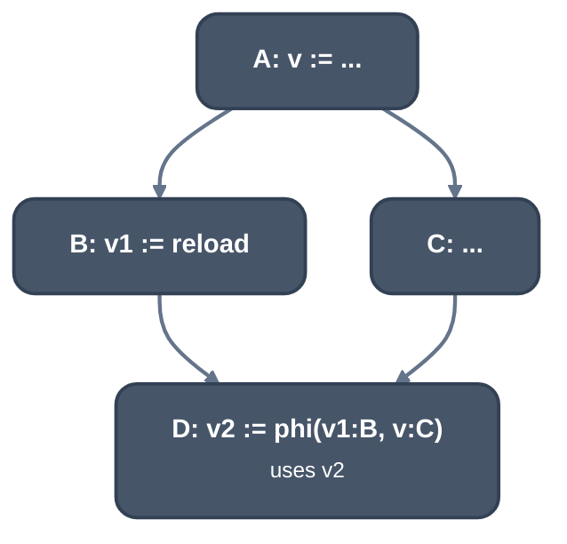

> Generated from the `//!` header of [`crates/backend/llrm-core/src/backend/ssarepair.rs`](https://github.com/ali-mosavian/llrm/blob/main/crates/backend/llrm-core/src/backend/ssarepair.rs); edit the header, not this file.
<!-- src: crates/backend/llrm-core/src/backend/ssarepair.rs sha256:b629d57af1be0f25414f1c5f97f73aff3befed46ea5d7452567ece8e60e1ce42 -->

# ssarepair

Restores SSA after the spiller gave some values more than one definition.

## How it works
A reload brings a value back under the same name, so the value has several
definitions, and every use after a reload must read it, or a phi where two
definitions meet. This is the classic construction (Cytron et al.; Braun et
al. 2013 reach the same result on the fly):

1. Phis go at the iterated dominance frontier of each redefined value's
   definitions, pruned to blocks where the value is live in.
2. Renaming walks the dominator tree with a stack of names per value.

A definition is a reload when the instruction says so (`spill_reload` or
`rematerialized`) and defines one of the redefined values. The first
definition keeps its name and each reload is named afresh. A block that
holds the value in no register on entry (`held`) reloads it before every
use, so it needs no phi.

*Before: v has one definition*

*After: a reload in B and a phi in D*

`simplified` removes the phis whose arguments are all one value (or the phi
itself) and renames every use to that value, repeated to a fixed point
because one removal can make another phi trivial.

## Runs
Inside [`crate::backend::ssaspill`](ssaspill.md): `simplified` first, `repaired` last.
