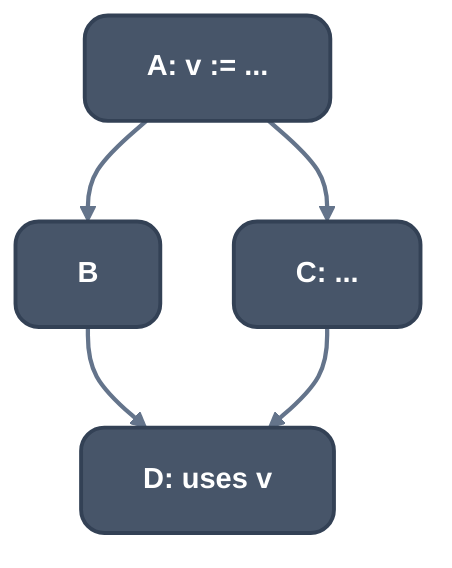
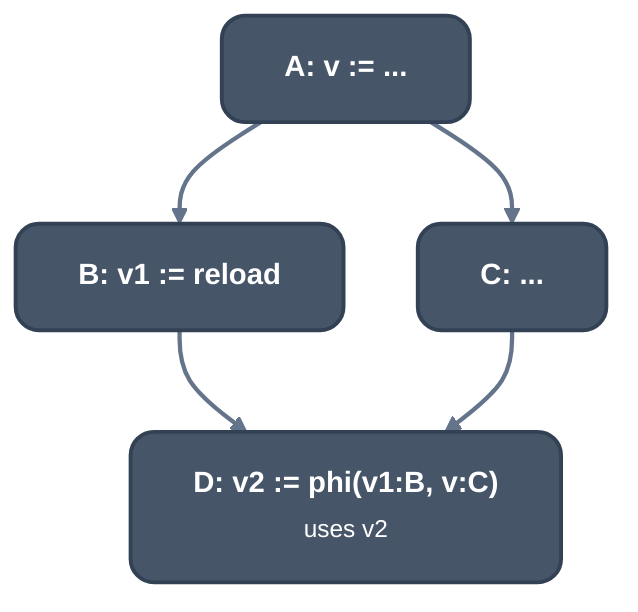

> Generated from the `//!` header of [`crates/backend/llrm-core/src/backend/ssarepair.rs`](https://github.com/ali-mosavian/llrm/blob/main/crates/backend/llrm-core/src/backend/ssarepair.rs); edit the header, not this file.
<!-- src: crates/backend/llrm-core/src/backend/ssarepair.rs sha256:01e18105057481eb02923b25393cf6e6007456ab3e51b8f7c14a0f49bb18f761 -->

# ssarepair

Restores SSA after the spiller gave some values more than one definition.

## How it works
A reload brings a value back under the same name, so the value has several
definitions, and every use after a reload must read it, or a phi where two
definitions meet. This is the classic construction (Cytron et al.; Braun et
al. 2013 reach the same result on the fly):

1. Phis go at the iterated dominance frontier of each redefined value's
   definitions, pruned to blocks where the value is live in.
2. Renaming walks the dominator tree with a stack of names per value.

A definition is a reload when the instruction says so (`spill_reload` or
`rematerialized`) and defines one of the redefined values. The first
definition keeps its name and each reload is named afresh. A block that
holds the value in no register on entry (`held`) reloads it before every
use, so it needs no phi.



*Before: v has one definition*



*After: a reload in B and a phi in D*

`simplified` removes the phis whose arguments are all one value (or the phi
itself) and renames every use to that value, repeated to a fixed point
because one removal can make another phi trivial.

## Example
`y11.1` is live across a call in one arm of an `if`. The spiller stores it
before the call and reloads it after it, and repair gives the join a phi.
Before, the spiller's input:

```lir
═══ _f@3 · SharedConstants · m16 ═══════════════════════════════════════════════
B1  ← B2 B3  → exit                                               ×1.0
    #14  t16        = phi         B2: y12.2, B3: y12.1
; ...
    #21  t23        = movsx.i32   y11.1:i16
    #22  t3.1       = add.i32     t22, t23

B2  ← B0  → B1                                                    ×0.5
    #24  t14@eax    = call        far _g@3(y4.1@eax)
    #25  y12.2      = add.i32     y12.1, t14
    #26               jmp         B1
```

After, with the reload and the repaired phi:

```lir
═══ _f@3 · SsaSpill · m16 ══════════════════════════════════════════════════════
B1  ← B2 B3  → exit                                               ×1.0
    #14  t16        = phi         B2: y12.2, B3: y12.1
    #31  t25        = phi         B2: t29, B3: y11.1
; ...
    #21  t23        = movsx.i32   t25:i16
    #22  t3.1       = add.i32     t22, t23

B2  ← B0  → B1                                                    ×0.5
    #34               store.i16   [slot3], y11.1                        ; spill
    #35  t28        = load.i32    [slot0]                               ; reload
    #24  t14@eax    = call        far _g@3(t28@eax)
    #25  y12.2      = add.i32     y12.1, t14
    #36  t29        = load.i16    [slot3]                               ; reload
    #26               jmp         B1
```

The arm through the call reads the reload `t29`, the other arm still has
`y11.1`, so the use in the join reads the phi `t25`.

From `ISEL_DUMP=1 LLRM_CANDIDATES=spiller` of a C function with
`if (c) s += g(a);` and seven loads from `p`, at -O2 -m16, trimmed.

## Runs
Inside [`crate::backend::ssaspill`](ssaspill.md): `simplified` first, `repaired` last.
