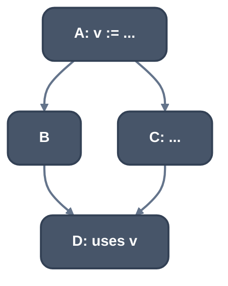
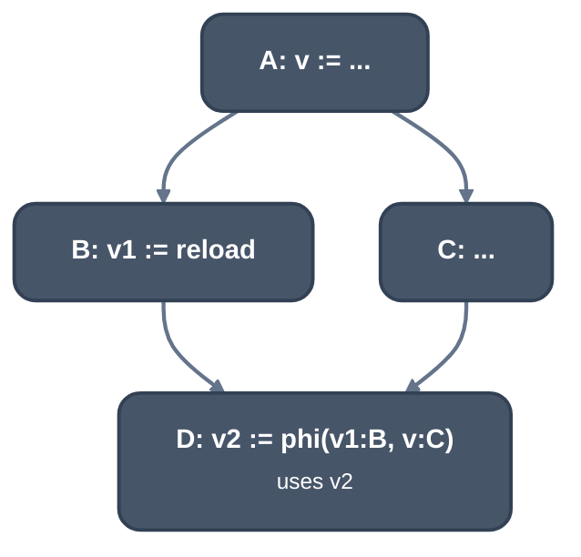

> Generated from the `//!` header of [`crates/backend/llrm-core/src/backend/ssarepair.rs`](https://github.com/ali-mosavian/llrm/blob/main/crates/backend/llrm-core/src/backend/ssarepair.rs); edit the header, not this file.
<!-- src: crates/backend/llrm-core/src/backend/ssarepair.rs sha256:ff37582ea0169b4e705447d54438de440cd853aac1197bca2cf866bb2cf17fa5 -->

# ssarepair

Restores SSA after the spiller gave some values more than one definition.

## How it works
A reload brings a value back under the same name, so the value has several
definitions, and every use after a reload must read it, or a phi where two
definitions meet. This is the classic construction (Cytron et al.; Braun et
al. 2013 reach the same result on the fly):

1. Phis go at the iterated dominance frontier of each redefined value's
   definitions, pruned to blocks where the value is live in.
2. Renaming walks the dominator tree with a stack of names per value.

A definition is a reload when the instruction says so (`spill_reload` or
`rematerialized`) and defines one of the redefined values. The first
definition keeps its name and each reload is named afresh. A block that
holds the value in no register on entry (`held`) reloads it before every
use, so it needs no phi.



*Before: v has one definition*



*After: a reload in B and a phi in D*

`simplified` removes the phis whose arguments are all one value (or the phi
itself) and renames every use to that value, repeated to a fixed point
because one removal can make another phi trivial.

## Example
`v5` and `v6` are live across a call in one arm of an `if`. The spiller
stores them before the call and reloads them after it, and repair gives the
join a phi for each. Before, the spiller's input:

```lir
=== FarIndirectCalls
    block 0x0013
      v15 := phi 0x001f:v12 0x001c:v14
      0x0019  v21 := add v20, v5  ; inserted
      0x001a  v22 := add v21, v6  ; inserted
    block 0x001c
      0x001c  call   ; inserted; requires v3@AX; delivers v13@EAX; clobbers ...
      0x001d  v14 := add v12, v13  ; inserted
      0x001e  jmp   ; inserted
```

After, with the reloads and the repaired phis:

```lir
=== SsaSpill
    block 0x0013
      v15 := phi 0x001f:v12 0x001c:v14
      v23 := phi 0x001c:v26 0x001f:v5
      v24 := phi 0x001c:v27 0x001f:v6
      0x0019  v21 := add v20, v23  ; inserted
      0x001a  v22 := add v21, v24  ; inserted
    block 0x001c
      0x001c  [[bp-0x8]] := mov v6  ; inserted
      0x001c  [[bp-0x6]] := mov v5  ; inserted
      0x001c  call   ; inserted; requires v3@AX; delivers v13@EAX; clobbers ...
      0x001d  v14 := add v12, v13  ; inserted
      0x001e  v26 := mov [[bp-0x6]]  ; inserted; spill reload
      0x001e  v27 := mov [[bp-0x8]]  ; inserted; spill reload
      0x001e  jmp   ; inserted
```

The arm through the call reads the reloads `v26` and `v27`, the other arm
still has `v5` and `v6`, so the uses in the join read the phis `v23` and
`v24`.

From `ISEL_DUMP=1 LLRM_CANDIDATES=spiller` of a C function with
`if (c) s += g(a);` and seven loads from `p`, at -O2 -m16, trimmed.

## Runs
Inside [`crate::backend::ssaspill`](ssaspill.md): `simplified` first, `repaired` last.
