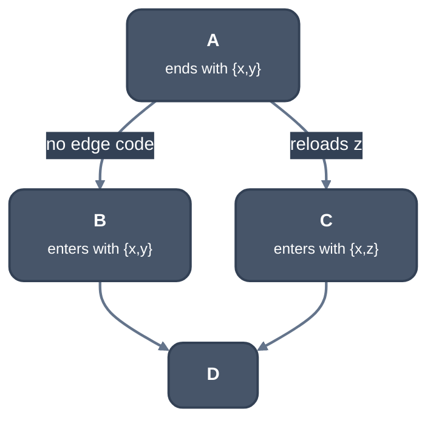

> Generated from the `//!` header of [`crates/backend/llrm-core/src/backend/ssaspill.rs`](https://github.com/ali-mosavian/llrm/blob/main/crates/backend/llrm-core/src/backend/ssaspill.rs); edit the header, not this file.
<!-- src: crates/backend/llrm-core/src/backend/ssaspill.rs sha256:e948ee349f9827c83b0b45fb9ce3efb405e23714d3fbe242ff95d4ddd0ce4dd3 -->

# ssaspill

Spills on SSA, before phi elimination: decides per block which values a
register holds, and where the rest are stored and reloaded.

## How it works
This is Braun and Hack, "Register Spilling and Live-Range Splitting for
SSA-Form Programs" (CC 2009). Values are handled per register file: the
general registers, and the segment registers selector values sit in, each
with the number `k` of registers the file offers. x87 values, pinned values
and the body's inputs are left alone.

Blocks are walked in reverse post-order. At a block's entry, the registers
hold the candidates live in, sorted by whether every predecessor ends with
them (tier 0), some do (1), or none (2), then by next use. A value no
predecessor ends with is taken only if it is a phi result arriving here or
the block is a loop header the pass has admitted; it is otherwise reloaded
where it is read.
A header holds a value only while the loop's reloads that restore it, on any
of its edges, run less than half as often as the reloads at its first uses.

Within a block, Belady's rule decides eviction. Next-use distance is counted
across blocks, with a large constant for a use beyond a loop exit. When an
instruction needs more registers than there are, the held value with the
furthest next use leaves, but a value that is stored where it is defined in
a block that runs about as often as the current one is evicted last, since
its store is already paid for. A use of a value not held is a reload, or a
memory operand where the instruction can read the cell. A value that can be
made again (a constant, an address, a load from a cell nothing changes) is
rematerialised instead of stored.



*Register sets across a diamond*

Where a successor expects a value in a register that a predecessor does not
end with, the edge reloads it, and where the predecessor ends with one the
successor does not take, it leaves on the edge. A phi that the registers
cannot hold becomes a memory phi: its arguments are stored to its slot on
the edge, or at their definitions when they share its slot (a web of phis
where no member is live when another is defined).

Whether a value is kept into a loop, and where its store goes (once after
its definition, or wherever it leaves the registers, whichever runs less)
follow block frequencies, or counts of one where the price is bytes (-Os).
What a later phase will take (x87 compares' AX, constrained registers) is
stated on the instruction as `requires`, `delivers` and `clobbers`, and the
spiller reserves exactly that and nothing else. Reloads redefine the value,
and [`crate::backend::ssarepair`](ssarepair.md) restores SSA.

For selector values, whether a loop's entry loads what the loop reads is
tried none, all, or loop by loop, and the cheaper by the level's measure
(bytes at -Os, then trips on a tie) is kept.

## Example
Eight values loaded from `p` are live across a call to `g`, more than the
general registers hold. Before, the phase's input:

```lir
=== FarIndirectCalls
  f_: 19 instructions
    block 0x0000
      0x0000     ; inserted; delivers v1@EAX
      0x0001  v2 := mov [None v1@unplaced]  ; inserted
      ; ... v3 to v6, loaded the same way
      0x000b  v7 := mov [None v1@unplaced]  ; inserted
      0x000d  v8 := mov [None v1@unplaced]  ; inserted
      0x000f  v9 := mov [None v1@unplaced]  ; inserted
      0x0010  call   ; inserted; requires v2@EAX; delivers v10@EAX; clobbers EAX
      ; ... v11 to v14
      0x0015  v15 := imul v6, v7  ; inserted
      0x0016  v16 := add v14, v15  ; inserted
      0x0017  v17 := imul v8, v9  ; inserted
      0x0018  v18 := add v16, v17  ; inserted
```

After:

```lir
=== SsaSpill
  f_: 21 instructions
    block 0x0000
      0x000b  v7 := mov [None v1@unplaced]  ; inserted
      0x000b  [[bp-0x4]] := mov v7  ; inserted
      0x000d  v8 := mov [None v1@unplaced]  ; inserted
      0x000f  v9 := mov [None v1@unplaced]  ; inserted
      0x000f  [[bp-0x8]] := mov v9  ; inserted
      0x0010  call   ; inserted; requires v2@EAX; delivers v10@EAX; clobbers EAX
      ; ... v11 to v14
      0x0015  v15 := imul v6, [[bp-0x4]]  ; inserted
      0x0016  v16 := add v14, v15  ; inserted
      0x0017  v17 := imul v8, [[bp-0x8]]  ; inserted
      0x0018  v18 := add v16, v17  ; inserted
```

`v7` and `v9` are stored to `[bp-0x4]` and `[bp-0x8]` after their
definitions, and their uses read the slot as a memory operand, so no reload
is needed. The dump prints the loads' addresses as `[None v1@unplaced]`.

From `ISEL_DUMP=1 LLRM_CANDIDATES=spiller` of `int f(int *p)` (`g(p[0])`
plus products of `p[0]..p[7]`) at -O2 -m32.

## Runs
The first machine phase after `far-indirect-calls`, before `phielim`, on the
spiller route only: `machine_with` drops it when the route is not taken. The
route is tried at every level but -O0, and kept where it is cheaper; see
`crate::backend` and `docs/reference/levels.md`. Assembly
drops the route when `until_changed` is set and the run changed nothing.

## See also
[`crate::backend::spiller`](spiller.md) is the counterpart that spills during
allocation, as LLVM's `InlineSpiller` does.
