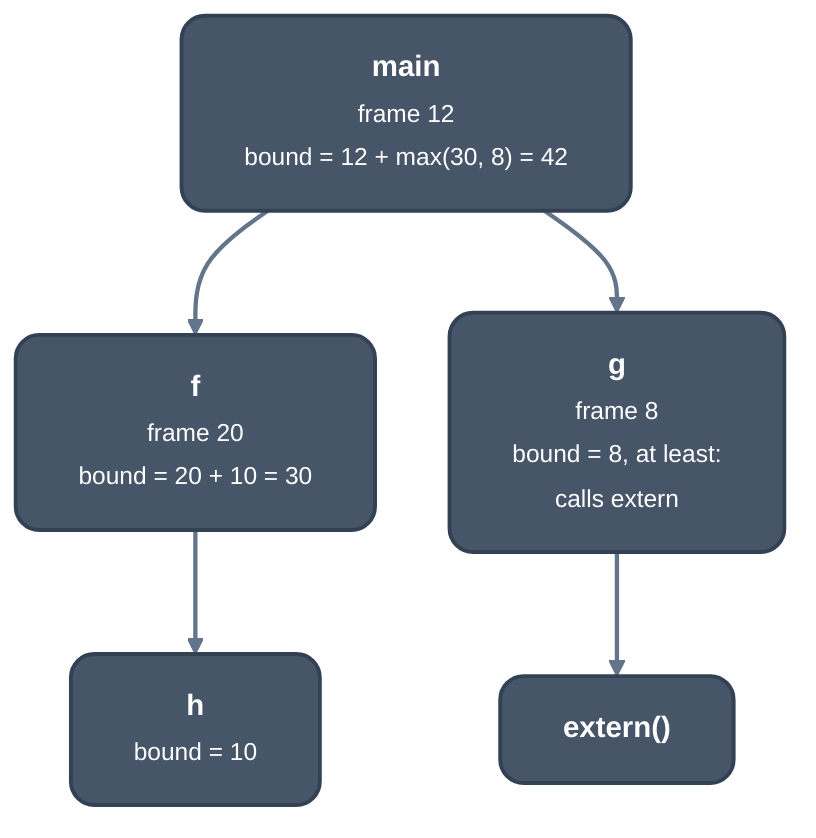

> Generated from the `//!` header of [`crates/codegen/llrm-codegen/src/backend/stackusage.rs`](https://github.com/ali-mosavian/llrm/blob/main/crates/codegen/llrm-codegen/src/backend/stackusage.rs); edit the header, not this file.
<!-- src: crates/codegen/llrm-codegen/src/backend/stackusage.rs sha256:9cb2cb214060606d9e3f58c02c5a1212479c439a440060650d19e79ad368810f -->

# stackusage

How much stack a program may use, as gcc's `-fstack-usage` and
`-Wstack-usage` report it.

## How it works
A procedure's frame is what a call to it leaves on the stack: the return
address, the entry's pushes and locals below BP (`push`, `enter`, `sub sp`),
and the most bytes its call sites have pushed for a call at once
(`outgoing`). Its bound is its frame plus the deepest bound of the
procedures it calls, computed bottom-up over the call graph.



*Stack bound over a call graph*

A bound is `Bytes(n)` (at most n), `AtLeast(n, names)` (a routine the
program does not define adds an unknown amount, so n is a lower bound and
the routines are named), or `Recursive` (a cycle of calls has none).
`deepest` is the largest bound over the procedures nothing calls. `report`
prints each frame and bound; `warnings` names each such root over
`-Wstack-usage=N`.

Two other facts live here. `elide_checks` drops the stack check of a leaf
procedure that no outside code enters (not public, entered only by the
module's own direct calls) when its frame and the module's deepest push stay
within the runtime's red zone. `stack_to_add` is the bytes a frontend adds
to the base stack the runtime links, so the deepest chain fits, or an error
if it cannot fit a stack segment (`stack_limit`: the segment size less
0x1000).

## Example
A program whose `main` calls `f` and `g`, `f` calls `h` and the undefined
`ext`, and `g` calls `ext`:

```text
stack usage, bytes: procedure, its frame, the most it can reach
_f@3  6  >= 6 (and _ext@3)
_g@3  4  >= 4 (and _ext@3)
_h@3  4  4
_main  6  >= 10 (and _ext@3)
```

`_h@3` calls nothing, so its bound equals its frame. `ext` is not defined
in the program, so every procedure that reaches it has only a lower bound,
and the report names it.

From `-fstack-usage` of a C program (`main` calls `f` and `g`; `f` calls
`h` and `ext`; `g` calls `ext`) at -O2 -m16.

## Runs
`elide_checks` is the `stack checks` step of assembly, once per module.
`Usage::of` runs after every module is assembled, only with `-fstack-usage`
or `-Wstack-usage=N`. `stack_to_add` is called by the QB and Nib frontends.

## See also
gcc's `-fstack-usage` and `-Wstack-usage`.
