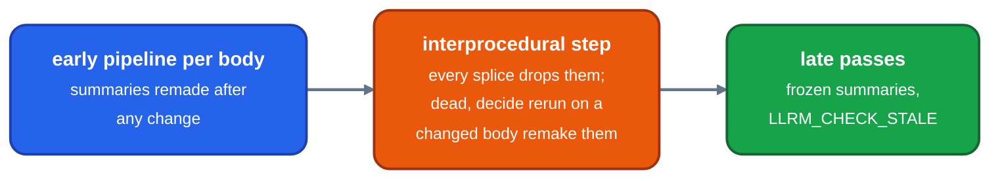

# Summaries at fixed points

Design note, not implemented. For contributors to the pass manager and the interprocedural stage: a way to make module summaries fewer times, and why it is parked.

Proposed in [#1189](https://github.com/ali-mosavian/llrm/pull/1189).

## Where summaries are made

`Summaries` and `GlobalsAA` are required module analyses, so the manager makes them before the next function pass whenever a pass changed a body ([module-analyses](module-analyses.md) makes each remake incremental). After the interprocedural step the module summaries are frozen: passes that add no memory operation (`FunctionPass::adds_memory_operations`) read the frozen ones, and `LLRM_CHECK_STALE` recomputes them after such a pass and checks the held result still covers the fresh one.

*Where summaries are made today*

## What gcc does

gcc makes a function's modref and pure-const summary once, at the end of its early optimisations, callees first ([`passes.def:69`](https://github.com/gcc-mirror/gcc/blob/releases/gcc-13.4.0/gcc/passes.def#L69), [`:102-103`](https://github.com/gcc-mirror/gcc/blob/releases/gcc-13.4.0/gcc/passes.def#L102)); the IPA passes run once over the unit; the inliner merges the callee's summary into the caller's (`ipa_merge_modref_summary_after_inlining`) rather than making it again.

## Proposal

1. Run the early pipeline over bodies callee-first (SCCs bottom-up) and make a body's summary when its pipeline settles.
2. In the interprocedural step, an inline of `c` into `f` leaves `f`'s summary as it is. A summary is already transitive (`_summarized` adds each callee's instantiated summary at its call site), so the held one stays sound. A rerun that only removes memory operations leaves it stale and sound. Passes that renumber parameters or add functions (dead-argument removal, argument promotion, cloning) recompute.
3. One recomputation at the end of the interprocedural step, from which the freeze starts.

Soundness is checked as the freeze is: a fresh summary must be covered by the held one. `Summary::covers` is built for the late passes: a fresh `unknown_*` covers anything, captures are ignored, and slice membership is exact. The early passes need a containment check of their own, with a test that fails on a dropped unknown write.

## Why it is parked

The most any scheme could save was measured by keeping `Summaries` and `GlobalsAA` across every edit of the interprocedural step, which is unsound: under 1% of the -O1 compile. The saving is bounded by that, so the callee-first order, which moves objects, is not worth its risk. Reproduce with `tools/measure.py` and `tools/pass-profile.py` ([compile-time](../working/measurement/compile-time.md)).

Open work on the cost of per-body points-to: [#1166](https://github.com/ali-mosavian/llrm/issues/1166).
