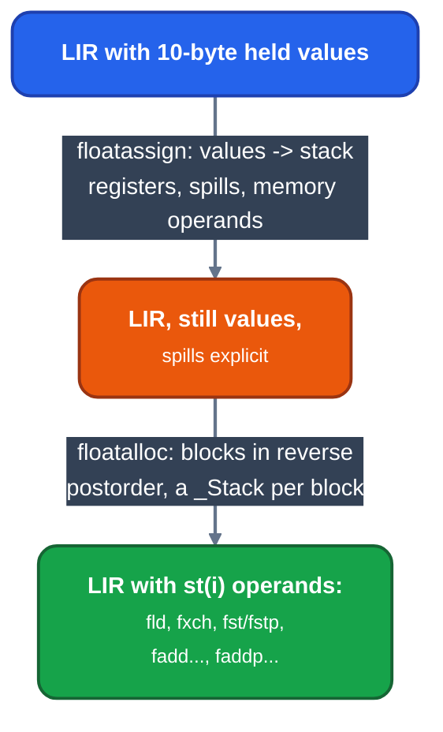

# x87 stack allocation and popping arithmetic

For contributors to the x87 backend. Covers how floating values are assigned to the eight-entry register stack and how a two-operand operation keeps an operand that is still live.

## Two passes

Both run in the machine phases ([backend phases](backend/readme.md)) and only on bodies with floating values.

- `floatassign` ([`floatassign.rs`](backend/floatassign.md)) is the allocation step, as gcc's IRA and LRA are for any register class: it decides which floating values hold one of the eight flat stack registers, and every spill, restore and memory operand it needs comes out explicit. It also materialises a floating-to-integer conversion through an owned temporary, with `wait` around the store in a BASIC module ([native-fpu-waits](../reference/semantics/native-fpu-waits.md)), and reads the integer only if something reads it.
- `floatalloc` ([`floatalloc.rs`](backend/floatalloc.md)) converts that to stack form, as gcc's reg-stack does, and decides nothing: it tracks which value is in which stack slot (`_Stack.values`, top first) and emits the `fld`, `fxch`, `fstp st(i)` and arithmetic that put each operand where the instruction needs it.



*The two x87 passes*

## A two-operand operation

`_Stack::arithmetic` ([`floatalloc.rs`](backend/floatalloc.md)) follows gcc's `handleTwoArgFP`. An operand dies where nothing reads it again, and the result takes its slot.

| Operands | Emitted |
|---|---|
| neither on top, one dies | `fxch` the dying one to the top |
| neither on top, both live | `fld` a copy of the left, which then dies |
| top is the left, right lives | `op st(0), st(i)` (reversed form where the left is the destination) |
| both die | popping form: `faddp`, `fsubp`, ... into the deeper slot |
| the same value twice, still live | copy it; the product replaces the copy, so no exchange |

Subtraction and division take their reversed form (`fsubr`, `fdivr`) when the right operand is the one on top, so operand order is never changed by an exchange. For a value used twice, the copy that is read sooner stays on top.

Initial stack `[right, left]`, both needed later:

```
fld st(1)          ; working copy of left
fld st(1)          ; working copy of right
fsubp st(1),st(0)  ; left - right; the originals stay below the result
```

Neither pass merges arithmetic or changes its order, rounding or storage conversions.

## Across blocks and under pressure

Across a block edge the stack contents are kept per edge bundle: blocks that share an edge share one stack layout, and a value that cannot stay on the stack goes to an 8-byte cell, which rounds it to double. [x87](../machine/register-allocation/x87.md) has the rules and the cases that are refused.

More than eight live values never reaches `floatalloc`: `floatassign` spills one to a ten-byte frame slot in extended format, so no precision is lost, and reloads it where it is read. An instruction that still needs more than eight stack operands is refused.

## See it

`llrm-cc -S` prints the assembly, where the stack form is visible; `--dump DIR` shows MIR only. Tests: `floatalloc_tests.rs`, `floatassign_tests.rs` simulate the allocated stack and assert the stored values.
