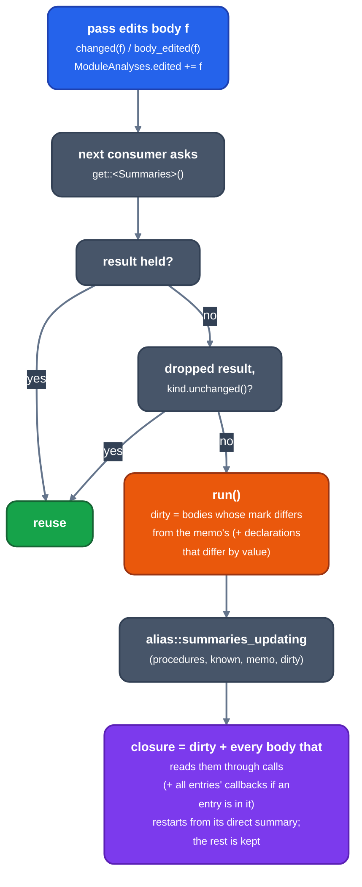

# Module analyses after an edit

For contributors to the pass manager and the interprocedural stage. Explains how `Summaries` and `GlobalsAA` are brought up to date after a body changes instead of being recomputed over the whole module.

## The cost it removes

The interprocedural stage ([`interprocedural.rs`](passes/interprocedural.md)) inlines, specialises and reverts, and each splice reports the body it edited with `ModuleAnalyses::changed` ([`passes.rs`](https://github.com/ali-mosavian/llrm/blob/c341bd6e3de058142c6652d399b8dfeb444eff9b/crates/ir/llrm-mir/src/passes.rs#L1438)). The next consumer of a module analysis would otherwise recompute it over every body. `LLRM_DEBUG=time` shows the `summaries`, `call-effects` and `globals-aa` rows; `tools/pass-profile.py` sums them over the programs ([compile-time](../working/measurement/compile-time.md)).

## Mechanism

*What a body edit costs the next consumer of Summaries*

- `ModuleAnalyses::memo<T>` ([`passes.rs`](https://github.com/ali-mosavian/llrm/blob/c341bd6e3de058142c6652d399b8dfeb444eff9b/crates/ir/llrm-mir/src/passes.rs#L1264)) holds what an analysis keeps for its next run, by type; `invalidate` does not drop it.
- `Summaries::run` ([`manager.rs`](analyses/manager.md)) is `attrsummary::summaries`: each defined function's `memory(...)`, parameter and `GlobalsModRef` facts as a `Summary` ([`attrsummary.rs`](analyses/attrsummary.md)). One pass over the functions, no fixed point, no memo; the attributes come from `functionattrs::post_order` once per component in the walk. Only `ProgramSummaries` still runs `alias::summaries` (the cross-module fixed point).
- `GlobalsAA` ([`globalsaa.rs`](analyses/globalsaa.md)) keeps its per-body contributions in a memo keyed by body and refolds them.
- Analyses that read no body (type ancestry, global sizes, call registers) survive a body edit.
- What a call back into the module may do (`alias::CalledBack`, the entries' summaries added up) counts each slice's owners: an entry whose summary changed moves the slices it gained and lost, and the sum is made again only when a slice gains its first owner or loses its last. Adding every entry up again on each shrink was 545 of GORILLA -O1's 1,039 Minstr for `summaries callbacks` (now 218, same object); `LLRM_CHECK_CALLBACKS=1` checks the incremental sum against a fresh one.

## Between segments, and after the summaries are made

The pass manager cuts a pipeline into segments at each program pass, and the program passes that edit bodies (`Stamp`, `Interprocedural`) make their own `ModuleAnalyses`. Each started from nothing: a run of `Summaries` and `GlobalsAA` worked out every body's facts again, 5 of the 8 runs on bench/sieve at -O1 and the first three of d_faces' 12. `ModuleAnalyses::carried` hands the results held, as results to reuse when worked out again equal, and the memos to the next `ModuleAnalyses` over the module (`ProgramAnalyses::carry`, `uncarry`; `ModuleAnalyses::carrying`). A memo already says what it was made under (the declarations and the globals' facts it read, each body's `mark`), so a run over a carried memo works out only what moved. A position in `edit_log` is of one log: `ModuleAnalyses::log_epoch` names it.

The summaries are made once the interprocedural step is done, and `manager.freeze` holds them past every later pass that says it adds no memory operation (`FunctionPass::adds_memory_operations`), as gcc's passes after IPA read the summaries it made there. Six of those passes (loop-simplify, LCSSA, fold, algebraic, indvars, dead) used the default, `true`, so each edit of theirs dropped the summaries and made them again. They say `false` now; `LLRM_CHECK_STALE=1` recomputes the frozen analyses after such a pass and asserts the held ones still cover them. A pass added to that stretch of the pipeline says what it does, and the test `the_passes_after_the_summaries_add_no_memory_operation` names the list.

d_faces with one allocation, instructions, on main 736e47aab: -O1 4310 M to 4118 M (-4.5%), -O2 4867 M to 4663 M, -O3 5615 M to 5431 M, -Os 4694 M to 4607 M. The object is the same at every level; `tools/identical.py` compares the 66 programs and QCport's 65 modules at -O1, -O2, -O3, -Os and -Omax with the check switches on. `globals-aa` ran 12 times, now 6 (212 to 111 M), and `summaries` direct, values and points-to fell from 123, 104 and 96 M to 51, 50 and 38 M.

A run in which every body is dirty is worked out from nothing (`alias::summaries_updating`): updating what was kept, where nothing is, woke readers and compared changes for 2.7 and 5.2 Minstr more than the run from nothing on the `joins` axis at N=64 (-O2). `alias::whole_runs` counts them for the test.

## Check switch

`LLRM_CHECK_MODULES=1` runs every module analysis again from scratch beside the updated one and asserts the two are equal; the panic names the summaries that differ and the dirty set. Run it over the bench programs and the test programs when changing an analysis that has a memo.

`ProgramSummaries` takes its bodies as `alias::Bodies`: calls by position, and a `Procedure` made only for the body a visit asks for.

## Related

[early-summaries](early-summaries.md) covers what the pipeline does with summaries between edits. [analyses](https://github.com/ali-mosavian/llrm/tree/main/crates/opt/llrm-analysis/src) lists the module analyses.
