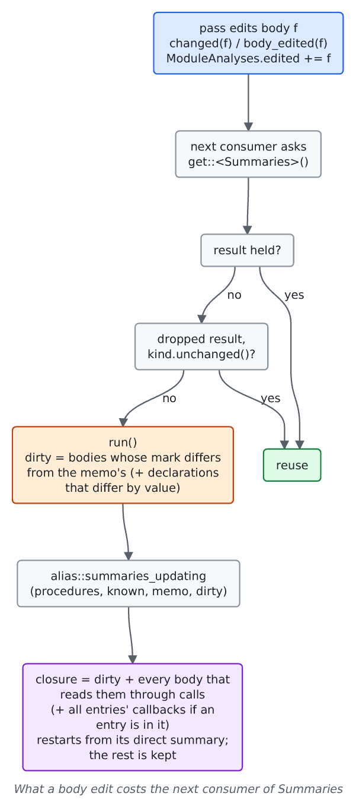

# Module analyses after an edit

For contributors to the pass manager and the interprocedural stage. Explains how `Summaries` and `GlobalsAA` are brought up to date after a body changes instead of being recomputed over the whole module.

## The cost it removes

The interprocedural stage ([`interprocedural.rs`](https://github.com/ali-mosavian/llrm/blob/c341bd6e3de058142c6652d399b8dfeb444eff9b/crates/opt/llrm-transforms/src/interprocedural.rs)) inlines, specialises and reverts, and each splice reports the body it edited with `ModuleAnalyses::changed` ([`passes.rs`](https://github.com/ali-mosavian/llrm/blob/c341bd6e3de058142c6652d399b8dfeb444eff9b/crates/ir/llrm-mir/src/passes.rs#L1438)). The next consumer of a module analysis would otherwise recompute it over every body. `LLRM_DEBUG=time` shows the `summaries`, `call-effects` and `globals-aa` rows; `tools/pass-profile.py` sums them over the programs ([compile-time](../working/measurement/compile-time.md)).

## Mechanism

- `ModuleAnalyses::memo<T>` ([`passes.rs`](https://github.com/ali-mosavian/llrm/blob/c341bd6e3de058142c6652d399b8dfeb444eff9b/crates/ir/llrm-mir/src/passes.rs#L1264)) holds what an analysis keeps for its next run, by type; `invalidate` does not drop it.
- `Summaries::run` ([`manager.rs`](https://github.com/ali-mosavian/llrm/blob/c341bd6e3de058142c6652d399b8dfeb444eff9b/crates/opt/llrm-analysis/src/manager.rs#L139)) keeps each body's calls and exposed-frame facts while the body's `mark` and the declarations are unchanged, and passes the dirty set to `alias::summaries_updating` ([`alias.rs`](https://github.com/ali-mosavian/llrm/blob/c341bd6e3de058142c6652d399b8dfeb444eff9b/crates/opt/llrm-analysis/src/alias.rs#L1080)). A body outside the closure reads nothing inside it, so its summary stands. A change of the globals' facts, an added or removed global, or a missing memo makes it a whole run.
- `GlobalsAA` ([`globalsaa.rs`](https://github.com/ali-mosavian/llrm/blob/c341bd6e3de058142c6652d399b8dfeb444eff9b/crates/opt/llrm-analysis/src/globalsaa.rs)) keeps its per-body contributions in a memo keyed by body and refolds them.
- Analyses that read no body (type ancestry, global sizes, call registers) survive a body edit.

## Check switch

`LLRM_CHECK_MODULES=1` runs every module analysis again from scratch beside the updated one and asserts the two are equal; the panic names the summaries that differ and the dirty set. Run it over the bench programs and the test programs when changing an analysis that has a memo.

## Related

[early-summaries](early-summaries.md) covers what the pipeline does with summaries between edits. [analyses](https://github.com/ali-mosavian/llrm/tree/main/crates/opt/llrm-analysis/src) lists the module analyses.
