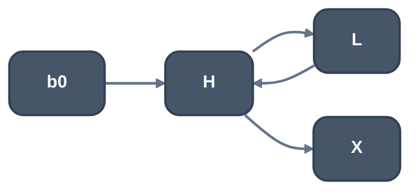
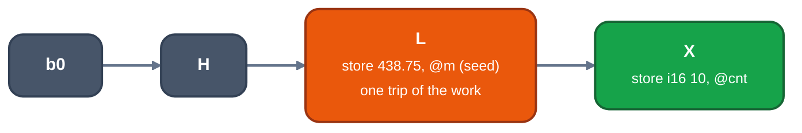

> Generated from the `//!` header of [`crates/opt/llrm-transforms/src/floatloop.rs`](https://github.com/ali-mosavian/llrm/blob/main/crates/opt/llrm-transforms/src/floatloop.rs); edit the header, not this file.
<!-- src: crates/opt/llrm-transforms/src/floatloop.rs sha256:7da1bab69c65817e34f585aea52f48ee5e293a3c2e879dfec99b46259866b432 -->

# floatloop

Runs a counted loop of exact float work in memory as its last trip alone,
from the memory the earlier trips leave, which [`llrm_analysis::floatfacts`](../analyses/floatfacts.md)
proves.

## How it works
The loop is two blocks: a header that tests the counter and may store it,
and a latch of float work that steps the counter and branches back. The
counter is the header's one live phi, affine with a known start and step,
and the trip count is proven. The latch work must not read the counter, and
nothing the loop computes except the counter may be read after it. The exit
has the header as its only predecessor and no phis. Fewer than two trips
leave nothing to save.

`floatfacts::repeated` replays the latch `count - 1` times over the cells
known before the loop. Each cell the latch reads before it writes
(`_carried`) gets a constant store at the top of the latch, holding what the
last trip reads. The final counter is `start + step * count`.



*Before, a loop of 10 trips*



*After, the last trip alone*

The header branch becomes a jump to the latch and the latch's jump goes to
the exit. Uses of the counter after the loop, a phi's included, become the
final number through `SsaUpdater`. The header's phis lose the latch arm and,
left with one input, are that value. The header's counter stores are
repeated before the exit with the final number. What nothing reads is
[`crate::dead`](dead.md)'s.

## Example
Before, the counter stored in the header and 48.75 added ten times:

```mir
b1:
  %i = phi i16 [ 0, %b0 ], [ %n, %b2 ]
  store i16 %i, ptr getelementptr (i8, ptr @m, i16 4)
  %c = icmp slt i16 %i, 10
  br i1 %c, label %b2, label %b3

b2:
  %v = load float, ptr @m
  %w = fadd float %v, 4.875000e+01
  store float %w, ptr @m
  %n = add i16 %i, 1
  br label %b1
```

After:

```mir
b2:
  store float 4.387500e+02, ptr @m
  %v = load float, ptr @m
  %w = fadd float %v, 4.875000e+01
  store float %w, ptr @m
  %n = add i16 0, 1
  br label %b3

b3:
  store i16 10, ptr getelementptr (i8, ptr @m, i16 4)
  ; ...
```

One trip runs from the 438.75 the first nine leave, and the counter is
stored as 10.

From unit test `test_exact_loop_runs_its_last_trip_alone` in
`floatloop_tests.rs`.

## Runs
Per-body pipeline, after `lcssa` and before `hoist`: LICM may move an
invariant preparation out of the loop afterwards. Skipped for a body with
no float value (`floatfacts::touches`) and for one with no loop of the
shape above whose latch touches one (`float_loop`, seen without the solve;
no gcc or LLVM pass is its counterpart); `LLRM_CHECK_FLOATSKIP=1` runs it
anyway and asserts it changed nothing. On at -O1 and up;
`Options::floatloop` turns it off for bisection. See
`docs/reference/levels.md`.

## Needs
[`llrm_analysis::floatfacts`](../analyses/floatfacts.md) (`manager::FloatFacts`), `consts`,
`induction`, `manager::writes`, and the loop shape that
[`crate::loopsimplify`](loopsimplify.md) and [`crate::lcssa`](lcssa.md) leave.

## Keeps
Nothing when it changes a loop; everything otherwise.

## See also
No LLVM or GCC counterpart. IndVarSimplify rewrites exit values and SCCP
folds the effects of a computable loop.
