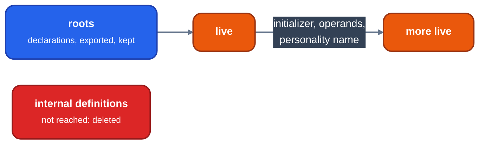

> Generated from the `//!` header of [`crates/opt/llrm-transforms/src/globaldce.rs`](https://github.com/ali-mosavian/llrm/blob/main/crates/opt/llrm-transforms/src/globaldce.rs); edit the header, not this file.
<!-- src: crates/opt/llrm-transforms/src/globaldce.rs sha256:9663c5bc5c2e7a1d4b4b5ca72fea3ff7f3696ff38eb0523916898e1003bcf36a -->

# globaldce

Delete the module's own bodies and variables that nothing live names.

## How it works
A definition is a root when it is not deletable: a declaration, a global
with external linkage, one the program exports (an entry point), or one
named in `program.exports.kept`. Only internal and private definitions can
be deleted, since no other module can name them.

Liveness is a worklist from the roots. A live variable makes live every
global its initializer names; a live function makes live every global named
by its constant operands and its personality. Names are found through
constant expressions (`globalsaa::embedded`), and a name in one module also
makes live the definition the program resolves it to in another.



*Liveness from the roots*

A declaration is never deleted: naming one asks the linker for it.
Deleting renumbers the module's globals, so the program analyses are
invalidated.

## Example
Before, with `@entered` an entry point and `@kept` in `exports.kept`:

```mir
@table = internal global [2 x i16] [i16 1, i16 2]
@unused = internal global i16 7
@kept = internal global i16 9
declare i16 @outside()

define internal i16 @helper() {
b:
  %v = load i16, ptr @table
  ret i16 %v
}

define internal i16 @orphan() {
b:
  %v = load i16, ptr @unused
  %w = call i16 @outside()
  ret i16 %v
}

; ... @entered, and @f which calls @helper
```

After:

```mir
@table = internal global [2 x i16] [i16 1, i16 2]
@kept = internal global i16 9

declare i16 @outside()

define internal i16 @helper() {
b:
  %v = load i16, ptr @table
  ret i16 %v
}

; ... @entered and @f unchanged
```

`@orphan` and the `@unused` it alone reads are deleted; the declaration
stays.

From unit test `test_what_nothing_live_names_is_deleted` in
`globaldce_tests.rs`.

## Runs
Once, as a program pass after the interprocedural step, so the bodies that
inlining made unreachable go before selection. Not run at -O0.

## See also
LLVM's GlobalDCE.
