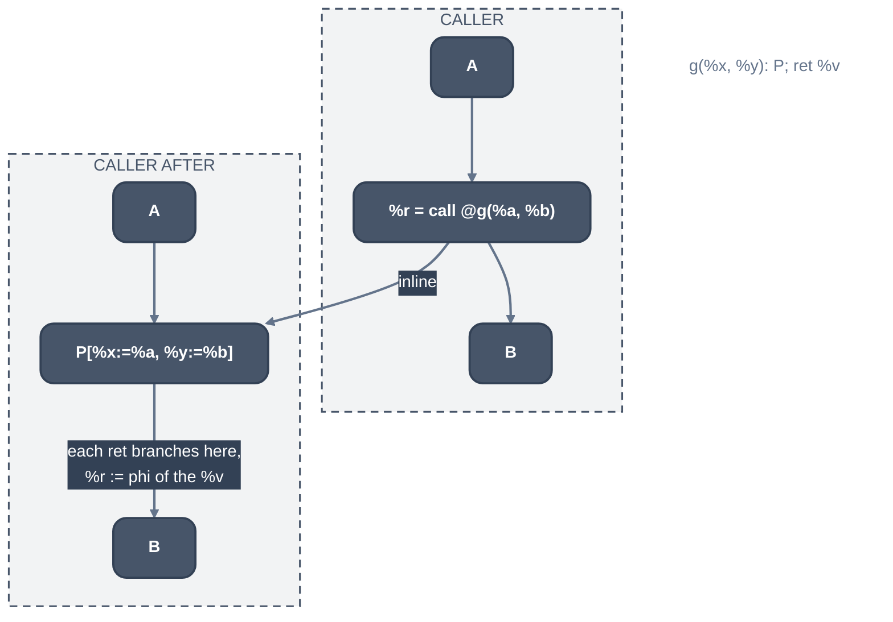

> Generated from the `//!` header of [`crates/opt/llrm-transforms/src/inline.rs`](https://github.com/ali-mosavian/llrm/blob/main/crates/opt/llrm-transforms/src/inline.rs); edit the header, not this file.
<!-- src: crates/opt/llrm-transforms/src/inline.rs sha256:2f8b2e86d659a21cd82d96d563faea08d3abc41d912a8bbb6b68e45cf7d231b5 -->

# inline

Whole-module MIR inlining: chooses the calls worth replacing by a copy of
the callee's body, and makes the copies.

## How it works
Inlining is a CFG operation: the caller's block is split at the call, the
callee's blocks are cloned in (`llrm_mir::splice`), formals become the
actual operands, and each `ret` joins the continuation. The body pipeline
then simplifies the result. A clone keeps its original's metadata and its
memory operations; a body that reads or writes through its arguments or its
own frame inlines like any other.

*Inlining a call to g*

A callee is a candidate (`candidates`) when it can be cloned (`cloneable`:
defined, `splice` carries it, it returns, it is not recursive, not
`noinline`, and does not call `setjmp`-like functions), and then by price.
The body's semantic operations (not phis, jumps, returns) must fit the
budget `max(6, min(24, call_cost / 2)) * limit / 225` (`Threshold::budget`),
and the work copied at every site beyond the last must stay below the calls
removed, in the target's clocks, or in code bytes where size outranks speed
(`-Os`). A routine marked `alwaysinline` is a candidate at any size and
`noinline` at none; `inlinehint` scales the budget by 325/225. A body held
only to inline from (`available_externally`) is a candidate at any size.

A public callee, or one whose address is taken, stays defined; a private one
goes with its last site. The last call of a function nothing else reaches
moves the body whatever its price (`Candidate::moved`), up to
`LAST_CALL_OPERATIONS`, where `Threshold::last` is on
(`-finline-functions-called-once`).

`constant_sites` admits a call whose actual is a known constant even where
the body is not a candidate for every caller: `folded` prices what the known
actuals remove from the body, and the copy is taken when what is left costs
no more than the call, weighted by the site's frequency (a hot site, in a
loop, by 525/225). The original stays for the other callers.

A copy is allowed (`fits`, `grows_within_limits`) only where

- the call's function type is the callee's and the callee is not variadic;
- the stack the copy adds stays within `FRAME_LIMIT` (256 bytes), and no
  body that allocates is copied into a recursive caller;
- a parameter the callee `releases` is passed an object the caller owns;
- the caller's growth stays within GCC's `caller_growth_limits`, whose
  `large-function-insns` is the allocator's knee (`ALLOCATION_KNEE`), not
  2700, and a body moved into a caller already past the knee is refused.

`expanded_all` decides every site of a caller first (`Plan`), tracking the
caller's size and stack as they grow and including what is inlined into each
copy, then splices from the last site to the first so each split moves only
what is left of its block. `byval` arguments the callee writes are copied
first.

Recursion is separate: `inlined_into_itself` gives a recursive function
copies of itself (GCC's `recursive_inlining`) to depth 8, while the body
stays under 450 operations and the call's block runs on more than a tenth of
the function's calls;
`peeled_into` gives a caller one copy of a recursive callee. `UnitSize`
bounds the unit's growth as `inline-unit-growth` (40%).

## Runs
Library of [`crate::interprocedural`](../analyses/interprocedural.md), which runs it once every body has
reached its fixed point, then sends each changed body back through the
pipeline (`inline<N>`, `ipa-inline<N>.`; `LLRM_DEBUG=inline` logs each
verdict). Off at -O0; the threshold is 90 at -O1 and -Og, 225 at -O2, 250 at
-O3 and -Omax. Per-level budgets are in `docs/reference/levels.md`.

## Needs
[`crate::profit`](profit.md) (operation prices, block frequencies),
[`llrm_analysis::consts`](../analyses/consts.md) (`folded`), and the module's call graph and
callee effects.

## See also
LLVM's
[`InlineCost.cpp`](https://github.com/llvm/llvm-project/blob/d1106deb71cc81016406a1917d0508d2df296266/llvm/lib/Analysis/InlineCost.cpp)
and GCC's
[`ipa-inline.cc`](https://github.com/gcc-mirror/gcc/blob/releases/gcc-13.4.0/gcc/ipa-inline.cc).
