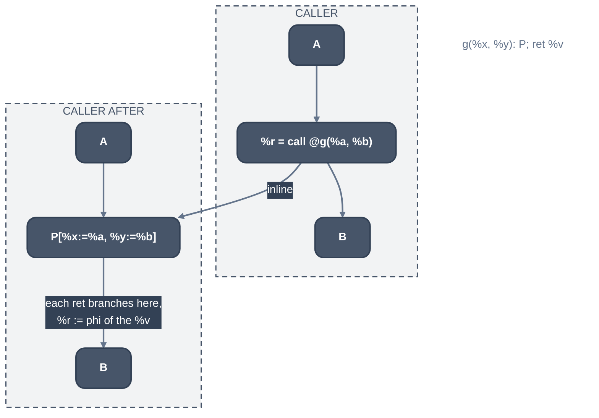

> Generated from the `//!` header of [`crates/opt/llrm-transforms/src/inline.rs`](https://github.com/ali-mosavian/llrm/blob/main/crates/opt/llrm-transforms/src/inline.rs); edit the header, not this file.
<!-- src: crates/opt/llrm-transforms/src/inline.rs sha256:6dd5e160af710284b4c7240c2e3972e49b98cdd460fb2181a4f441a11cc355b2 -->

# inline

Whole-module MIR inlining: chooses the calls worth replacing by a copy of
the callee's body, and makes the copies. A call costs its own instructions
and hides the callee from the caller's passes; the copy saves the first and
exposes the second.

## How it works
Inlining is a CFG operation: the caller's block is split at the call, the
callee's blocks are cloned in (`llrm_mir::splice`), formals become the
actual operands, and each `ret` joins the continuation. The body pipeline
then simplifies the result. A clone keeps its original's metadata and its
memory operations; a body that reads or writes through its arguments or its
own frame inlines like any other.



*Inlining a call to g*

A callee can be cloned (`cloneable`: defined, `splice` carries it, it
returns, it is not recursive, not `noinline`, and does not call
`setjmp`-like functions); whether it is copied at a site is
`inlinecost::decide`'s, the walk's ([`crate::walk`](walk.md)).

A static alloca of the callee goes to the caller's entry; one whose count
is an argument folds to a constant in the copy, as `CloneAndPruneFunctionInto`
simplifies it, and is static too. Any other (a variable count) stays where it
is, and the copy is bracketed by `llvm.stacksave` and, before each return,
`llvm.stackrestore`.

A copy is allowed (`fits_with`) only where

- the call's function type is the callee's and the callee is not variadic;
- no body that allocates is copied into a recursive caller, except the last
  call of a private callee;
- a parameter the callee `releases` is passed an object the caller owns.

Which sites are copied is `inlinecost::decide`'s (the walk's).

`expanded_all` decides every site of a caller first (`Plan`), tracking the
caller's size and stack as they grow and including what is inlined into each
copy, then splices from the last site to the first so each split moves only
what is left of its block. `byval` arguments the callee writes are copied
first.

## Example
Before:

```mir
define i16 @min(ptr %x, ptr %y) {
b1:
  %a = load i16, ptr %x
  %b = load i16, ptr %y
  %less = icmp slt i16 %a, %b
  br i1 %less, label %b2, label %b3

b2:
  ret i16 %a

b3:
  ret i16 %b
}

define i16 @main(i16 %p, i16 %q) {
b1:
  %x = alloca i16
  %y = alloca i16
  store i16 %p, ptr %x
  store i16 %q, ptr %y
  %r = call i16 @min(ptr %x, ptr %y)
  ret i16 %r
}
```

After, `@min` unchanged:

```mir
define i16 @main(i16 %p, i16 %q) {
b1:
  %x = alloca i16
  %y = alloca i16
  store i16 %p, ptr %x
  store i16 %q, ptr %y
  br label %0

0:
  %a = load i16, ptr %x
  %b = load i16, ptr %y
  %less = icmp slt i16 %a, %b
  br i1 %less, label %1, label %2

1:
  br label %3

2:
  br label %3

3:
  %4 = phi i16 [ %a, %1 ], [ %b, %2 ]
  ret i16 %4
}
```

The call is the callee's blocks with the formals bound to `%x` and `%y`; its
two `ret`s branch to the block `3`, which takes the call's result as a phi
of what they returned.

From unit test
`test_a_public_callee_reading_through_its_arguments_inlines_and_stays_defined`
in `inline_tests.rs`.

## Runs
Library of [`crate::interprocedural`](../analyses/interprocedural.md), which runs it once every body has
reached its fixed point, then sends each changed body back through the
pipeline (`inline<N>`, `ipa-inline<N>.`; `LLRM_DEBUG=inline` logs each
verdict). Off at -O0; the threshold is 90 at -O1 and -Og, 225 at -O2, 250 at
-O3 and -Omax. Per-level budgets are in `docs/reference/levels.md`.

## Needs
[`crate::profit`](profit.md) (operation prices, block frequencies),
[`llrm_analysis::consts`](../analyses/consts.md) (`folded`), and the module's call graph and
callee effects.

## See also
LLVM's
[`InlineCost.cpp`](https://github.com/llvm/llvm-project/blob/d1106deb71cc81016406a1917d0508d2df296266/llvm/lib/Analysis/InlineCost.cpp)
and GCC's
[`ipa-inline.cc`](https://github.com/gcc-mirror/gcc/blob/releases/gcc-13.4.0/gcc/ipa-inline.cc).
