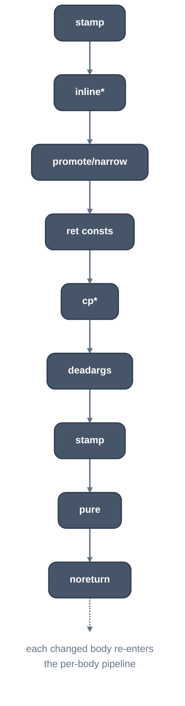

> Generated from the `//!` header of [`crates/opt/llrm-transforms/src/interprocedural.rs`](https://github.com/ali-mosavian/llrm/blob/main/crates/opt/llrm-transforms/src/interprocedural.rs); edit the header, not this file.
<!-- src: crates/opt/llrm-transforms/src/interprocedural.rs sha256:1e66b3749fd826a7614575f934c713c77d37a30ec70ef8b61526c46bb2f73054 -->

# interprocedural

The whole-program step run once every body has reached its own fixed point:
states what each body does, inlines, carries constants across direct calls,
drops dead pure calls and the tails of calls that never return, and sends
each changed body back through its pipeline. What one body proves about its
callees or callers is invisible to a pass that sees one body; this step
carries it across the calls.

## How it works
A frontend hands in its pipeline; nothing here names a language or a
machine. A body changes in place and is reported with
`ModuleAnalyses::changed`, so the module analyses are updated for the
bodies that differ rather than recomputed
(`docs/optimizations/module-analyses.md`). A procedure has every caller in
the program when the program does not export it (`unexported`); the roots
are the exported bodies. Each stage re-runs the pipeline over the bodies it
changed under a stage name (`LLRM_DEBUG=runs` and `--dump` use it). A pass
that found nothing on a body starts again only where what it read has
changed ([`crate::settled`](settled.md)); `ipa-cp.` and `ipa-deadargs.` vouch for their
edits of a caller that are no more than a call's new name or one argument
fewer.

The stages, in order:

1. `stamped_all` (the `stamp` slot, before the walk): each exactly defined
   body is stamped with what is proved of it, callees first: `memory(...)`,
   `nocapture`/`readonly`/`readnone`/ `writeonly`/`initializes` on pointer
   parameters, `willreturn`, `norecurse`, `nounwind`. A stated attribute is
   only narrowed. The same stamp is stated on the declarations of the body
   in other modules.
2. The private bodies nothing reaches any more, the ones the walk
   ([`crate::walk::Walk`](walk.md)) inlined into every caller, lose their bodies
   (`bare_the_unreached`). Inlining is the walk's alone.
3. `promote.` ([`crate::argpromotion`](argpromotion.md)), `narrow.` ([`crate::narrowspace`](narrowspace.md)),
   `globalsra.` ([`crate::globalsra`](globalsra.md)): a pointer a body only reads is
   passed as the fields it reads; a far pointer every call fills from DGROUP
   is passed as its offset.
4. `ipa<N>.`: a body whose every `ret` returns one integer has its calls'
   results replaced by it (`llrm_analysis::interprocedural`); the call
   stays.
5. A loop of `ipa-cp.` ([`crate::ipacp`](ipacp.md) cloning) and return propagation,
   until nothing changes. What every caller passes is IPSCCP's, before the
   walk ([`crate::walk::ModuleIpo`](walk.md)); the pin does not run it again here,
   but it runs once more after `promote.` changed a body (DEVIATE, below
   it).
6. `ipa-deadargs.` ([`crate::deadargs`](deadargs.md)): parameters nothing reads go.
7. `ipa-pure.` removes unused calls to bodies proved pure and terminating,
   and `ipa-noreturn.` cuts the code after a call to a private body every
   path of which stops, keeping the call.



*Interprocedural stages, from bodies at their fixed points*

The step returns `Proved`: the bodies that cannot return, and the ones a
root still reaches.

## Example
The stage `ipa-noreturn.` on a call to a body every path of which stops.
Before:

```mir
define internal void @spin() {
b:
  br label %l

l:
  br label %l
}

define i16 @f(i16 %a) {
b:
  call void @spin()
  %s = add i16 %a, 1
  ret i16 %s
}
```

After:

```mir
define internal void @spin() memory(none) nounwind norecurse {
b:
  br label %l

l:
  br label %l
}

define i16 @f(i16 %a) memory(none) nounwind norecurse {
b:
  call void @spin()
  unreachable
}
```

The stamp states each body's attributes, and the code after the call that
never returns is cut; the call stays. `@f` is run through its pipeline again
as `ipa-noreturn.`.

From unit test `test_a_private_terminal_body_cuts_its_callers_tail` in
`interprocedural_tests.rs`.

## Runs
A `ProgramPass` after the per-body fixed point and before `globaldce`,
and not at -O0. `Stamp` is the same stamping run earlier, before any body's
pipeline, so loops are judged on what their callees do. Which stages run
follows the level: `inline` and `ipa-cp` thresholds, `ipa-cp-clone` (-O3
and up). See
`docs/reference/levels.md`.

## Needs
[`crate::inline`](inline.md), [`crate::ipacp`](ipacp.md), [`crate::profit`](profit.md), and
`llrm_analysis`' `Summaries`, `GlobalsAA` and `interprocedural`.

## See also
LLVM's FunctionAttrs and IPSCCP; GCC's `ipa-inline.cc`, `ipa-cp.cc` and
`ipa-modref.cc`.
