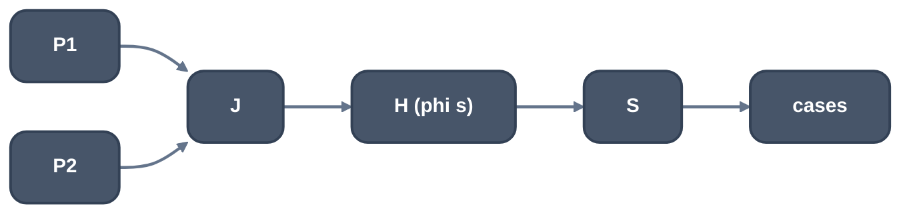
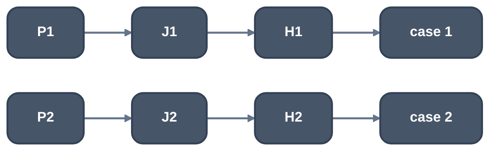

> Generated from the `//!` header of [`crates/opt/llrm-transforms/src/jumpthread.rs`](https://github.com/ali-mosavian/llrm/blob/main/crates/opt/llrm-transforms/src/jumpthread.rs); edit the header, not this file.
<!-- src: crates/opt/llrm-transforms/src/jumpthread.rs sha256:206a2817c50ab768dd1dfe156cc0c219cbb3e631ebd99fe132c8810099889f15 -->

# jumpthread

Threads a path through a branch or switch that the way into it decides: the
blocks between the deciding value and the test are copied for that path,
which jumps straight to its target and does not run the test. LLVM's
`DFAJumpThreading` and gcc's backward (FSM) threader
(`tree-ssa-threadbackward.cc`).

## How it works
`state = step(state); switch (state)` in a loop: the switch reads a phi of
the loop's header, and the value that comes round is a constant on each path
into the join that makes it (or constant from the preheader). Each such path
gets its own copy of the blocks from the join down to the switch, and the
copy of the switch is a jump to the case its constant picks, so the dispatch
is gone from that path.



*Before*



*After (J, H, S stay for other paths)*

A candidate is a `switch` on a phi in a block `S` of a loop (`p` in `H`),
`H` reaching `S` through blocks each with the one before as its only
predecessor, and `p`'s input from the loop being a constant, or a phi in its
own block `J` (ending in a jump to `H`) with a constant from the predecessor
`P`. The copies of `J..S` take `H`'s phis as the values they have on the
path. A value made in the originals and read outside them is made again by
the copies, and an `SsaUpdater` joins the two where the paths meet. The
result is not a natural loop where several cases lead back; later loop
passes skip it.

A conditional branch is threaded the same way where it tests an `i1` phi, or
a compare of a phi with a constant, whatever the loop. With `correlated`, a
branch whose compare the way into its block already settles, from a branch
on a compare of one of its operands above (`guards::on_edge`), is threaded
to its arm on each way: the branches a header copy leaves. A path into a
loop header from outside is not threaded; that is a rotation, `Rotate`'s. A
block is not copied if it holds a landing pad, a call that unwinds to a
handler, a stack object, or a call that may not be duplicated.

With `correlated` and `states`, a loop whose header branches on a value the
loop does not change, its arms rejoining before the latch, is first split
into a loop for each arm (`split_arms`).

Copies cost code, so limits follow gcc's: a switch path may copy at most
`MAX_PATH` (100) instructions, sized as gcc counts a path
(`size_weighted`); a branch path at most `(BRANCH_PATH - 1) / PATH_SCALE`
(7) instructions plus the phis of a block with several predecessors and
successors, the compare the threading kills not counted; the whole function
at most `MAX_COPIED` (400). Paths are found on the function as it came, so a
branch the copies make is not threaded again. Tuned for size no path with
copies is taken; a branch whose copies hold nothing still is, as gcc does.

Where anything was copied, `fold`, `algebraic`, `decide` and `dead` run once
over the function, since each copy knows its state.

## Example
The branch case, on `r = phi(1, 0); if (r != 0)` after an inlined call.
Before:

```mir
; ... b0, head (the loop header, branching to test or done)
test:
  %c = icmp sgt i16 %k, %i
  br i1 %c, label %yes, label %no

yes:
  br label %join

no:
  br label %join

join:
  %r = phi i16 [ 1, %yes ], [ 0, %no ]
  %t = icmp ne i16 %r, 0
  br i1 %t, label %hit, label %step

hit:
  %h = add i16 %acc, %i
  br label %step

step:
  %acc1 = phi i16 [ %acc, %join ], [ %h, %hit ]
  %i1 = add nsw i16 %i, 1
  br label %head
```

After:

```mir
test:
  %c = icmp sgt i16 %k, %i
  br i1 %c, label %yes, label %no

yes:
  %h = add i16 %acc, %i
  br label %step

no:
  br label %step

step:
  %acc1 = phi i16 [ %h, %yes ], [ %acc, %no ]
  %i1 = add nsw i16 %i, 1
  br label %head
```

`%r` is 1 on `yes` and 0 on `no`, so each path decides `%t` itself: `yes`
runs `hit`'s work and `no` skips it, and `join` and its compare are gone.

From unit test
`test_a_branch_on_a_compare_of_a_phi_of_constants_is_decided_on_each_path`
in `jumpthread_tests.rs`.

## Runs
After the loop passes and `rotate`, before the last `hoist`. Switch state
machines (`states`) follow `-fexpensive-optimizations` (-O2 and up); branch
threading by correlation (`correlated`) follows `-ftree-ch`, which is off by
default. `for_size` is -Os and -Oz.

## Needs
`cfg::Shape`, `guards`, `SsaUpdater`, [`crate::fold`](fold.md), [`crate::algebraic`](algebraic.md),
[`crate::decide`](decide.md), [`crate::dead`](dead.md).

## Keeps
Nothing; blocks and edges change.

## See also
LLVM `DFAJumpThreading.cpp`; gcc `tree-ssa-threadbackward.cc`,
`tree-ssa-threadupdate.cc`. Tests: `jumpthread_tests.rs`.
