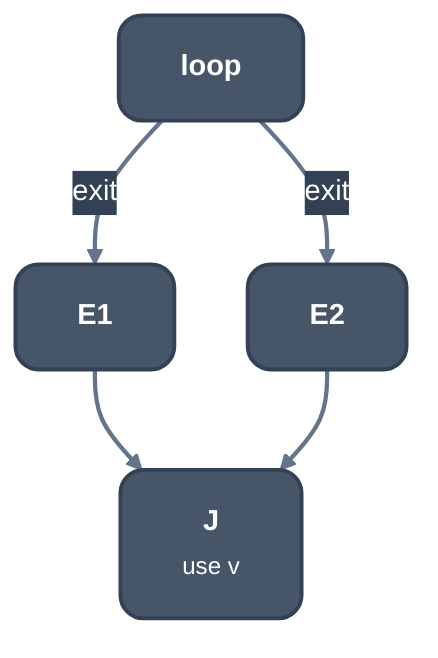
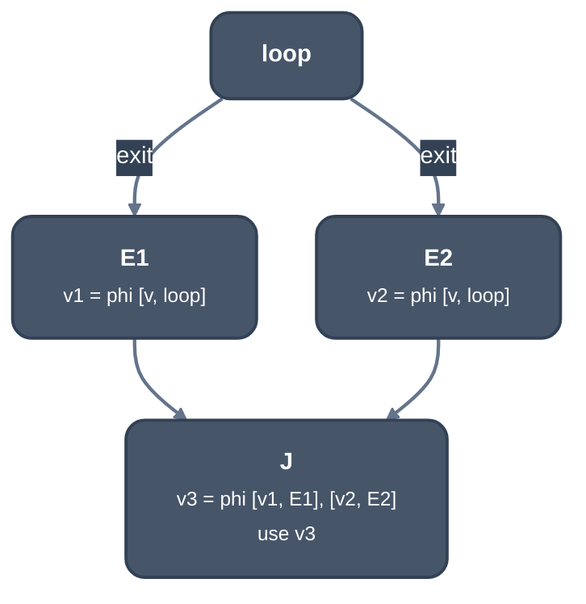

> Generated from the `//!` header of [`crates/opt/llrm-transforms/src/lcssamerges.rs`](https://github.com/ali-mosavian/llrm/blob/main/crates/opt/llrm-transforms/src/lcssamerges.rs); edit the header, not this file.
<!-- src: crates/opt/llrm-transforms/src/lcssamerges.rs sha256:09700a5c027c9b5f64ec113466ff15bf605322e4f83bc6fb4fb5c7e31222d775 -->

# lcssamerges

Close a loop with several exits: a phi at each exit, merged by phis where
the exits' paths join.

## How it works
`lcssa` calls it for a loop whose exits lead to more than one block. Every
exit block must have only predecessors inside the loop; otherwise nothing
changes.

For each value defined in the loop and read outside it, the blocks that
read it (a phi's reading counts at the incoming edge's block) are walked
backwards through predecessors until a block is reached where the value is
available: an exit whose predecessors are all dominated by the definition.
Reaching the loop, the entry or a block without predecessors abandons that
value.

Within the blocks so found, a block is a join when the exits reaching it
are more than one and it has several predecessors. One phi is made for each
exit and each join. An exit's phi takes the value on each loop edge, a
join's takes its predecessors' phis. Every reader outside the loop then
reads the phi supplied by the nearest exit or join above it.



*Before: v is used past the join J*



*After: a phi per exit, one at the join*

Everything is resolved to a supplier before any phi is created, so a
refused merge leaves the function untouched. Phi names take `.lcssa`.

## Example
A loop with two exits, `b3` from the header and `b4` from the latch, that
join in `b5`, where `%carried` is read. Before:

```mir
; ... b0, then:
b1:
  %carried = phi i16 [ %seed, %b0 ], [ %stepped, %b2 ]
  %more = icmp ult i16 %carried, %n
  br i1 %more, label %b2, label %b3

b2:
  %stepped = add i16 %carried, 1
  %stay = icmp ult i16 %stepped, %m
  br i1 %stay, label %b1, label %b4

b3:
  br label %b5

b4:
  br label %b5

b5:
  %answer = add i16 %carried, 7
  ret i16 %answer
```

After:

```mir
; ... b0 to b2 unchanged, then:
b3:
  %carried.lcssa = phi i16 [ %carried, %b1 ]
  br label %b5

b4:
  %carried.lcssa1 = phi i16 [ %carried, %b2 ]
  br label %b5

b5:
  %carried.lcssa2 = phi i16 [ %carried.lcssa, %b3 ], [ %carried.lcssa1, %b4 ]
  %answer = add i16 %carried.lcssa2, 7
  ret i16 %answer
```

From unit test `test_distinct_exits_merge_before_the_downstream_use` in
`lcssamerges_tests.rs`.

## Runs
Called from [`crate::lcssa`](lcssa.md) for each multi-exit loop, so wherever `lcssa`
runs.

## Needs
Dominators and predecessors computed from the function on entry.

## See also
LLVM's `formLCSSA` (LCSSA.cpp), which closes each exit block separately.
