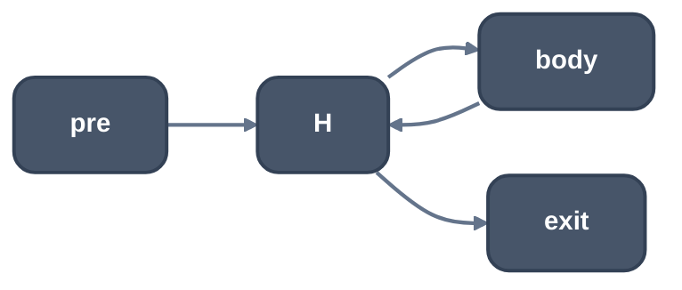
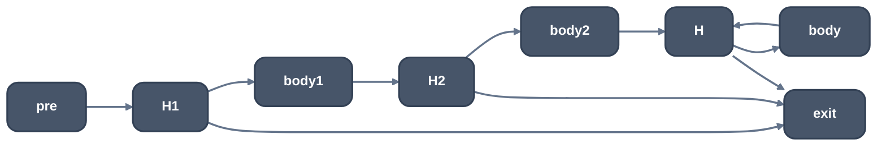

> Generated from the `//!` header of [`crates/opt/llrm-transforms/src/loopclone.rs`](https://github.com/ali-mosavian/llrm/blob/main/crates/opt/llrm-transforms/src/loopclone.rs); edit the header, not this file.
<!-- src: crates/opt/llrm-transforms/src/loopclone.rs sha256:15a077f6aef5defe0155bc913bf8a02c6ae24c56ac74cd9412ce44d3461991d4 -->

# loopclone

Loop iterations cloned as CFG: `peeled` copies whole iterations ahead of a
loop, `chained` copies bodies inside it, keeping the loop and every exit.

## How it works
This is the mechanism for peeling, unswitching and unroll-and-jam; it makes
no profitability decision. Both functions return each copy's map from an
original block to its clone, or `None` having changed nothing when the loop
is not one they can clone. Both need
- a header that is not the entry, one latch that ends in a jump to it, and
  one outside predecessor that falls into the header (a preheader);
- no block but the header entered from outside the loop;
- only `br` and `switch` as multi-way terminators in the body;
- loop live-outs in LCSSA: no instruction outside the loop reads a value the
  loop defines, and no phi outside takes one from outside the loop.

`peeled(function, loop, count)` clones the loop's blocks `count` times, in
order, and puts them between the preheader and the loop:

*Before*

*After peeled(.., 2)*

The first copy's header phis take the preheader's arm, each later copy's
the previous copy's latch value, and the residual loop's header the last
copy's latch value. Every exit phi gains an arm for each copy's exit edge.
The residual loop stays so the result is right whatever the trip count;
the caller proves it unreachable where the count is exact.

`chained(function, loop, copies)` is the partial unroll LLVM's `UnrollLoop`
makes when no iteration is left over. The loop must leave only from its
header, by a conditional branch. The copies hold no header test: the
original latch runs on into the first copy's header work, each copy's latch
into the next, and the last into the header. That is right only where the
trip count is a multiple of `copies + 1`, which the caller proves.

## Runs
Called by [`crate::peel`](peel.md) and [`crate::unswitch`](unswitch.md) (`peeled`) and
[`crate::unroll_jam`](unroll_jam.md) (`chained`); not a pass.

## Needs
LCSSA ([`crate::lcssa`](lcssa.md)) and a simplified loop ([`crate::loopsimplify`](loopsimplify.md)).

## See also
LLVM's `peelLoop` (`LoopPeel.cpp`) and `UnrollLoop`.
