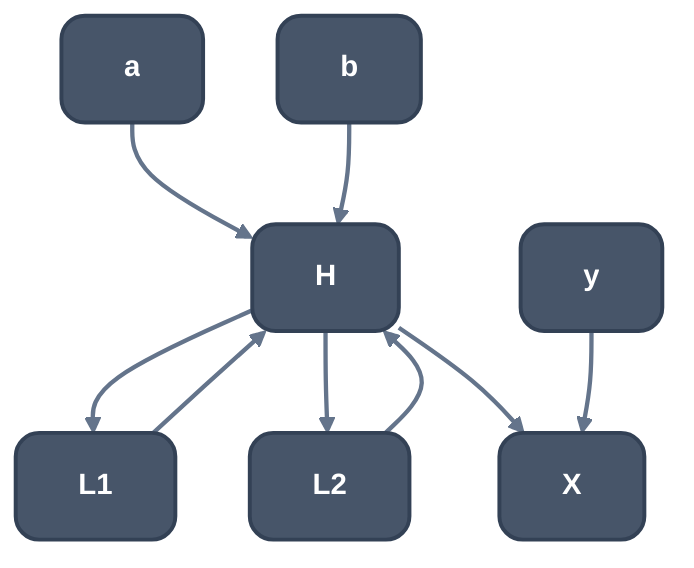
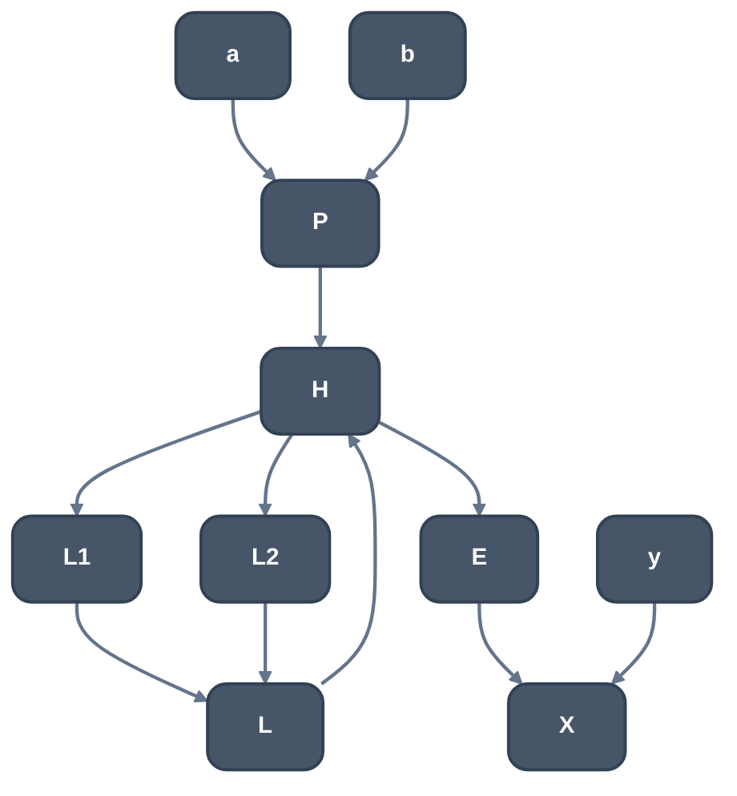

> Generated from the `//!` header of [`crates/opt/llrm-transforms/src/loopsimplify.rs`](https://github.com/ali-mosavian/llrm/blob/main/crates/opt/llrm-transforms/src/loopsimplify.rs); edit the header, not this file.
<!-- src: crates/opt/llrm-transforms/src/loopsimplify.rs sha256:618ef40628d24fe9868696ddf56961cf240b6120e32045b5a4948aaead2c1818 -->

# loopsimplify

Loop canonical form: every reducible loop gets one preheader, one latch
and dedicated exits, so the loop passes can assume them.

## How it works
For each loop the pass finds the edges to group and routes each group
through one new block, which the target's phis read (`grouped`):
- a preheader, when the header has more than one predecessor outside the
  loop, or the one it has also branches elsewhere;
- one latch, when the header has several backedges;
- a dedicated exit, for each exit block that is also reached from outside
  the loop, so all its predecessors are in the loop.



*Before: two entries, two latches, an exit also reached from y*



*After: preheader P, one latch L, dedicated exit E*

A phi on the target is split: the grouped arms become a phi of the new
block (or the one value they all share) and one arm of the target's phi.
Grouping needs every source to end in a `br` whose edge can be retargeted,
and every phi of the target to name exactly the target's predecessors.

The loops are processed one at a time. What a loop needs grouped is worked
out from the edges of its blocks and of the targets, and every grouping is
checked before the first is made, so a refused one leaves the body as it
was. No copy of the function and no graph of it is made. The loops of
the shape are updated for the new blocks rather than found again
(`LLRM_CHECK_SHAPE` compares them with a new shape). The loops are the
natural ones, as LoopInfo finds them: an irreducible cycle is no loop, and
its function's natural loops are simplified all the same.

## Example
Before:
```mir
define i16 @f(i1 %c, i16 %s, i16 %t) {
b0:
  br i1 %c, label %b5, label %b4

b5:
  br label %b1

b4:
  br label %b1

b1:
  %carried = phi i16 [ %s, %b5 ], [ %t, %b4 ], [ %stepped, %b2 ]
  br i1 %c, label %b2, label %b3

b2:
  %stepped = add i16 %carried, 1
  br label %b1

b3:
  ret i16 %carried
}
```
After:
```mir
define i16 @f(i1 %c, i16 %s, i16 %t) {
b0:
  br i1 %c, label %b5, label %b4

b5:
  br label %0

b4:
  br label %0

b1:
  %carried = phi i16 [ %stepped, %b2 ], [ %1, %0 ]
  br i1 %c, label %b2, label %b3

b2:
  %stepped = add i16 %carried, 1
  br label %b1

b3:
  ret i16 %carried

0:
  %1 = phi i16 [ %s, %b5 ], [ %t, %b4 ]
  br label %b1
}
```
`b1` was entered from `b5` and `b4`. Both now jump to the new preheader
`%0`, whose phi holds the two seeds, so the header's phi has one arm from
outside the loop.

From unit test `test_grouping_preserves_each_phi_edge_value` in
`loopsimplify_tests.rs`.

## Runs
In [`crate::pipeline`](pipeline.md)'s per-body fixed point, after `tailrec` and before
`lcssa`; again after the header copy of `-ftree-ch`, where it
re-simplifies the loops that copy made; `simplified` is called by
[`crate::lsr_pass`](lsr_pass.md) after it guards a loop. On at every level above -O0.

## Keeps
Nothing where it changes a body; it reads only the CFG's structure.

## See also
LLVM's `LoopSimplify`.
