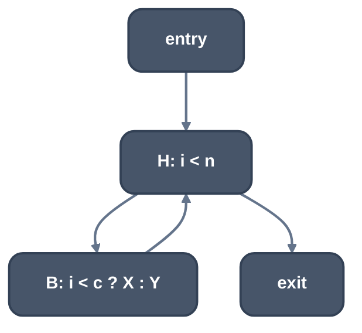
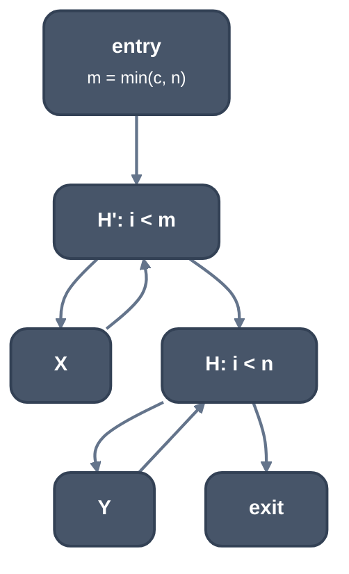

> Generated from the `//!` header of [`crates/opt/llrm-transforms/src/loopsplit.rs`](https://github.com/ali-mosavian/llrm/blob/main/crates/opt/llrm-transforms/src/loopsplit.rs); edit the header, not this file.
<!-- src: crates/opt/llrm-transforms/src/loopsplit.rs sha256:487aa7e2fa82c98ae47feed71dc377fd30193be25edd89d511ac006d2a915ccd -->

# loopsplit

A loop with a test of its counter against an invariant in its body becomes
two loops, one for the trips before the test flips and one for those after,
neither with the test.

## How it works
A candidate is a loop `induction::counted` proves to count up by one,
tested before each trip with `<` (signed or unsigned), that has one latch,
one outside predecessor (the entry), no exit but its header's, and at most
128 operations. In its body (not the header) a block ends in a `br` on an
`icmp` of the counter and a value that is not defined in the loop and whose
definition dominates the entry. The counter only rises and does not wrap,
so the test holds for a prefix of the trips and fails for the rest
(`i < c`, `i <= C`), or the reverse (`i >= c`, `i > C`). `<=` and `>` are
taken for constants below the type's largest, as `i < C + 1`.

The pass works on a copy of the function with the loops closed
([`crate::lcssa`](lcssa.md)). [`crate::loopclone`](loopclone.md)'s `peeled` makes one clone of the
loop, which runs first. The entry computes `min(c, n)`, `n` being the
loop's bound, and the clone's header tests the counter against it, leaving
for the original loop's header instead of the exit. The original loop
tests `n` as before and takes up with the clone's counters. In each loop
the branch goes the one way it does in that part of the trips.



*Before*



*After*

The split is kept without a price: each loop has fewer operations a trip
than the one it came from, and the trips are shared out between them. The
growth is bounded: a loop of more than 128 operations is left, and each
loop is split once a run.

## Example
Before:
```mir
define void @f(ptr %a, i16 %n, i16 %k) {
b0:
  br label %b1

b1:
  %i = phi i16 [ 0, %b0 ], [ %next, %b4 ]
  %more = icmp slt i16 %i, %n
  br i1 %more, label %b2, label %b5

b2:
  %early = icmp slt i16 %i, %k
  br i1 %early, label %b3, label %b4
  ; ... b3 stores 1, b4 steps %i
}
```
After:
```mir
b0:
  %0 = icmp slt i16 %k, %n
  %1 = select i1 %0, i16 %k, i16 %n
  br label %b6

b6:
  %i1 = phi i16 [ 0, %b0 ], [ %next1, %b8 ]
  %more1 = icmp slt i16 %i1, %1
  br i1 %more1, label %b7, label %b9
  ; ... the loop with the store alone
b1:
  %i = phi i16 [ %i1, %b9 ], [ %next, %b4 ]
  %more = icmp slt i16 %i, %n
  ; ... the loop without it
```

From unit test `an_early_test_of_the_counter_splits_the_loop` in
`loopsplit_tests.rs`.

## Runs
Once per body, after unswitching and before unroll-jam, at -O3 and -Omax
(`-fsplit-loops`). The halves go through the scalar rounds again.

## Needs
[`crate::lcssa`](lcssa.md), [`crate::loopclone`](loopclone.md), `induction`'s counted proofs.

## Keeps
Nothing when it splits: the function is replaced by the candidate.

## See also
Implements gcc's `tree-ssa-loop-split.cc` (`split_loop`, `-fsplit-loops`).
LLVM has no scalar counterpart (IRCE splits for range checks, #1194).
[`crate::simpleloopunswitch`](simpleloopunswitch.md) does the same for a test that does not change.
