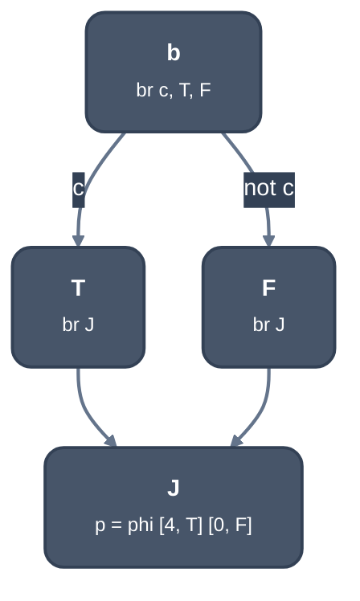
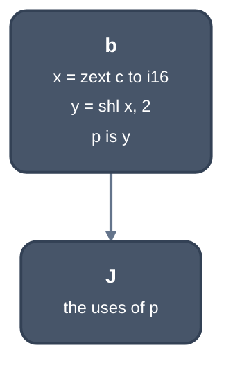

> Generated from the `//!` header of [`crates/opt/llrm-transforms/src/phiopt.rs`](https://github.com/ali-mosavian/llrm/blob/main/crates/opt/llrm-transforms/src/phiopt.rs); edit the header, not this file.
<!-- src: crates/opt/llrm-transforms/src/phiopt.rs sha256:0e34d1952386eff31a3f05fb03397c08e466084ca7cb72991a593b8149d68370 -->

# phiopt

A phi of two constants that a branch chooses between becomes arithmetic of
the branch's condition, where that costs no more than the branch.

## How it works
The shape is `br c, T, F` where each of `T` and `F` is an empty block of
one jump (reached from the branch alone) or the join `J` itself, both
leading to `J`, whose predecessors are exactly those two sides. Every phi
of `J` must take a constant integer (wider than one bit) from each side;
otherwise the branch is left whole.

Each phi is rewritten in the form that costs least on the target. With
`t` the constant from `T`, `f` the constant from `F` and `d = t - f`:

| condition on `d` | form | cost |
|---|---|---|
| `d = 1` | `f + zext c` | extend |
| `d = -1` | `f + sext c` | extend |
| `d` a power of two above 1 | `(zext c << k) + f` | extend + shift |
| `d > 1`, time-priced | `zext c * d + f` | extend + multiply by `d` |
| any | `(sext c & d) + f` | extend + 2 adds |

The `+ f` term is dropped when `f` is 0, else it costs an add. The sum of
the forms and one condition held as a value (`set`) is compared with the
branch it replaces (`OperationCosts::branch`, plus half again for a diamond,
the jump from the arm that is not the fall-through) and one copy (`move`)
per phi. The rewrite is made when it is no dearer; all phis of a join
go together or none. The multiply form is offered only where prices are
in time: at `-Os` the pass is priced in bytes (`size_costs`) and the
multiply is not offered.



*Before: a branch chooses between two constants*



*After: arithmetic of the condition, no branch*

The 486 has no conditional move, so a select is a branch anyway (the
backend's `selects`); this pass is for what the branch is worth when it
is not one. `can_win` skips the walk of a body when no form can cost no
more than the loosest branch on the target.

## Example
Before:
```mir
define ... @pipeline.body(i16 %0) ... {
b1:
  %1 = icmp ne i16 %0, 0
  br i1 %1, label %b3, label %b2

b2:
  br label %b4

b3:
  br label %b4

b4:
  %2 = phi i16 [ 0, %b2 ], [ 4, %b3 ]
  ret i16 %2
}
```
After:
```mir
define ... @pipeline.body(i16 %0) ... {
b1:
  %1 = icmp ne i16 %0, 0
  %2 = zext i1 %1 to i16
  %3 = shl i16 %2, 2
  ret i16 %3
}
```
The phi of `4` and `0` is `c != 0` extended and shifted left by 2, with no
branch.

From `--dump` of `pick` (`if (c) x = 4; else x = 0; return x;`) at -O2 -m16
-march=i386, stages `dead` and `phiopt`.

## Runs
In [`crate::pipeline`](pipeline.md)'s per-body fixed point, after `decide`. On at every
level above -O0, as gcc runs `-fssa-phiopt` at -O1 and above. After a
rewrite the empty sides are removed and blocks merged. The measured effect
on the 486 and P5 is recorded in `docs/reference/levels.md`.

## Needs
The target's `OperationCosts` (`branch`, `move`, `extend`, `set`, `add`,
`shift`) and `Machine::multiply_by`.

## See also
gcc's `pass_phiopt` (`conditional_replacement`, `two_value_replacement`,
and `match.pd`'s `cond ? c : 0` as `-cond & c`), enabled at -O1 by
[`opts.cc:609`](https://github.com/gcc-mirror/gcc/blob/releases/gcc-13.4.0/gcc/opts.cc#L609);
LLVM's `FoldTwoEntryPHINode` in SimplifyCFG, whose
`two-entry-phi-node-folding-threshold` (4) is the same test in its own unit.
