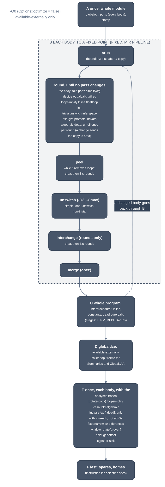

> Generated from the `//!` header of [`crates/opt/llrm-transforms/src/pipeline.rs`](https://github.com/ali-mosavian/llrm/blob/main/crates/opt/llrm-transforms/src/pipeline.rs); edit the header, not this file.
<!-- src: crates/opt/llrm-transforms/src/pipeline.rs sha256:6a9b3b58ed21fe7fa39b42a8282ded19457315d10cd161a0e66c8792ab639e81 -->

# pipeline

The MIR optimization pipeline every driver runs: the order of the passes,
the per-body fixed point, and which options switch them off.

## How it works
`recorded` (and `applied`, which drops its result) builds a
`PassManager` and adds, in this order: whole-module steps, `Fixed` over
every body, the whole-program [`crate::interprocedural`](../analyses/interprocedural.md) step, and loop and
address passes that run once, after the program is settled. Every pass
after `globalopt` is a function, module or program pass of the manager.
With `LLRM_VERIFY` set the module is verified after each manager pass;
with `Applied::dump` set each changed step of each body is written there.
A body sent back through `Fixed` by a later stage starts only the passes
that found nothing last time and read nothing that changed since
([`crate::settled`](settled.md)); `LLRM_CHECK_SETTLED=1` runs them and fails where one
changes the body.

*The mir pipeline, stages A to F*

The order of B is the `every` list of [`pipeline`](pipeline.md); `passes` returns it
as names. `Fixed` takes two passes out of it: `sroa` runs at structural
boundaries, `merge` once at the end. A pass that is off is not in the list.

A round runs the remaining passes in order. The body is at a fixed point
when a round changes nothing; a pass reports a change by preserving less
than every analysis. A pass that changed nothing is skipped until an edit
reaches what it reads (`FunctionPass::reads`, `footprint::of`). The limit
is `max(16, size + 1)` rounds, and a round that reproduces an earlier
printed body is an error, so an oscillating pair fails at once. `sroa` and
`promote` are skipped on a body with an irreducible loop: promotion needs
dominators.

Peeling repeats while it leaves fewer loops, so an outer loop whose inner
loop was peeled is peeled in turn. The passes that make a candidate
re-optimize it with a `Fixed` of its own that has unswitching
off.

In E, `lsr` is after the interprocedural step because nothing after it may
choose a loop's counters again; `rotate{proven}` is last of the loop
passes; `hoist`
runs again to lift what a rotated loop (run at least once) may now leave;
`gepoffset` follows it because it would move a constant `gep` out of its
loop; `cgpaddr` follows the last `gvn`, which makes the phis it sinks;
`sink` follows `cgpaddr`, once the passes that move work up have run.

## Example
No honest example: the pipeline is the order of the passes, not one rewrite,
and no one function shows it. `llrm-cc --dump DIR` writes the module after
each stage (`NN-stage.ll`) and, for each body, each changed step of the
fixed point (`N/NNN-rRR-pass.ll`); the pass examples come from those.

## Runs
Options are `Options`; `Level::options` in llrm-codegen's `driver/flags.rs`
maps `-O0`, `-O1`, `-O2`, `-O3`, `-Omax`, `-Os`, `-Oz`, `-Og` to
`Options::none`, `basic`, `standard`, `speed`, `aggressive`, `size`,
`min_size` (`-Og`: `basic` without `loopidioms`). `-f` flags set single
fields (`PASSES` in the same file). The per-level table, with the gcc and
LLVM counterpart of each limit, is
[docs/reference/levels.md](https://github.com/ali-mosavian/llrm/blob/c341bd6e3de058142c6652d399b8dfeb444eff9b/docs/reference/levels.md).

`Options::wanted` gates passes by name, so every pass can be bisected off:

| field | passes |
|---|---|
| `optimize` | all; off, only `available-externally` runs |
| `lcssa`, `floatloop`, `fold`, `simplifycfg`, `decide`, `dead` | the pass of that name |
| `hoist` | `hoist`, `loopmotion` |
| `forward` and `drop_loads` | `gvn`, `equalcalls` |
| `drop_stores` | `dse` |
| `sink` | `sink` |
| `promote` | `sroa`, `promote` |
| `strength` | `indvars`, `lsr`, `canonfreeze`, `window`, `gepoffset`, `cgpaddr` |
| `loopidioms` | `loopidioms`, `merge`, `memcpyopt` |
| `sibcalls` | `tailrec` |
| `unswitch`, `interchange`, `unroll_and_jam` | the passes of that name (`unswitch` and `unroll_and_jam` on at -O3 and -Omax; `interchange` on at every level but -O0) |
| `copy_headers` | the header copy in E (off by default; `-ftree-ch`) |

`pre` makes `gvn` insert on the path that lacks a value; `for_size` prices
`hoist`, `algebraic`, `loopidioms`, `lsr`, `window` and
`calleepop` in bytes. `limits` are the copy budgets of the unroller.

## Needs
`Summaries`, `GlobalsAA` and `ProgramSummaries` are required
up front, and frozen at the end of D so the passes of E read them without
recomputing after each edit. In LLVM's order `GlobalsAA` and
`GlobalsModRefAnalysis` are made before the walk and again at the end of D
alone (`RequireAnalysisPass`, `RecomputeGlobalsAAPass`), read cached
between.

## See also
gcc's pass lists, `passes.def`; LLVM's `PassBuilderPipelines.cpp`.
`LLRM_DEBUG=time` times each step, `runs` counts rounds, skips and the
work of passes that changed nothing.
